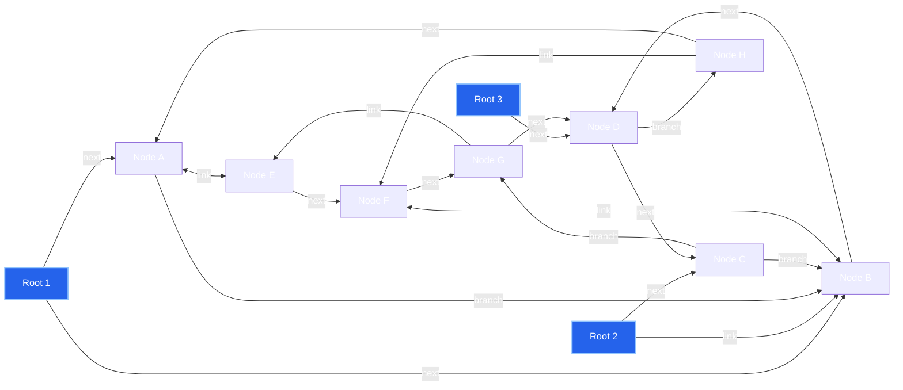
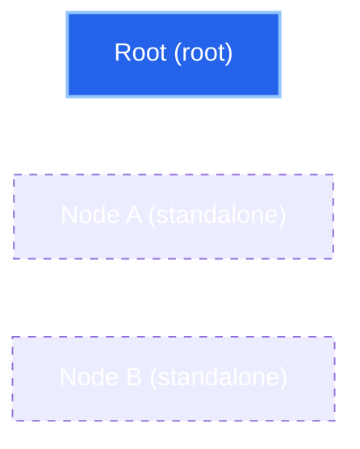
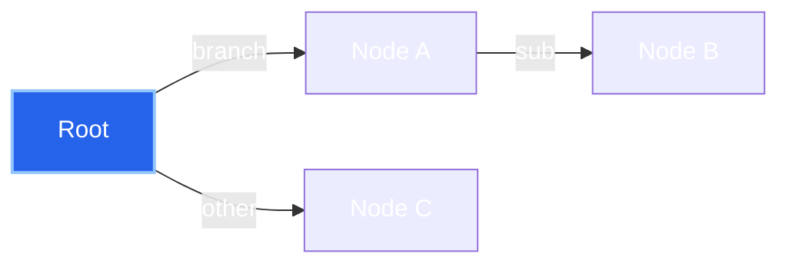
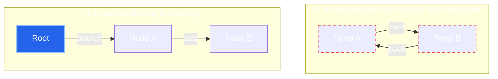
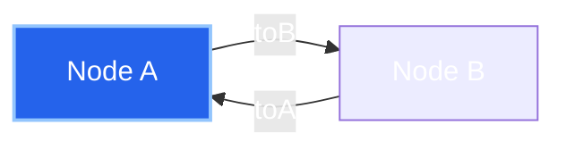
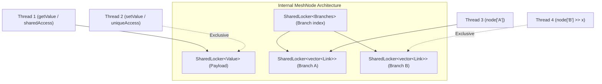

import { Card, CardGrid, Aside } from '@astrojs/starlight/components';

[`CppUtils::Container::MeshNetwork`](/en/reference/container/meshnodeptr/) is designed for creating **non-hierarchical graphs** (whether they have a single root or not), where nodes connect via labeled branches, tolerate cycles without memory leaks, are safely manipulated across threads, and support disk pagination ([`MeshPager`](/en/reference/filesystem/meshpager/)).

While this model provides high flexibility, it introduces structural overhead (link allocations, branch lookup tables, multithreading support).

<Aside type="caution" title="Do not use MeshNetwork if...">
- **Your structure is strictly hierarchical (tree, parent-child)**: prefer [`Tree`](/en/reference/container/tree/node/), [`BTree`](/en/reference/container/btree/node/), or simple nested `std::vector` nodes, which are much lighter.
- **You need a key-value associative mapping**: prefer `std::unordered_map`, `std::map`, or [`FlatHashMap`](/en/reference/container/flathashmap/).
- **Your graph is static or has uniform node lifetimes** (without concurrency or paging): a simple `std::vector` with index-based links will be more compact and faster.

Only choose `MeshNetwork` if your use case demands a non-hierarchical graph (cyclic or not) requiring concurrent access or lazy loading from disk.
</Aside>

**Example of a graph representable with `MeshNetwork`:**



This guide is a **step-by-step tutorial** designed to teach you how to declare a mesh, connect branches, manipulate nodes safely across threads, and serialize graphs with progressive disk pagination.

<CardGrid>
	<Card title="Non-Hierarchical Graph" icon="seti:graphql">
		Freely connect nodes via named branches (`Token`, `string`, etc.), with support for cycles.
	</Card>
	<Card title="RAII Destruction" icon="seti:lock">
		Instant reclamation of detached subgraphs, even in the presence of cycles.
	</Card>
	<Card title="Deadlock-Free Concurrency" icon="code-branch">
		Per-node locking via [RAII lockers](/en/guides/lockers/) for safe concurrent access.
	</Card>
	<Card title="Paged Disk Persistence" icon="seti:db">
		Progressive disk serialization, saving, and on-demand loading via [`MeshPager`](/en/reference/filesystem/meshpager/) to minimize RAM usage.
	</Card>
</CardGrid>

<Aside type="note" title="Why not std::shared_ptr and std::weak_ptr?">
	It is certainly possible to build a non-hierarchical graph using `std::shared_ptr` and `std::weak_ptr`, but it quickly becomes tedious and poorly suited to generic graphs whose structure changes dynamically: you have to manually decide which references remain strong to avoid leaking detached cycles, without prematurely dropping nodes when reachability paths change. `MeshNetwork` automates this by keeping alive only the nodes still reachable from at least one root.
</Aside>

## Declaring Nodes

Declare a node pointer by specifying the branch key type (here `CppUtils::Type::Token`) and the payload value type stored in each node (here `std::string`):

The examples in this guide use the `""_token` user-defined literal (from `using namespace CppUtils::String::Literals;`).

```cpp
// Define the node type to manipulate (Token keys, std::string values)
using NodePtr = CppUtils::Container::MeshNodePtr<CppUtils::Type::Token, std::string>;

// Create a graph root anchor
auto root = NodePtr::makeRoot("Root");

// Instantiate standalone nodes (not yet attached to a root)
auto nodeA = NodePtr::make("Node A");
auto nodeB = NodePtr::make("Node B");
```



<Aside type="tip" title="Smart Pointer Semantics (RAII)">
	Every `MeshNodePtr` variable behaves like a shared smart pointer (`std::shared_ptr`): as long as a variable holds a `MeshNodePtr`, that node and its owned descendants stay alive in memory.
</Aside>

<Aside type="caution" title="Top-Down Assembly Rule (makeRoot vs make)">
	`MeshNetwork` relies on **root nodes** (`makeRoot`) as lifetime anchors: a root keeps everything reachable from it alive, whereas a regular node (`make`) stays alive only while attached to at least one root (which is what allows detached cycles to be freed automatically).

	To attach a child node to a parent (`parent["branch"_token] >> child`), **the parent must therefore already be connected to a root**. Always assemble your graph **top-down**:
	```cpp
	auto root = NodePtr::makeRoot("Root");
	// 'child' is attached to 'root' before attaching 'grandChild'
	auto child = root["next"_token] >> NodePtr::make("Child");
	auto grandChild = child["next"_token] >> NodePtr::make("GrandChild");
	```

	```mermaid
	graph LR
	    Root["Root"] -->|"next"| Child["Child"] -->|"next"| GrandChild["GrandChild"]

	    classDef root fill:#2563eb,stroke:#93c5fd,stroke-width:2px,color:#ffffff
	    class Root root
	```

	If you need to assemble the graph in another order, you can create temporary roots with `makeRoot(...)`, then demote them to regular nodes once attached via `node->uniqueAccess()->setRoot(false)`:
	```cpp
	// Bottom-up assembly (child subtree first, then attach to root)
	auto tempChild = NodePtr::makeRoot("Child");
	tempChild["next"_token] >> NodePtr::make("GrandChild");

	auto root = NodePtr::makeRoot("Root");
	root["next"_token] >> tempChild;
	tempChild->uniqueAccess()->setRoot(false); // Demote to a regular node
	```
</Aside>

## Linking Nodes

Use dedicated operators to connect or detach nodes:

### Creating a Unidirectional Link (`>>`)

The `>>` operator links a child node to a parent branch. It supports two forms:
- `branch >> node` attaches `node` to `branch` and returns `node`;
- `parent["a"_token] >> child["b"_token]` attaches `child` to `parent["a"_token]` and returns the `child["b"_token]` branch, allowing multi-level chaining in a single expression:

```cpp
// Attach 'nodeA' onto root's "branch" branch
root["branch"_token] >> nodeA;

// Attach 'nodeB' onto nodeA's "sub" branch
nodeA["sub"_token] >> nodeB;

// Equivalent single-expression chaining
root["branch"_token] >> nodeA["sub"_token] >> nodeB;

// Fluid chaining on instantiation
auto nodeC = root["other"_token] >> NodePtr::make("Node C");
```



<Aside type="note" title="Idempotent Linking">
	Attaching the same node to the same branch multiple times (via `>>` or [`&`](#creating-a-bidirectional-link-)) does not create duplicate links: `MeshNetwork` checks whether the link already exists before inserting it.
</Aside>

### Detaching a Unidirectional Link (`-`)

The `-` operator removes a link to a node without affecting sibling nodes on the branch:

```cpp
// Remove nodeA from the "branch" branch
root["branch"_token] - nodeA;
```

As long as you hold a local `MeshNodePtr` handle to the detached node (`nodeA`), it remains valid in memory along with its children (`nodeB`) and can be re-attached. Conversely, any detached node or group of nodes (including cyclic ones) with no remaining root path and no local handle is immediately reclaimed in RAII:

```cpp
// 1. nodeA stays valid via its local handle and keeps its child nodeB
root["branch"_token] >> nodeA;

// 2. Cyclic subgraph with no remaining local handle: freed on detachment
{
	auto tempA = root["temp"_token] >> NodePtr::make("Temp A");
	auto tempB = tempA["next"_token] >> NodePtr::make("Temp B");
	tempB["back"_token] >> tempA; // Internal cycle
} // tempA and tempB leave scope, but stay alive while reachable from root

root["temp"_token].clear(); // No root path and no local handle: tempA and tempB are destroyed immediately (despite the cycle)
```



To clear all children from an entire branch at once, use the `clear()` member method:

```cpp
root["branch"_token].clear();
```

To detach all outgoing branches from a node in a single call, use `clearBranches()`:

```cpp
root.clearBranches();
```

### Creating a Bidirectional Link (`&`)

The `&` operator creates both reciprocal links in a single statement. Each bracket refers to the **outgoing** branch of its respective node, and attachment automatically starts from whichever node is already connected to a root:

```cpp
// At least one node must be a root or already attached to a root
auto nodeA = NodePtr::makeRoot("Node A");
auto nodeB = NodePtr::make("Node B");

// nodeA["toB"] -> nodeB and nodeB["toA"] -> nodeA
// (both keys can also be identical)
nodeA["toB"_token] & nodeB["toA"_token];
```



Functionally, `&` is equivalent to chaining two `>>` links in a single statement:

```cpp
// Functional unidirectional equivalent
nodeA["toB"_token] >> nodeB;
nodeB["toA"_token] >> nodeA;
```

### Detaching a Bidirectional Link (`/`)

The `/` operator detaches both directions of a cross-linked pair simultaneously. As with `&`, each bracket specifies the **outgoing** branch to detach on each node:

```cpp
// Removes nodeB from nodeA["toB"] and nodeA from nodeB["toA"]
nodeA["toB"_token] / nodeB["toA"_token];
```

Functionally, `/` is equivalent to chaining two `-` operations in a single statement:

```cpp
nodeA["toB"_token] - nodeB;
nodeB["toA"_token] - nodeA;
```

## Reading and Updating a Node

Each node protects its payload with a thread-safe container:

```cpp
// Acquire a shared read-only accessor to the payload value
if (auto valueAccessor = nodeA.getValue())
{
	// The value remains locked for shared reading throughout this block
	std::println("Current value: {}", valueAccessor.value());
} // valueAccessor is destroyed here and releases the lock

// Mutate the payload thread-safely (only possible once the lock is released)
nodeA.setValue("Node A v2");
```

<Aside type="caution" title="Prerequisite: Mastering RAII Lockers">
	`MeshNetwork` relies heavily on [RAII lockers](/en/guides/lockers/) (`SharedLocker`, `Accessor`, `uniqueAccess()`, `sharedAccess()`) to protect node payloads, branches, and multi-thread operations. Make sure you thoroughly understand how these lockers work and how their scopes behave to avoid unintended contention or deadlocks in your code.
</Aside>

## Comparing Nodes

Always distinguish between two forms of node comparison:
1. **Node Identity (`nodeA == nodeB`)**: Returns a `bool` indicating whether two pointers reference the **exact same memory allocation**, regardless of value.
2. **Value Equality (`nodeA.getValue().value() == nodeB.getValue().value()`)**: Compares the payload contents.

```cpp
auto node1 = NodePtr::makeRoot("Value");
auto node2 = NodePtr::makeRoot("Value");
auto alias1 = node1;

assert(node1 == alias1); // True: same node instance
assert(node1 != node2);  // True: distinct allocations
assert(node1.getValue().value() == node2.getValue().value()); // True: identical payload "Value"
```

## Traversing the Graph

`MeshNodePtr` seamlessly integrates with standard C++ ranges, views, and algorithms.

### Accessing a Branch (`[]` and `at()`)

There are two ways to access a node's branch, depending on whether you want to create or mutate it (`node[key]`) or query it without risking exceptions (`node.at(key)`):

| Call | On non-`const` `node` | On `const` `node` | If key is missing |
| :--- | :--- | :--- | :--- |
| **`node[key]`** | Returns a mutable branch (exclusive lock) | Returns a read-only branch (shared lock) | **Creates** the branch if non-`const`; **throws `std::out_of_range`** if `const` |
| **`node.at(key)`** | Returns a `std::expected` (read-only branch, shared lock, or `std::string_view` error) | Same | **Does not create** and **never throws** (`std::unexpected<std::string_view>`) |

<Aside type="caution" title="Null MeshNodePtr (Default-Constructed)">
	A `MeshNodePtr` instantiated without `make` or `makeRoot` is **null** (`not emptyNode`):

	```cpp
	auto emptyNode = NodePtr{}; // Null (invalid) handle
	assert(not emptyNode);

	auto result = emptyNode.at("branch"_token); // No exception: !result.has_value()
	// emptyNode["branch"_token]; // Throws std::runtime_error
	```
</Aside>

On a branch, indexed access `branch[i]` (as well as `front()` and `back()`) also returns a `std::expected<MeshNodePtr, std::string_view>`.

Check branch presence and node membership beforehand:

```cpp
if (root.contains("branch"_token))
{
	auto branch = root["branch"_token];
	std::println("Connected nodes count: {}", std::ranges::size(branch));
	std::println("Contains nodeA: {}", branch.contains(nodeA));
}
```

Exception-safe access (recommended for read-only inspection):

```cpp
if (auto branch = root.at("branch"_token))
{
	if (auto firstNode = branch->front())
	{
		std::println("First node: {}", firstNode->getValue().value());
	}
}
```

Count the links of a branch without creating it if absent:

```cpp
const auto linkCount = root.at("branch"_token).transform([](const auto& branch) {
	return std::ranges::size(branch);
}).value_or(0uz);
```

### Iterating Over a Branch (Ranges, Views, and Iterators)

A branch can be traversed like any standard C++ collection:

- It supports random-access iteration (`std::random_access_iterator`).
- The `Branch` object holds a RAII lock on the branch's link vector (`std::vector<Link>`) for the entire loop or expression, so no links can be added to or removed from that branch during traversal.
- However, each link references its target via a `WeakPtr` rather than a strong pointer. This prevents reference-cycle memory leaks and allows another thread or `MeshPager` to delete or unpage a target node without locking the entire graph. If the target has expired or been unpaged in the meantime, the iterator yields an empty `MeshNodePtr` (hence the `if (child)` check).

Start by iterating directly over attached children with a range-`for` loop:

```cpp
for (const auto& child : root["branch"_token])
{
	if (child)
	{
		std::println("Node: {}", child.getValue().value());
	}
}
```

Because branches work with `std::ranges` algorithms, you can test conditions over their elements in a single expression:

```cpp
const auto hasNodeA = std::ranges::any_of(root["branch"_token], [](const auto& node) {
	return node and node.getValue().value() == "Node A";
});
```

They also compose cleanly with `std::views`, for instance to filter valid nodes and reverse traversal order:

```cpp
for (const auto& validChild : root["branch"_token]
	| std::views::filter([](const auto& node) { return static_cast<bool>(node); })
	| std::views::reverse)
{
	std::println("Valid node: {}", validChild.getValue().value());
}
```

Finally, thanks to `std::random_access_iterator` support, you can work with iterators directly (such as computing an index by subtraction):

```cpp
auto branch = root["branch"_token];
if (auto it = std::ranges::find_if(branch, [](const auto& node) {
		return node and node.getValue().value() == "Node A";
	}); it != std::ranges::end(branch))
{
	std::println("Found at index {}", it - std::ranges::begin(branch));
}
```

### Listing All Branches (`getBranches()`)

When branch keys are not known upfront, use `getBranches()` to iterate over all outgoing branches of a node.

In the loop below, `links` has type [`SafeShared<std::vector<Link>>`](/en/reference/container/functions/#safeshared) (a thread-safe shared pointer to the branch's link vector), and `.sharedAccess()` acquires read-only access to it:

```cpp
for (const auto& [branchKey, links] : node.getBranches().value())
{
	std::println("Branch '{}': {} link(s)", branchKey, links->sharedAccess()->size());
}
```

## Concurrency and Multi-Threaded Access

The internal architecture of `MeshNode` relies on synchronization without a global lock, built around three independent levels of [`CppUtils::Thread::SharedLocker`](/en/reference/thread/sharedlocker/):

1. **Payload lock (`SharedLocker<Value>`)**: `getValue()` and `setValue()` only lock the node's payload, without blocking branch operations.
2. **Branch-index lock (`SharedLocker<Branches>`)**: `getBranches()` only locks the branch-key index.
3. **Per-branch lock (`SharedLocker<std::vector<Link>>`)**: each branch key has its own link-vector lock. Holding a `Branch` proxy on `"branchA"` never blocks access to the node's payload or concurrent edits to `"branchB"`.

An accessor therefore never locks the entire node, only the specific resource being accessed.



In practice, one thread can modify a node's payload (or one of its branches) while another thread works on a different branch or reads the same node's payload, without blocking each other.

<Aside type="caution" title="Common Pitfall: Holding onto a Branch Proxy or getValue()">
	`node["branch"]` returns a `Branch` proxy that holds an exclusive RAII lock (`Accessor`) on the branch until it is destroyed, and `node.getValue()` returns a `ReadOnlyAccessor<Value>` holding a shared lock. Keeping those objects alive while performing another operation on the same node in the same scope causes a self-deadlock:

	```cpp
	// ❌ Self-deadlock risk with a Branch proxy
	auto branch = root["branch"_token]; // Acquires an exclusive lock on "branch"
	root["branch"_token] >> nodeA; // Attempts to re-acquire the lock held by 'branch'
	```

	```cpp
	// ❌ Self-deadlock risk with a value accessor
	auto valueAccessor = nodeA.getValue(); // Acquires a shared lock on the payload
	nodeA.setValue("New value"); // Blocks while 'valueAccessor' is still alive
	```

	To prevent this, keep proxy and accessor scopes short with inline expressions or dedicated blocks:

	```cpp
	// ✅ Good practice: short scopes
	root["branch"_token] >> nodeA; // Inline expression: temporary proxy is destroyed and lock released immediately
	{
		auto valueAccessor = nodeA.getValue();
		std::println("{}", valueAccessor.value());
	} // 'valueAccessor' is destroyed here: the shared lock is released
	nodeA.setValue("New value");
	```
</Aside>

## Disk Paging (`MeshPager`)

When your graph needs to persist between program executions or exceeds the machine's physical RAM, CppUtils provides out-of-core persistence through [`CppUtils::FileSystem::MeshPager`](/en/reference/filesystem/meshpager/).

<Aside type="note" title="Under the Hood & Performance">
	Internally, `MeshPager` builds on [`CppUtils::FileSystem::IndexedStorage`](/en/reference/filesystem/indexedstorage/), which keeps an in-memory index for **O(1) direct reads** without scanning files. On writes, it reuses free blocks inside preallocated binary chunks (64 MiB by default, configurable via `MeshPager{saveDirectory, maxChunkSize}`) and serializes payloads via `CppUtils::Type::Binary::Serializer`.
</Aside>

### Track Nodes in the Pager (`track`)

`MeshPager` does not discover your nodes automatically: after importing [`CppUtils.FileSystem.MeshPager`](/en/reference/filesystem/meshpager/) and opening a storage directory, you need to register each node with `pager.track(node)`. This assigns it a persistent ID (`std::size_t`).

Calling `track()` does not immediately write the node to disk, though: while it stays in the pager's cache, it remains in RAM. Persistence to disk only triggers when a node falls outside a focus window and is unloaded from RAM, or when the `MeshPager` is destroyed:

```cpp
using namespace CppUtils::Type::Literals;
using MeshPager = CppUtils::FileSystem::MeshPager<CppUtils::Type::Token, std::string>;
using PagedNode = MeshPager::MeshNodePtr; // Equivalent to CppUtils::Container::MeshNodePtr<CppUtils::Type::Token, std::string, MeshPager::Policy>

const auto saveDirectory = std::filesystem::path{"./save"};
auto pager = MeshPager{saveDirectory};

auto root = PagedNode::makeRoot("Root");
auto nodeA = root["next"_token] >> PagedNode::make("Node A");
auto nodeB = nodeA["next"_token] >> PagedNode::make("Node B");
auto nodeC = nodeB["next"_token] >> PagedNode::make("Node C");
auto nodeD = nodeC["next"_token] >> PagedNode::make("Node D");
auto nodeE = nodeD["next"_token] >> PagedNode::make("Node E");

// Register nodes in the pager
pager.track(root);
pager.track(nodeA);
pager.track(nodeB);
pager.track(nodeC);
pager.track(nodeD);
pager.track(nodeE);
```

### Maintain Nodes in RAM with `acquireFocus`

Instead of keeping the entire graph in RAM, `pager.acquireFocus(node, radius)` returns an RAII window (`ScopedFocus`) that keeps nodes within `radius` hops resident in memory and automatically evicts the rest to disk:

<svg viewBox="0 0 600 250" width="100%" style="max-width: 600px; height: auto; display: block; margin: 1.5rem auto;" role="img" aria-label="Circular radius-1 focus zone centered on root, with nodes and persistent links on disk">
	<defs>
		<marker id="arrow-solid-en" viewBox="0 0 10 10" refX="8" refY="5" markerWidth="6" markerHeight="6" orient="auto-start-reverse">
			<path d="M 0 1 L 10 5 L 0 9 z" fill="currentColor" />
		</marker>
		<marker id="arrow-dashed-en" viewBox="0 0 10 10" refX="8" refY="5" markerWidth="6" markerHeight="6" orient="auto-start-reverse">
			<path d="M 0 1 L 10 5 L 0 9 z" fill="#94a3b8" />
		</marker>
	</defs>
	<circle cx="130" cy="130" r="95" fill="rgba(56, 189, 248, 0.08)" stroke="#38bdf8" stroke-width="2" stroke-dasharray="6 4" />
	<text x="130" y="20" text-anchor="middle" fill="#38bdf8" font-size="13" font-weight="600">Focus Zone: Radius = 1 (RAM)</text>
	<rect x="280" y="38" width="305" height="194" rx="12" fill="rgba(148, 163, 184, 0.08)" stroke="#94a3b8" stroke-width="1.5" stroke-dasharray="4 4" />
	<text x="432" y="58" text-anchor="middle" fill="#94a3b8" font-size="12" font-weight="600">Out of range (Disk)</text>
	<line x1="154" y1="130" x2="173" y2="130" stroke="currentColor" stroke-width="2" marker-end="url(#arrow-solid-en)" />
	<text x="163" y="121" text-anchor="middle" fill="currentColor" font-size="10">next</text>
	<line x1="215" y1="130" x2="293" y2="97" stroke="#94a3b8" stroke-width="1.8" stroke-dasharray="5 4" marker-end="url(#arrow-dashed-en)" />
	<text x="248" y="103" text-anchor="middle" fill="#94a3b8" font-size="10">targetId = 3</text>
	<line x1="400" y1="97" x2="463" y2="97" stroke="#94a3b8" stroke-width="1.8" stroke-dasharray="5 4" marker-end="url(#arrow-dashed-en)" />
	<text x="432" y="89" text-anchor="middle" fill="#94a3b8" font-size="10">targetId = 4</text>
	<line x1="517" y1="118" x2="517" y2="166" stroke="#94a3b8" stroke-width="1.8" stroke-dasharray="5 4" marker-end="url(#arrow-dashed-en)" />
	<text x="524" y="146" text-anchor="start" fill="#94a3b8" font-size="10">targetId = 5</text>
	<line x1="465" y1="189" x2="402" y2="189" stroke="#94a3b8" stroke-width="1.8" stroke-dasharray="5 4" marker-end="url(#arrow-dashed-en)" />
	<text x="432" y="181" text-anchor="middle" fill="#94a3b8" font-size="10">targetId = 6</text>
	<circle cx="130" cy="130" r="24" fill="rgba(56, 189, 248, 0.2)" stroke="#38bdf8" stroke-width="2" />
	<text x="130" y="127" text-anchor="middle" fill="currentColor" font-size="12" font-weight="600">root</text>
	<text x="130" y="141" text-anchor="middle" fill="currentColor" font-size="10">ID = 1</text>
	<circle cx="195" cy="130" r="20" fill="rgba(56, 189, 248, 0.12)" stroke="#38bdf8" stroke-width="1.5" />
	<text x="195" y="127" text-anchor="middle" fill="currentColor" font-size="11" font-weight="600">nodeA</text>
	<text x="195" y="140" text-anchor="middle" fill="currentColor" font-size="9.5">ID = 2</text>
	<rect x="295" y="76" width="105" height="42" rx="8" fill="rgba(148, 163, 184, 0.15)" stroke="#94a3b8" stroke-width="1.5" />
	<text x="347" y="94" text-anchor="middle" fill="currentColor" font-size="11" font-weight="600">nodeB</text>
	<text x="347" y="109" text-anchor="middle" fill="currentColor" font-size="9.5">ID = 3 (distance 2)</text>
	<rect x="465" y="76" width="105" height="42" rx="8" fill="rgba(148, 163, 184, 0.15)" stroke="#94a3b8" stroke-width="1.5" />
	<text x="517" y="94" text-anchor="middle" fill="currentColor" font-size="11" font-weight="600">nodeC</text>
	<text x="517" y="109" text-anchor="middle" fill="currentColor" font-size="9.5">ID = 4 (distance 3)</text>
	<rect x="465" y="168" width="105" height="42" rx="8" fill="rgba(148, 163, 184, 0.15)" stroke="#94a3b8" stroke-width="1.5" />
	<text x="517" y="186" text-anchor="middle" fill="currentColor" font-size="11" font-weight="600">nodeD</text>
	<text x="517" y="201" text-anchor="middle" fill="currentColor" font-size="9.5">ID = 5 (distance 4)</text>
	<rect x="295" y="168" width="105" height="42" rx="8" fill="rgba(148, 163, 184, 0.15)" stroke="#94a3b8" stroke-width="1.5" />
	<text x="347" y="186" text-anchor="middle" fill="currentColor" font-size="11" font-weight="600">nodeE</text>
	<text x="347" y="201" text-anchor="middle" fill="currentColor" font-size="9.5">ID = 6 (distance 5)</text>
</svg>

```cpp
{
	auto focus = pager.acquireFocus(root, 1uz);
	// 'root' and its direct neighbor 'nodeA' stay in RAM.
	// 'nodeB', 'nodeC', 'nodeD', and 'nodeE' (at distance >= 2) are evicted to disk while preserving their persistent links.
} // When 'focus' (and later 'pager') is destroyed, remaining nodes are flushed to disk.
```

If `node` is not yet tracked by the pager, `acquireFocus()` automatically calls `track(node)` before activating the window.

### Combine Multiple Focuses

Multiple `ScopedFocus` guards can be active at the same time, whether they overlap (like a sliding window across a traversal) or remain **completely disjoint** to keep separate regions resident in RAM. The union of their radii determines which nodes stay in RAM, while the rest remain on disk.

#### Overlapping Focus Zones (Sliding Window)

<svg viewBox="0 0 640 270" width="100%" style="max-width: 640px; height: auto; display: block; margin: 1.5rem auto;" role="img" aria-label="Two overlapping circular radius-1 focus zones centered on nodeA and nodeB, with nodeD and nodeE persisted on disk">
	<defs>
		<marker id="arrow-overlap-en" viewBox="0 0 10 10" refX="8" refY="5" markerWidth="6" markerHeight="6" orient="auto-start-reverse">
			<path d="M 0 1 L 10 5 L 0 9 z" fill="currentColor" />
		</marker>
		<marker id="arrow-overlap-dashed-en" viewBox="0 0 10 10" refX="8" refY="5" markerWidth="6" markerHeight="6" orient="auto-start-reverse">
			<path d="M 0 1 L 10 5 L 0 9 z" fill="#94a3b8" />
		</marker>
	</defs>
	<circle cx="145" cy="140" r="115" fill="rgba(56, 189, 248, 0.08)" stroke="#38bdf8" stroke-width="2" stroke-dasharray="6 4" />
	<circle cx="235" cy="140" r="115" fill="rgba(52, 211, 153, 0.08)" stroke="#34d399" stroke-width="2" stroke-dasharray="6 4" />
	<text x="115" y="16" text-anchor="middle" fill="#38bdf8" font-size="12" font-weight="600">Focus A: Radius = 1 (RAM)</text>
	<text x="295" y="16" text-anchor="middle" fill="#34d399" font-size="12" font-weight="600">Focus B: Radius = 1 (RAM)</text>
	<rect x="405" y="45" width="220" height="190" rx="12" fill="rgba(148, 163, 184, 0.08)" stroke="#94a3b8" stroke-width="1.5" stroke-dasharray="4 4" />
	<text x="515" y="66" text-anchor="middle" fill="#94a3b8" font-size="12" font-weight="600">Out of range (Disk)</text>
	<line x1="167" y1="140" x2="211" y2="140" stroke="currentColor" stroke-width="2" marker-end="url(#arrow-overlap-en)" />
	<text x="189" y="131" text-anchor="middle" fill="currentColor" font-size="10">next</text>
	<line x1="257" y1="140" x2="296" y2="140" stroke="currentColor" stroke-width="2" marker-end="url(#arrow-overlap-en)" />
	<text x="276" y="131" text-anchor="middle" fill="currentColor" font-size="10">next</text>
	<line x1="342" y1="140" x2="453" y2="106" stroke="#94a3b8" stroke-width="1.8" stroke-dasharray="5 4" marker-end="url(#arrow-overlap-dashed-en)" />
	<text x="385" y="112" text-anchor="middle" fill="#94a3b8" font-size="10">targetId = 5</text>
	<line x1="515" y1="128" x2="515" y2="170" stroke="#94a3b8" stroke-width="1.8" stroke-dasharray="5 4" marker-end="url(#arrow-overlap-dashed-en)" />
	<text x="523" y="153" text-anchor="start" fill="#94a3b8" font-size="10">targetId = 6</text>
	<circle cx="145" cy="140" r="22" fill="rgba(56, 189, 248, 0.2)" stroke="#38bdf8" stroke-width="2" />
	<text x="145" y="137" text-anchor="middle" fill="currentColor" font-size="11" font-weight="600">nodeA</text>
	<text x="145" y="151" text-anchor="middle" fill="currentColor" font-size="9.5">ID = 2</text>
	<circle cx="235" cy="140" r="22" fill="rgba(52, 211, 153, 0.2)" stroke="#34d399" stroke-width="2" />
	<text x="235" y="137" text-anchor="middle" fill="currentColor" font-size="11" font-weight="600">nodeB</text>
	<text x="235" y="151" text-anchor="middle" fill="currentColor" font-size="9.5">ID = 3</text>
	<circle cx="320" cy="140" r="22" fill="rgba(52, 211, 153, 0.12)" stroke="#34d399" stroke-width="1.5" />
	<text x="320" y="137" text-anchor="middle" fill="currentColor" font-size="11" font-weight="600">nodeC</text>
	<text x="320" y="151" text-anchor="middle" fill="currentColor" font-size="9.5">ID = 4</text>
	<rect x="455" y="84" width="120" height="44" rx="8" fill="rgba(148, 163, 184, 0.15)" stroke="#94a3b8" stroke-width="1.5" />
	<text x="515" y="102" text-anchor="middle" fill="currentColor" font-size="11" font-weight="600">nodeD</text>
	<text x="515" y="117" text-anchor="middle" fill="currentColor" font-size="9.5">ID = 5 (distance 2)</text>
	<rect x="455" y="172" width="120" height="44" rx="8" fill="rgba(148, 163, 184, 0.15)" stroke="#94a3b8" stroke-width="1.5" />
	<text x="515" y="190" text-anchor="middle" fill="currentColor" font-size="11" font-weight="600">nodeE</text>
	<text x="515" y="205" text-anchor="middle" fill="currentColor" font-size="9.5">ID = 6 (distance 3)</text>
</svg>

```cpp
{
	auto focusA = pager.acquireFocus(nodeA, 1uz);
	auto focusB = pager.acquireFocus(nodeB, 1uz);
}
```

#### Disjoint Focus Zones (Non-Touching)

<svg viewBox="0 0 680 265" width="100%" style="max-width: 680px; height: auto; display: block; margin: 1.5rem auto;" role="img" aria-label="Two disjoint circular radius-1 focus zones centered on nodeA and nodeD, with nodeC persisted on disk in between">
	<defs>
		<marker id="arrow-multi-en" viewBox="0 0 10 10" refX="8" refY="5" markerWidth="6" markerHeight="6" orient="auto-start-reverse">
			<path d="M 0 1 L 10 5 L 0 9 z" fill="currentColor" />
		</marker>
		<marker id="arrow-multi-dashed-en" viewBox="0 0 10 10" refX="8" refY="5" markerWidth="6" markerHeight="6" orient="auto-start-reverse">
			<path d="M 0 1 L 10 5 L 0 9 z" fill="#94a3b8" />
		</marker>
	</defs>
	<circle cx="120" cy="140" r="105" fill="rgba(56, 189, 248, 0.08)" stroke="#38bdf8" stroke-width="2" stroke-dasharray="6 4" />
	<circle cx="560" cy="140" r="105" fill="rgba(52, 211, 153, 0.08)" stroke="#34d399" stroke-width="2" stroke-dasharray="6 4" />
	<text x="120" y="20" text-anchor="middle" fill="#38bdf8" font-size="12" font-weight="600">Focus A: Radius = 1 (RAM)</text>
	<text x="560" y="20" text-anchor="middle" fill="#34d399" font-size="12" font-weight="600">Focus B: Radius = 1 (RAM)</text>
	<rect x="275" y="76" width="130" height="118" rx="12" fill="rgba(148, 163, 184, 0.08)" stroke="#94a3b8" stroke-width="1.5" stroke-dasharray="4 4" />
	<text x="340" y="96" text-anchor="middle" fill="#94a3b8" font-size="11.5" font-weight="600">Out of range (Disk)</text>
	<line x1="142" y1="140" x2="173" y2="140" stroke="currentColor" stroke-width="2" marker-end="url(#arrow-multi-en)" />
	<text x="157" y="131" text-anchor="middle" fill="currentColor" font-size="10">next</text>
	<line x1="215" y1="140" x2="288" y2="140" stroke="#94a3b8" stroke-width="1.8" stroke-dasharray="5 4" marker-end="url(#arrow-multi-dashed-en)" />
	<text x="251" y="131" text-anchor="middle" fill="#94a3b8" font-size="10">targetId = 4</text>
	<line x1="390" y1="140" x2="536" y2="140" stroke="#94a3b8" stroke-width="1.8" stroke-dasharray="5 4" marker-end="url(#arrow-multi-dashed-en)" />
	<text x="463" y="131" text-anchor="middle" fill="#94a3b8" font-size="10">targetId = 5</text>
	<line x1="582" y1="140" x2="611" y2="140" stroke="currentColor" stroke-width="2" marker-end="url(#arrow-multi-en)" />
	<text x="596" y="131" text-anchor="middle" fill="currentColor" font-size="10">next</text>
	<circle cx="120" cy="140" r="22" fill="rgba(56, 189, 248, 0.2)" stroke="#38bdf8" stroke-width="2" />
	<text x="120" y="137" text-anchor="middle" fill="currentColor" font-size="11" font-weight="600">nodeA</text>
	<text x="120" y="151" text-anchor="middle" fill="currentColor" font-size="9.5">ID = 2</text>
	<circle cx="195" cy="140" r="20" fill="rgba(56, 189, 248, 0.12)" stroke="#38bdf8" stroke-width="1.5" />
	<text x="195" y="137" text-anchor="middle" fill="currentColor" font-size="11" font-weight="600">nodeB</text>
	<text x="195" y="150" text-anchor="middle" fill="currentColor" font-size="9.5">ID = 3</text>
	<rect x="290" y="118" width="100" height="44" rx="8" fill="rgba(148, 163, 184, 0.15)" stroke="#94a3b8" stroke-width="1.5" />
	<text x="340" y="136" text-anchor="middle" fill="currentColor" font-size="11" font-weight="600">nodeC</text>
	<text x="340" y="151" text-anchor="middle" fill="currentColor" font-size="9.5">ID = 4 (disk)</text>
	<circle cx="560" cy="140" r="22" fill="rgba(52, 211, 153, 0.2)" stroke="#34d399" stroke-width="2" />
	<text x="560" y="137" text-anchor="middle" fill="currentColor" font-size="11" font-weight="600">nodeD</text>
	<text x="560" y="151" text-anchor="middle" fill="currentColor" font-size="9.5">ID = 5</text>
	<circle cx="633" cy="140" r="20" fill="rgba(52, 211, 153, 0.12)" stroke="#34d399" stroke-width="1.5" />
	<text x="633" y="137" text-anchor="middle" fill="currentColor" font-size="11" font-weight="600">nodeE</text>
	<text x="633" y="150" text-anchor="middle" fill="currentColor" font-size="9.5">ID = 6</text>
</svg>

```cpp
{
	auto focusA = pager.acquireFocus(nodeA, 1uz);
	auto focusD = pager.acquireFocus(nodeD, 1uz);
}
```

### Manual Focus Control (`addFocus`, `removeFocus`)

If you need non-RAII control (such as tying a focus to an event rather than a lexical scope), use `addFocus(nodeId, distance)` and `removeFocus(nodeId, distance)`:

```cpp
// Manage a focus lifetime manually (without an RAII scope)
const auto idA = nodeA.getId();
pager.addFocus(idA, 1uz);
// ...
pager.removeFocus(idA, 1uz);
```

### Load and Unload Nodes Manually (`loadNode`, `unloadNode`)

If you want to control node residency in RAM manually **without using [focus windows](#maintain-nodes-in-ram-with-acquirefocus)**, `MeshPager` provides two complementary methods: `loadNode(nodeId)` to load a node from disk into RAM, and `unloadNode(nodeId)` to serialize it to disk and free RAM immediately:

```cpp
auto root = pager.loadNode(rootId); // Loads root from disk
pager.unloadNode(rootId); // Flushes root to disk and removes it from RAM
```

`loadNode()` and `unloadNode()` work on **any node** by its ID, not only root nodes: every node is stored and indexed independently by its `nodeId`.

<Aside type="caution" title="Watch out for unfocused non-root nodes">
	A non-root node loaded directly via `loadNode()` is not attached to any root in RAM. If a focus is acquired or released elsewhere (for example via `acquireFocus()`) while that node is still in RAM outside any focus, it will be treated as an orphan and **permanently deleted from disk** (`removeNode()`) instead of merely unloaded. Make sure to unload it with `unloadNode()` or cover it with a focus.
</Aside>

```cpp
auto root = pager.loadNode(rootId);
auto nodeA = root["next"_token].front().value(); // Loads nodeA on demand
```

Once a node is loaded with `loadNode()`, accessing any of its branches automatically reloads target nodes that are not yet in RAM from disk, and the same applies to any subsequent hops across the graph.

<Aside type="tip" title="Lazy Loading and Memory Management">
	With `MeshPager`, you never have to load the whole graph into RAM at once: just load your starting node and traverse branches [as usual](#traversing-the-graph). You can also pass a node loaded this way to `acquireFocus()` to keep it pinned in RAM and let focus updates evict out-of-range neighbors, or call `unloadNode()` during long traversals so lazily reloaded nodes do not stay cached indefinitely.
</Aside>

### Finding Entry Points on Restart

`MeshPager` assigns sequential IDs starting at `1uz` (`0uz` is reserved for untracked or null nodes) and does not maintain a root catalog. Two best practices make it easy to locate your entry points on the next startup:

- **Dedicated entry-point node at ID `1uz`**: in a fresh directory, register a dedicated root node first so it automatically receives ID `1uz` and links to your graph's roots or branches. On restart, calling `pager.loadNode(1uz)` gives you immediate access to the whole entry table.
- **Application-side persistence**: if your entry points are dynamic or independent, save the IDs returned by `pager.track(root)` (or `root.getId()`) in an application configuration file (or in a separate [`IndexedStorage`](/en/reference/filesystem/indexedstorage/) instance using a distinct directory from the pager) and read them back at startup.

### Manual or Automatic Disk Deletion (`removeNode`)

Two mechanisms handle deleting nodes from disk, depending on your use case:

- **Automatic cleanup (non-root nodes)**: when a node or subgraph is detached from every root, it is automatically deleted from disk as soon as a focus is updated (for example when a `ScopedFocus` goes out of scope). A plain `unloadNode()` call does **not** trigger this cleanup: it simply flushes the node to disk and evicts it from RAM.
- **Explicit deletion (`removeNode(nodeId)`)**: required to delete a **root node** (never deleted automatically, even with no parent) or to **immediately** remove a specific node from RAM, link tables, and disk storage (especially when not using focus windows, or without waiting for a `ScopedFocus` to expire).

```cpp
{
	auto focus = pager.acquireFocus(root, 1uz);
	root["next"_token] - nodeA;
} // When focus goes out of scope, nodeA (and nodeB if unreachable) are removed from disk

// Or explicitly delete a node by ID
pager.removeNode(rootId);
```

### Built-in Serialization for Keys and Values

To persist a node to disk when it is evicted from RAM (and reconstruct it when reloaded), `MeshPager<Key, Value>` must convert both its branch keys (`Key`) and node values (`Value`) into a binary stream using `CppUtils::Type::Binary::Serializer`.

The following types are supported out of the box, with no extra boilerplate:

- **Trivially copyable types (excluding pointers)**: arithmetic types (`int`, `double`, `bool`, etc.), `enum` types, and plain POD structs (`std::is_trivially_copyable_v<T>`).
- **`std::string`**
- **`std::vector<T>`**, provided `T` is itself serializable.
- **`std::unordered_map<Key, Value>`**, provided both `Key` and `Value` are serializable.

### Custom Type Serialization

To extend binary serialization support to your own custom types (for instance a struct containing `std::string` or other non-trivial members), specialize [`CppUtils::Type::Binary::Serializer`](/en/reference/type/binary/serializer/):

```cpp
struct UserAccount
{
	std::string name;
	std::uint64_t score = 0;
};

template<>
struct CppUtils::Type::Binary::Serializer<UserAccount> final
{
	static auto serialize(const UserAccount& user, auto& target) -> void
	{
		CppUtils::Type::serialize(user.name, target);
		CppUtils::Type::serialize(user.score, target);
	}

	[[nodiscard]] static auto deserialize(auto& source, UserAccount& user) -> std::expected<void, std::string_view>
	{
		if (auto result = CppUtils::Type::deserialize(source, user.name); not result)
			return result;
		if (auto result = CppUtils::Type::deserialize(source, user.score); not result)
			return result;
		return {};
	}

	[[nodiscard]] static auto deserialize(auto& source) -> std::expected<UserAccount, std::string_view>
	{
		auto user = UserAccount{};
		if (auto result = deserialize(source, user); not result)
			return std::unexpected{result.error()};
		return user;
	}
};
```

Once this specialization is defined, you can directly instantiate `MeshPager<std::string, UserAccount>`: the pager automatically serializes and reloads your `UserAccount` payloads to and from disk with no extra configuration.

