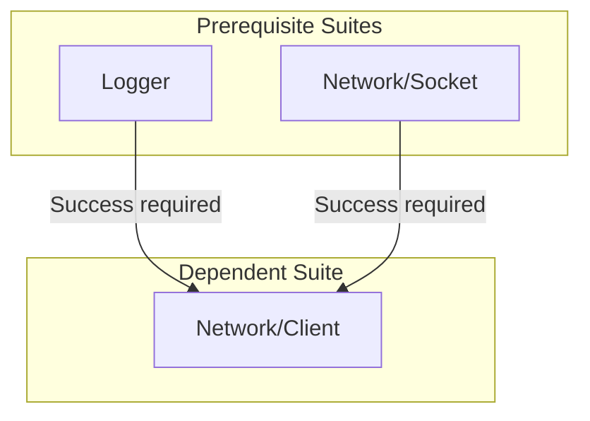

import { Card, CardGrid, Aside, Tabs, TabItem } from '@astrojs/starlight/components';

Automated unit tests form the foundation of any resilient and maintainable software project. Yet, in the C++ ecosystem, establishing a testing suite historically requires adopting legacy third-party frameworks conceived over fifteen years ago (GoogleTest, Catch2, doctest, Boost.Test, CppUnit). While mature, these tools suffer from major architectural trade-offs:

- **Proliferation of preprocessor macros**: Traditional frameworks impose macros both to declare test suites and cases (`TEST`, `TEST_F`, `TEST_CASE`) and for each assertion (`ASSERT_EQ`, `CHECK`, etc.). These macros [ignore static typing and namespaces](https://morgancaron.github.io/articles/cpp/preprocessor#typage-et-namespaces), [pollute the global namespace](https://morgancaron.github.io/articles/cpp/preprocessor#pollution-namespace-global), and [impede step-by-step debugging](https://morgancaron.github.io/articles/cpp/preprocessor#debogage-pas-a-pas). Yet C++ cleanly achieves both [test suite registration](#declaring-a-test-suite) and [value diagnostics for assertions](#value-diagnostics) without any preprocessor trickery.
- **Lack of native modularity**: Conceived around legacy header inclusions (`#include`), these tools lack native integration with C++20 modules, increasing compilation times.
- **Lack of dependency scheduling and cascading failure avalanches**: Traditional test frameworks run tests without any awareness of real dependencies between components. If a foundational building block fails (memory allocator, network socket, message queue), all dependent high-level tests collapse simultaneously, flooding the terminal with dozens of secondary failures that mask the genuine root cause.
- **The illusion of mocking as a workaround**: Faced with tight coupling, developers introduce virtual interfaces and mock objects to isolate units artificially. These synthetic abstractions distort real runtime behavior, inflate production code with dynamic dispatch overhead (vtable, smart pointers, heap allocations), and conceal integration regressions, race conditions, and genuine edge cases.

The [`CppUtils::UnitTest`](/en/reference/unittest/functions/) module reimagines unit testing from the ground up for modern C++26:

<CardGrid>
	<Card title="Zero Preprocessor Macros" icon="seti:cpp">
		Pure declarative syntax with zero preprocessor macros. Eliminates macro code pollution, identifier collisions, and hidden generated code.
	</Card>
	<Card title="Dependency Graph" icon="seti:pipeline">
		Deterministic execution via a [Directed Acyclic Graph (DAG)](https://en.wikipedia.org/wiki/Directed_acyclic_graph). Tests run according to their genuine dependencies, isolating the root cause without mocks.
	</Card>
	<Card title="Value Diagnostics" icon="magnifier">
		Test conditions directly using standard C++ operators (`==`, `!=`, `<`, etc.). On failure, the exact values compared are automatically displayed in the report without requiring dedicated macros.
	</Card>
	<Card title="Process Isolation" icon="seti:lock">
		Every test executes inside a dedicated child process ([`fork()`](#process-isolation-and-timeout-management)). Absolute resilience against fatal crashes (`SIGSEGV`) and infinite loops (enforced by a strict watchdog timer with `SIGKILL`).
	</Card>
	<Card title="Exception Monitoring" icon="warning">
		Verify that expected exceptions are correctly thrown ([`throws`](#throws-matcher-exception-verification)) or guarantee that none occur ([`noThrow`](#nothrow-matcher-exception-absence)), both in the main test thread and across worker threads.
	</Card>
	<Card title="Parameterized Testing" icon="puzzle">
		Run identical test logic across a collection of types ([`forTypes`](#iterating-over-a-list-of-types-fortypes)) or dynamic values ([`forValues`](#iterating-over-a-list-of-values-forvalues)), configured at the individual test level or across an entire suite.
	</Card>
	<Card title="Platform-Conditional Skipping" icon="seti:ignored">
		Cleanly bypass tests when the execution environment (OS, network, hardware capabilities) does not satisfy prerequisite criteria ([`skip`](#deliberately-skipping-a-test-skip-and-skipif), [`skipIf`](#deliberately-skipping-a-test-skip-and-skipif)), without failing the suite.
	</Card>
	<Card title="Deterministic Fuzzing" icon="random">
		Deterministic pseudo-random generation to stress-test algorithms with unexpected payloads, including configurable pseudo-random string and integer sequences.
	</Card>
	<Card title="Integrated Benchmarks" icon="seti:clock">
		Built-in performance measurements with comparative ratios and automated console warnings when a candidate implementation regresses against baseline standards.
	</Card>
	<Card title="Asynchronous Assertions" icon="code-branch">
		Periodic condition polling ([`eventually`](#eventually-matcher-waiting-for-an-asynchronous-condition)) or waiting on an asynchronous operation ([`completes`](#completes-matcher-reactive-synchronization-without-polling)).
	</Card>
	<Card title="Compile-Time Constexpr Tests" icon="setting">
		Validate your `constexpr` contracts and computations directly during compilation ([`suite.test<Predicate>`](#compile-time-tests-suitetestpredicate)). Instant build-time error detection with zero runtime execution overhead.
	</Card>
	<Card title="Universal CI/CD Reports" icon="document">
		Standard JUnit XML report generation ([`--report`](#junit-xml-report-export-and-cicd-integration)). Native integration in GitLab CI and GitHub Actions to automatically publish metrics and failure annotations in pull requests.
	</Card>
</CardGrid>

---

## Comparison with C++ Testing Frameworks

`CppUtils::UnitTest` breaks free from the compromises of historical frameworks: zero preprocessor macros, direct expression capture, and automated suite scheduling via a dependency graph.

### Syntax Comparison

The interactive tabs below demonstrate an identical testing scenario expressed in each framework:

<Tabs>
	<TabItem label="CppUtils::UnitTest" icon="star">
		<Tabs>
			<TabItem label="Namespace alias">
```cpp
// Native C++20 module support (zero macros, zero header files)
import std;
import CppUtils;

namespace MyApp::Tests
{
	namespace ut = CppUtils::UnitTest;

	// Suite declaration with dependencies
	auto _ = ut::testSuite("Math/Calculator").dependsOn("Logger") = [](ut::TestSuite& suite) {
		suite.test("Operations") = [] {
			// Assertions capturing actual runtime values without macros
			ut::expect(add(20, 22)) == 42;
			not ut::expect(isNegative(42));
			ut::expect([&] { divide(10, 0); }) == ut::throws<std::invalid_argument>;
		};

		// Parameterized test across a collection of values
		suite.test("Scale factor").forValues(10, 50, 100) = [](int scale) {
			ut::expect(scale) > 0;
		};
	};
}
```
			</TabItem>
			<TabItem label="With using namespace">
```cpp
// Native C++20 module support (zero macros, zero header files)
import std;
import CppUtils;

namespace MyApp::Tests
{
	using namespace CppUtils::UnitTest;

	// Suite declaration with dependencies
	auto _ = testSuite("Math/Calculator").dependsOn("Logger") = [](TestSuite& suite) {
		suite.test("Operations") = [] {
			// Assertions capturing actual runtime values without macros
			expect(add(20, 22)) == 42;
			not expect(isNegative(42));
			expect([&] { divide(10, 0); }) == throws<std::invalid_argument>;
		};

		// Parameterized test across a collection of values
		suite.test("Scale factor").forValues(10, 50, 100) = [](int scale) {
			expect(scale) > 0;
		};
	};
}
```
			</TabItem>
		</Tabs>
	</TabItem>
	<TabItem label="Boost.UT">
```cpp
import boost.ut;

int main() {
    // Recommended practice by Boost.UT documentation (an alias remains possible to avoid name collisions)
    using namespace boost::ut;

    // Test declaration via literal suffix
    // No dependency management between suites (linear execution)
    "operations"_test = [] {
        // Requires literal suffixes (_i) to capture values on failure (limited to basic arithmetic types)
        expect(add(20, 22) == 42_i);
        expect(not isNegative(42));
        expect(throws<std::invalid_argument>([] { divide(10, 0); }));
    };

    // Parameterized test via overloaded pipe operator |
    "scale_factor"_test = [](int scale) {
        expect(scale > 0_i);
    } | std::vector{10, 50, 100};
}
```
	</TabItem>
	<TabItem label="Catch2 (v3)">
```cpp
// Native C++20 modules not supported (mandatory #include headers)
#include <catch2/catch_test_macros.hpp>
#include <catch2/generators/catch_generators.hpp>
#include <stdexcept>

// Intrusive macros polluting the global namespace
// No dependency management between suites (linear execution)
TEST_CASE("Math/Calculator Operations", "[math]") {
    // Mandatory preprocessor macros to decompose operands
    REQUIRE(add(20, 22) == 42);
    REQUIRE_FALSE(isNegative(42));
    REQUIRE_THROWS_AS(divide(10, 0), std::invalid_argument);
}

// Parameterized test: the GENERATE macro re-executes the entire TEST_CASE body
TEST_CASE("Math/Calculator Scale factor", "[math]") {
    auto scale = GENERATE(10, 50, 100);
    REQUIRE(scale > 0);
}
```
	</TabItem>
	<TabItem label="Google Test">
```cpp
// Native C++20 modules not supported (mandatory #include headers)
#include <gtest/gtest.h>
#include <stdexcept>

// Intrusive macros polluting the global namespace
// No dependency management between suites (linear execution)
TEST(CalculatorTest, Operations) {
    EXPECT_EQ(add(20, 22), 42); // Distinct macro required for each operator
    EXPECT_FALSE(isNegative(42));
    EXPECT_THROW(divide(10, 0), std::invalid_argument);
}

// Parameterized test: requires a dedicated fixture class inheriting TestWithParam + 2 verbose macros
class ScaleTest : public testing::TestWithParam<int> {};

TEST_P(ScaleTest, PositiveScale) {
    EXPECT_GT(GetParam(), 0);
}

INSTANTIATE_TEST_SUITE_P(Values, ScaleTest, testing::Values(10, 50, 100));
```
	</TabItem>
	<TabItem label="doctest">
```cpp
// Native C++20 modules not supported (mandatory #include headers)
#include <doctest/doctest.h>
#include <stdexcept>

// Intrusive macros polluting the global namespace
// No dependency management between suites (linear execution)
TEST_CASE("Math/Calculator") {
    SUBCASE("Operations") {
        CHECK(add(20, 22) == 42); // Macro-based expression decomposition
        CHECK_FALSE(isNegative(42));
        CHECK_THROWS_AS(divide(10, 0), std::invalid_argument);
    }

    // Parameterized test: the GENERATE macro re-executes the entire TEST_CASE body (like Catch2)
    SUBCASE("Scale factor") {
        auto scale = GENERATE(10, 50, 100);
        CHECK(scale > 0);
    }
}
```
	</TabItem>
	<TabItem label="Boost.Test">
```cpp
// Native C++20 modules not supported (mandatory #include headers)
#define BOOST_TEST_MODULE CalculatorTest
#include <boost/test/included/unit_test.hpp>
#include <boost/test/data/test_case.hpp>
#include <stdexcept>

// Intrusive macros polluting the global namespace
// No dependency management between suites (linear execution)
// Hidden scope (namespace) injected without visible braces, enclosing any intermediate code
BOOST_AUTO_TEST_SUITE(Calculator)

BOOST_AUTO_TEST_CASE(Operations) {
    BOOST_TEST(add(20, 22) == 42);
    BOOST_TEST(!isNegative(42));
    BOOST_CHECK_THROW(divide(10, 0), std::invalid_argument);
}

// Parameterized test: requires heavy and complex dataset macro
BOOST_DATA_TEST_CASE(ScaleFactor, boost::unit_test::data::make({10, 50, 100}), scale) {
    BOOST_TEST(scale > 0);
}

BOOST_AUTO_TEST_SUITE_END() // Mandatory closure of the hidden scope opened by the suite macro
```
	</TabItem>
	<TabItem label="Qt Test">
```cpp
// Native C++20 modules not supported (mandatory #include headers)
#include <QTest>
#include <stdexcept>

// Verbose declaration via class inheriting QObject
// No dependency management between suites (linear execution)
class CalculatorTest : public QObject {
    Q_OBJECT
private slots:
    void testOperations() {
        QCOMPARE(add(20, 22), 42); // Forces tested types to adapt to the test framework by requiring overloads of the non-standard proprietary QTest::toString API for failure diagnostics
        QVERIFY(!isNegative(42));
        QVERIFY_THROWS_EXCEPTION(std::invalid_argument, divide(10, 0));
    }

    // Parameterized test: requires 2 distinct methods and a dynamic table
    void testScale_data() {
        QTest::addColumn<int>("scale");
        QTest::newRow("10") << 10;
        QTest::newRow("50") << 50;
        QTest::newRow("100") << 100;
    }

    void testScale() {
        QFETCH(int, scale);
        QVERIFY(scale > 0);
    }
};

QTEST_MAIN(CalculatorTest)

// Mandatory inclusion of MOC-generated code: reliance on a proprietary preprocessor injecting invisible code and applying non-standard "magic" ('Q_OBJECT', slots) to introspect tests
#include "CalculatorTest.moc"
```
	</TabItem>
	<TabItem label="MS Test">
```cpp
// Native C++20 modules not supported (mandatory #include headers)
#include "CppUnitTest.h"
#include <stdexcept>

// Microsoft's official practice to access the Assert:: class, deliberately polluting the global namespace with their entire proprietary framework
using namespace Microsoft::VisualStudio::CppUnitTestFramework;

// Intrusive macros polluting the global namespace
// No dependency management between suites (linear execution)
TEST_CLASS(CalculatorTest) {
public:
    TEST_METHOD(TestOperations) {
        Assert::AreEqual(42, add(20, 22));
        Assert::IsFalse(isNegative(42));
        Assert::ExpectException<std::invalid_argument>([] { divide(10, 0); });
    }

    // Parameterized test: no native mechanism, imperative loop without isolation
    TEST_METHOD(TestScale) {
        for (int scale : {10, 50, 100})
            Assert::IsTrue(scale > 0);
    }
};
```
	</TabItem>
	<TabItem label="CppUnit">
```cpp
// Native C++20 modules not supported (mandatory #include headers)
#include <cppunit/extensions/HelperMacros.h>
#include <stdexcept>

// Intrusive macros and verbose fixture class
// No dependency management between suites (linear execution)
class CalculatorTest : public CppUnit::TestFixture {
    CPPUNIT_TEST_SUITE(CalculatorTest);
    CPPUNIT_TEST(testOperations);
    CPPUNIT_TEST(testScale);
    CPPUNIT_TEST_SUITE_END();

public:
    void testOperations() {
        CPPUNIT_ASSERT_EQUAL(42, add(20, 22)); // Assertion macros lacking modern decomposition
        CPPUNIT_ASSERT(!isNegative(42));
        CPPUNIT_ASSERT_THROW(divide(10, 0), std::invalid_argument);
    }

    // Parameterized test: no native support, imperative loop without isolation
    void testScale() {
        for (int scale : {10, 50, 100})
            CPPUNIT_ASSERT(scale > 0);
    }
};

CPPUNIT_TEST_SUITE_REGISTRATION(CalculatorTest);
```
	</TabItem>
</Tabs>

<Aside type="note" title="Impact of using namespace Directives">
While a `using namespace` directive in test code only pollutes the namespace of the test executable itself without contaminating the tested project's headers, it directly causes identifier collisions and overload ambiguities whenever the tested project defines functions, types, or constants with common names (`test`, `suite`, `expect`, `throws`, etc.). For an in-depth analysis of these architectural risks, see the dedicated section on the [**`using namespace`**](https://morgancaron.github.io/articles/cpp/scopes#using-namespace) directive.
</Aside>

### Feature Comparison Matrix

| Feature | `CppUtils::UnitTest` | Boost.UT | Catch2 (v3) | Google Test | doctest | Boost.Test | Qt Test | MS Test (C++) | CppUnit |
| :--- | :---: | :---: | :---: | :---: | :---: | :---: | :---: | :---: | :---: |
| **Zero preprocessor macros** | ✅ | ✅ | ❌ ([`REQUIRE`](https://github.com/catchorg/Catch2/blob/devel/docs/assertions.md)) | ❌ ([`EXPECT_EQ`](https://google.github.io/googletest/reference/assertions.html)) | ❌ ([`CHECK`](https://github.com/doctest/doctest/blob/master/doc/markdown/assertions.md)) | ❌ ([`BOOST_CHECK`](https://www.boost.org/doc/libs/release/libs/test/doc/html/boost_test/testing_tools/summary.html)) | ❌ ([`QCOMPARE`](https://doc.qt.io/qt-6/qtest.html#QCOMPARE)) | ❌ ([`TEST_METHOD`](https://learn.microsoft.com/visualstudio/test/microsoft-visualstudio-testtools-cppunittestframework-api-reference#test_macros)) | ❌ ([`CPPUNIT_`](https://freedesktop.org/wiki/Software/cppunit/)) |
| **Native C++20 modules** | ✅ (`import`) | ✅ ([`ut.cppm`](https://github.com/boost-ext/ut/blob/master/include/boost/ut.cppm)) | ❌ (`#include` headers) | ❌ (`#include` headers) | ❌ (`#include` headers) | ❌ (`#include` headers) | ❌ (`#include` headers) | ❌ (`#include` headers) | ❌ (`#include` headers) |
| **Expression decomposition (`lhs == rhs`)** | ✅ (`expect(a) == b` syntax) | ✅ (`1_i == 2` or `that %` / `eq`) | ⚠️ Partial (macro decomposition) | ❌ (dedicated macros [`ASSERT_EQ`](https://google.github.io/googletest/reference/assertions.html)) | ⚠️ Partial (macro decomposition) | ⚠️ Partial (via [`BOOST_TEST`](https://www.boost.org/doc/libs/release/libs/test/doc/html/boost_test/testing_tools/extended_comparison/test.html)) | ❌ ([`QCOMPARE`](https://doc.qt.io/qt-6/qtest.html#QCOMPARE)) | ❌ ([`Assert::AreEqual`](https://learn.microsoft.com/visualstudio/test/microsoft-visualstudio-testtools-cppunittestframework-api-reference#assert_classes)) | ❌ ([`CPPUNIT_ASSERT_EQUAL`](https://cppunit.sourceforge.net/doc/lastest/group___assertions.html#ga71162f02be052994ea26d15cb9115ab5)) |
| **Mocking** | ❌ ([learn why](#why-no-mocking-library-is-provided)) | ❌ | ❌ (via third-party) | ✅ ([GoogleMock](https://google.github.io/googletest/gmock_for_dummies.html)) | ❌ (via third-party) | ❌ (via third-party) | ⚠️ Partial ([`QSignalSpy`](https://doc.qt.io/qt-6/qsignalspy.html)) | ❌ | ❌ |
| **Dependency scheduling** | ✅ (topological ordering & automatic failure skipping) | ❌ | ❌ | ❌ | ❌ | ❌ | ❌ | ❌ | ❌ |
| **Integrated benchmarks & comparison** | ✅ (`benchmark`, `warnIfSlower`) | ❌ | ⚠️ Partial ([`BENCHMARK`](https://github.com/catchorg/Catch2/blob/devel/docs/benchmarks.md)) | ❌ | ❌ | ❌ | ❌ | ❌ | ❌ |
| **Parameterized tests (`forValues`)** | ✅ | ✅ | ✅ ([`GENERATE`](https://github.com/catchorg/Catch2/blob/devel/docs/generators.md)) | ✅ ([`INSTANTIATE_TEST_SUITE_P`](https://google.github.io/googletest/advanced.html#value-parameterized-tests)) | ✅ ([`GENERATE`](https://github.com/doctest/doctest/blob/master/doc/markdown/parameterized-tests.md)) | ✅ ([datasets](https://www.boost.org/doc/libs/release/libs/test/doc/html/boost_test/tests_organization/test_cases/test_case_generation.html)) | ⚠️ Partial ([`QTest::newRow`](https://doc.qt.io/qt-6/qtest-overview.html#data-driven-testing)) | ❌ | ❌ |
| **Typed tests (`forTypes`)** | ✅ (variadic direct) | ✅ | ✅ ([`TEMPLATE_TEST_CASE`](https://github.com/catchorg/Catch2/blob/devel/docs/test-cases-and-sections.md#type-parametrised-test-cases)) | ✅ ([`TYPED_TEST`](https://google.github.io/googletest/advanced.html#typed-tests)) | ⚠️ Partial ([`TYPE_TO_STRING`](https://github.com/doctest/doctest/blob/master/doc/markdown/parameterized-tests.md)) | ✅ ([template test cases](https://www.boost.org/doc/libs/release/libs/test/doc/html/boost_test/tests_organization/test_cases/test_case_generation/datasets_auto_creation/types.html)) | ❌ | ❌ | ❌ |
| **Deterministic fuzzing engine** | ✅ (with repeatable seed) | ❌ | ❌ | ❌ | ❌ | ❌ | ❌ | ❌ | ❌ |
| **Process isolation (`fork`)** | ✅ (`SIGSEGV` resilience) | ❌ | ❌ | ⚠️ Partial ([`death_test`](https://google.github.io/googletest/advanced.html#death-tests)) | ❌ | ❌ | ❌ | ❌ | ❌ |
| **Asynchronous verification (`eventually`, `completes`)** | ✅ (periodic polling and reactive wake) | ❌ | ❌ | ❌ | ❌ | ❌ | ❌ | ❌ | ❌ |
| **JUnit XML reports (CI/CD)** | ✅ (native via `--report=junit:...`) | ❌ | ✅ ([`-r junit`](https://github.com/catchorg/Catch2/blob/devel/docs/reporters.md#junit-reporter)) | ✅ ([`--gtest_output=xml`](https://google.github.io/googletest/advanced.html#generating-an-xml-report)) | ✅ ([`-r=junit`](https://github.com/doctest/doctest/blob/master/doc/markdown/reporters.md#reporters-and-listeners)) | ✅ ([`--log_format=JUNIT`](https://www.boost.org/doc/libs/release/libs/test/doc/html/boost_test/utf_reference/rt_param_reference/log_format.html)) | ✅ ([`-junitxml`](https://doc.qt.io/qt-6/qtest-overview.html#qtest-command-line-arguments)) | ⚠️ Partial ([proprietary `.trx`](https://learn.microsoft.com/visualstudio/test/vstest-console-options), JUnit via third-party plugin) | ✅ ([`XmlOutputter`](https://cppunit.sourceforge.net/doc/lastest/class_xml_outputter.html)) |
| **Zero external dependencies** | ✅ | ✅ | ✅ | ✅ | ✅ | ❌ ([Boost](https://www.boost.org/)) | ❌ ([Qt Core & MOC](https://doc.qt.io/qt-6/qtest.html)) | ❌ ([Visual Studio](https://learn.microsoft.com/visualstudio/test/writing-unit-tests-for-c-cpp)) | ✅ |

### Why This Architecture Makes the Difference

- **Code clarity and modern tooling**: Eliminating macros entirely enables perfect IDE code completion, reliable automated refactoring, and step-by-step debugging without hidden generated code.
- **Positioning relative to modern alternatives**: Among all existing frameworks, **Boost.UT** represents the most advanced and respectable effort to break free from macros. `CppUtils::UnitTest` preserves that modern spirit while removing the remaining friction: zero requirement for dedicated literal suffixes (`_i`) to capture any standard type, native dependency graph scheduling, and process-level crash resilience.
- **Immediate root cause isolation**: Thanks to the dependency graph (`CppUtils::Container::DependencyGraph`), if a foundational module fails, hundreds of dependent high-level tests are automatically skipped instead of overwhelming the terminal with noise.
- **Unified software quality**: Instead of juggling Google Test for unit tests, Google Benchmark for performance profiling, libFuzzer for fuzzing, and custom scripts for crash isolation, `CppUtils::UnitTest` consolidates all these pillars into a single, cohesive, and expressive API.

---

## Declaring a Test Suite

A test suite is declared simply:

```cpp
import std;
import CppUtils;

namespace MyApp::Tests
{
	namespace ut = CppUtils::UnitTest;

	auto _ = ut::testSuite("Math/Calculator") = [](ut::TestSuite& suite) {
		using namespace std::literals;

		suite.test("Addition") = [] {
			const auto result = 20 + 22;
			ut::expect(result) == 42;
		};

		suite.test("Heavy computation").timeout(30s) = [] {
			ut::expect(performHeavyComputation()) > 0;
		};
	};
}
```

### Dependencies Between Test Suites

When a test suite requires other test suites to pass before running, declare them with `.dependsOn(...)`:

```cpp
auto _ = ut::testSuite("Network/Client").dependsOn("Logger", "Network/Socket") = [](ut::TestSuite& suite) {
	suite.test("Connection") = [] {
		// This test only executes if "Logger" and "Network/Socket" succeeded
	};
};
```



By declaring these dependencies, the runner structures test execution as a [Directed Acyclic Graph (DAG)](https://en.wikipedia.org/wiki/Directed_acyclic_graph). This graph structure provides three major benefits:
- **Immediate root-cause identification**: If `Network/Socket` fails, `Network/Client` is not even executed and is marked as skipped due to unmet prerequisites. The genuine failure is never buried beneath an avalanche of cascading secondary errors caused by a broken upstream dependency.
- **Clean terminal output with `failFast`**: When [`failFast`](#configuration-options-cpputilsunittesttestsettings) is enabled, the runner stops immediately on the first root failure without running dependent suites.
- **Eliminating the need for mocking (*mocks / stubs*)**: Because tests execute in the strict topological order of their genuine dependencies and failures are isolated at the source, introducing artificial test doubles to mask upstream fragility becomes unnecessary. You test genuine components end-to-end with full confidence.

---

## Why No Mocking Library Is Provided

The deliberate omission of a mocking library in CppUtils is an intentional design choice. In the C++ ecosystem, mocking introduces two fundamental problems:

### 1. The Illusion of Testing and False Guarantees

A mock replaces genuine components with canned responses. This gives the illusion of testing a component, while the real integration has **never actually run**:
- **Networking example**: If you mock a socket to return a pre-scripted JSON payload, you validate parsing under ideal conditions, but completely miss how your component interacts with real stream dynamics: fragmented packets, state desynchronization, or race conditions when data arrives during an internal state transition. These concurrent operations can collide in production, causing issues that a static mock will never reveal.
- **Filesystem example**: If you mock filesystem calls, you bypass OS file locks, actual user permissions, and physical disk synchronization.

In production, the system operates in a scenario that has **never truly been tested**. CppUtils encourages testing against real conditions: launching an actual local server on an ephemeral port or creating genuine temporary files.

### 2. Distortion of Production Code (*Zero-Cost Abstraction*)

Making a class "mockable" often forces developers to compromise production design: imposing object-oriented (OOP) class hierarchies for dependency injection, multiplying virtual interfaces (`virtual` / vtables), and relying on dynamic allocations (`std::unique_ptr<Interface>`). These indirections inhibit compiler inlining and add runtime overhead solely to satisfy the testing harness.

### The Alternative: Dependency-Graph Scheduling

The perceived need for mocks often stems from fear that upstream failures will trigger cascading test crashes, making it difficult to pinpoint the root cause of the issue. With [`CppUtils::Container::DependencyGraph`](/en/reference/container/dependencygraph/), CppUtils resolves this: foundational modules [run first](#dependencies-between-test-suites). If a dependency fails, dependent suites are automatically skipped, pinpointing the root cause without resorting to artificial simulations.

---

## Writing Assertions

Unlike traditional frameworks that force developers to memorize dozens of specialized macros depending on the type of check ([`ASSERT_EQ`](https://google.github.io/googletest/reference/assertions.html#EXPECT_EQ), [`ASSERT_NE`](https://google.github.io/googletest/reference/assertions.html#EXPECT_NE), [`ASSERT_THROW`](https://google.github.io/googletest/reference/assertions.html#EXPECT_THROW), [`CHECK_FALSE`](https://github.com/catchorg/Catch2/blob/devel/docs/assertions.md), etc. (see [Comparison](#comparison-with-c-testing-frameworks))), `CppUtils::UnitTest` prioritizes simplicity with **a single assertion function: `expect(...)`**.

### Boolean Assertion: `expect`

The `expect` function validates that a condition or expression is true:

```cpp
ut::expect(database.isConnected());
ut::expect(not std::ranges::empty(buffer));
```

Writing `== true` is unnecessary: `expect(condition);` directly evaluates the condition.

Upon failure, the report pinpoints the exact source file, line number, column, and the evaluated runtime value:

```terminal
[blue]──────────────────────────────────────────────────────────────[/blue]
[blue]Database/Connection/Ping:[/blue]
                         [red]🛇 ERROR 🛇[/red]
The following test didn't pass:
Database/Connection/Ping
  In tests/Database/Connection.mpp
At line 42, column 5
In expect(condition)
with value:
[red]false[/red]

[red]Failed ✕[/red]
```

#### Objects Convertible to Boolean

Any type convertible to `bool` (`std::optional`, raw pointers, `std::unique_ptr`, `std::shared_ptr`, types with `explicit operator bool()`) is automatically converted and evaluated as a boolean by `expect`:

```cpp
auto user = std::optional<User>{fetchUser(42)};
ut::expect(user);

auto connection = std::unique_ptr<Socket>{connect()};
ut::expect(connection);
```

Upon failure on a null pointer or empty `std::optional`, the report directly outputs `with value: nullptr` or `with value: nullopt` in red:

```terminal
[blue]──────────────────────────────────────────────────────────────[/blue]
[blue]Database/Connection/Open:[/blue]
                         [red]🛇 ERROR 🛇[/red]
The following test didn't pass:
Database/Connection/Open
  In tests/Database/Connection.mpp
At line 42, column 2
In expect(condition)
with value:
[red]nullopt[/red]

[red]Failed ✕[/red]
```

#### Negation: `not expect(...)` over `expect(not ...)`

To assert that a condition must be false, prefer placing the negation on the outside:

```cpp
// Recommended:
not expect(session.isExpired());

// Equivalent:
expect(session.isExpired()) == false;
```

While writing `expect(not condition);` works in C++, external negation provides significantly richer diagnostics upon failure:

- With `expect(not error);`: the logical inversion is resolved *before* entering `expect`. The expression is immediately collapsed into a raw `bool`. Upon failure, the report merely shows `with value: false` without revealing the object's contents:

```cpp
auto error = std::optional<std::string>{"Connection refused"};
expect(not error);
```

```terminal
[blue]──────────────────────────────────────────────────────────────[/blue]
[blue]Network/Connection:[/blue]
                         [red]🛇 ERROR 🛇[/red]
The following test didn't pass:
Network/Connection
  In tests/Network/Connection.mpp
At line 42, column 5
In expect(condition)
with value:
[red]false[/red]

[red]Failed ✕[/red]
```

- With `not expect(error);`: the framework captures the original object intact. For any dereferenceable type (`operator*`) whose underlying value is printable, the diagnostic unpacks and displays the actual unexpected element that caused the failure in red:

```cpp
auto error = std::optional<std::string>{"Connection refused"};
not expect(error);
```

```terminal
[blue]──────────────────────────────────────────────────────────────[/blue]
[blue]Network/Connection:[/blue]
                         [red]🛇 ERROR 🛇[/red]
The following test didn't pass:
Network/Connection
  In tests/Network/Connection.mpp
At line 42, column 5
In not expect(condition)
with value:
[red]Connection refused[/red]

[red]Failed ✕[/red]
```

### Value Diagnostics

In traditional testing libraries, inspecting operand values forces developers to abandon idiomatic C++ operators in favor of an overwhelming zoo of specialized macros ([`ASSERT_EQ`](https://google.github.io/googletest/reference/assertions.html#EXPECT_EQ), [`ASSERT_NE`](https://google.github.io/googletest/reference/assertions.html#EXPECT_NE), [`ASSERT_LT`](https://google.github.io/googletest/reference/assertions.html#EXPECT_LT), [`ASSERT_LE`](https://google.github.io/googletest/reference/assertions.html#EXPECT_LE), [`ASSERT_GT`](https://google.github.io/googletest/reference/assertions.html#EXPECT_GT), [`ASSERT_GE`](https://google.github.io/googletest/reference/assertions.html#EXPECT_GE), [`EXPECT_FLOAT_EQ`](https://google.github.io/googletest/reference/assertions.html#EXPECT_FLOAT_EQ), etc.).

With `CppUtils::UnitTest`, standard C++ comparison operators replace all these macros without verbose wrappers or [proprietary literals](https://boost-ext.github.io/ut/):

```cpp
ut::expect(left) == right;
ut::expect(left) != right;
ut::expect(left) < right;
ut::expect(left) <= right;
ut::expect(left) > right;
ut::expect(left) >= right;
```

```cpp
namespace ut = CppUtils::UnitTest;

auto _ = ut::testSuite("Auth/Session") = [](ut::TestSuite& suite) {
	using namespace std::chrono_literals;

	suite.test("Validate session") = [] {
		ut::expect(session.getRemainingTime()) > 0s;
		ut::expect(session.getUserRole()) == "admin";
		ut::expect(session.getFailedAttempts()) <= 3u;
		ut::expect(std::ranges::size(session.getActiveTokens())) == 2uz;
	};
};
```

#### Why This Syntax Was Chosen

1. **Pure C++23 with zero preprocessor macros**: In frameworks like Catch2 or GoogleTest, expression decomposition strictly requires macros (`REQUIRE(a == b)`, `EXPECT_EQ(a, b)`). In pure C++, writing `expect(a == b);` would pass an already-evaluated `bool` to `expect`, making separate inspection of `a` and `b` impossible. By writing `expect(a) == b;`, `expect(a)` returns a temporary proxy object (`ExpectationProxy`) that intercepts the subsequent comparison operator, capturing both left-hand (`lhs`) and right-hand (`rhs`) operands along with their operator symbol without a single macro.
2. **Zero identifier collisions and variable shadowing**: Approaches relying on free functions such as `value(...)` or `that(...)` cause major conflicts whenever a test declares a local variable sharing that common name. Writing `auto value = calculate(); expect(value(value) == 42);` produces a fatal compilation error (`error: type does not provide a call operator`). With `expect(value) == 42;`, the variable `value` is passed directly with no risk of shadowing or ambiguity.
3. **Zero pollution from custom test literals**: To intercept comparisons without macros, [Boost.UT](https://boost-ext.github.io/ut/) must force at least one operand into an intermediate framework type: either via proprietary literal suffixes (`42_i == sum()`), limited to basic arithmetic types, or via a matcher wrapper (`expect(that % 0 == sum());`), or via prefixed named functions (`expect(eq(a, b));`). `CppUtils::UnitTest` solves this in a unified and generic way without compromises: zero imposed literals, zero verbose wrappers, and zero prefixed functions. Any modern C++ type is naturally captured with standard language operators.
4. **Direct Readability**: The assertion reads from left to right ("expect left equals right") without redundant prefixes.
5. **Assertions Without Relational Operators**: Boolean conditions evaluate directly (e.g. `ut::expect(user.isConnected());`) without requiring comparison operators or a redundant `== true` suffix.

Upon failure (for instance if `user.getRole()` returns `"guest"` instead of `"admin"`), the diagnostic decomposes the expression and prints the exact runtime values of both operands:

```terminal
[blue]──────────────────────────────────────────────────────────────[/blue]
[blue]UnitTest/Auth:[/blue]
                         [red]🛇 ERROR 🛇[/red]
The following test didn't pass:
Auth/Session/Admin verification
  In tests/Auth/Session.mpp
At line 42, column 2
In expect(lhs) == rhs
with lhs:
guest
and rhs:
admin

Diff:
  lhs (-): "[red]guest[/red]"
  rhs (+): "[green]admin[/green]"

[red]Failed ✕[/red]
```

<Aside type="tip" title="Visual Colored Diff in the Terminal">
For string comparisons (`std::string`, `std::string_view`, `const char*`), `CppUtils::UnitTest` automatically computes character-by-character differences via the [`CppUtils::Container::Sequence::getDifferences`](/en/reference/container/sequence/functions/#getDifferences) algorithm:
- Deleted characters from the left operand (`lhs`) are highlighted in **red** (`-`).
- Added characters from the right operand (`rhs`) are highlighted in **green** (`+`).
- Common characters remain in standard neutral text color.
</Aside>

For isolated differences within long strings, this diff calculation pinpoints the mismatched characters in place:

```cpp
const auto expectedUrl = "https://api.example.com/v1/users/42/profile";
const auto actualUrl   = "https://api.example.com/v2/users/42/profile";
ut::expect(expectedUrl) == actualUrl;
```

```terminal
[blue]──────────────────────────────────────────────────────────────[/blue]
[blue]Network/Api/EndpointCheck:[/blue]
                         [red]🛇 ERROR 🛇[/red]
The following test didn't pass:
Network/Api/EndpointCheck
  In tests/Network/Api.mpp
At line 18, column 2
In expect(lhs) == rhs
with lhs:
https://api.example.com/v1/users/42/profile
and rhs:
https://api.example.com/v2/users/42/profile

Diff:
  lhs (-): "https://api.example.com/v[red]1[/red]/users/42/profile"
  rhs (+): "https://api.example.com/v[green]2[/green]/users/42/profile"

[red]Failed ✕[/red]
```

*(As shown above, only the `1` appears in red and the `2` in green, while the rest of the URL remains in standard neutral color).*

Likewise, when multiple segments differ within a sentence, each mismatch is highlighted individually without merging the unchanged intermediate text:

```cpp
const auto expectedSentence = "The quick brown fox jumps over the lazy dog";
const auto actualSentence   = "The fast brown fox leaps over a lazy dog";
ut::expect(expectedSentence) == actualSentence;
```

```terminal
[blue]──────────────────────────────────────────────────────────────[/blue]
[blue]UnitTest/VisualColorInspection/Diff visuel complexe (segments multiples):[/blue]
                         [red]🛇 ERROR 🛇[/red]
The following test didn't pass:
UnitTest/VisualColorInspection/Diff visuel complexe (segments multiples)
  In tests/UnitTest/UnitTest.mpp
At line 711, column 5
In expect(lhs) == rhs
with lhs:
The quick brown fox jumps over the lazy dog
and rhs:
The fast brown fox leaps over a lazy dog

Diff:
  lhs (-): "The [red]quick[/red] brown fox [red]jum[/red]ps over [red]the[/red] lazy dog"
  rhs (+): "The [green]fast[/green] brown fox [green]lea[/green]ps over [green]a[/green] lazy dog"

[red]Failed ✕[/red]
```

### Native Complex Type Formatting

The inspection engine relies on generic C++20 concepts, without requiring serialization macros or custom display overloads (unlike, for instance, [`QTest::toString`](https://doc.qt.io/qt-6/qtest.html#toString) in Qt Test). Any type that satisfies these concepts (iterable ranges, dereferenceable types, tuple-like structures, etc.), whether from the standard library, a third-party library, or your own code, is automatically analyzed and formatted.

#### Containers and Ranges

Containers (`std::vector`, `std::span`, lists, views) are compared element by element using `std::ranges::equal` and formatted as readable lists:

```cpp
const auto headers = std::vector<std::string>{"content-type", "authorization"};
ut::expect(headers) == std::vector<std::string>{"content-type", "accept"};
```

```terminal
[blue]──────────────────────────────────────────────────────────────[/blue]
[blue]Network/Headers/Validate:[/blue]
                         [red]🛇 ERROR 🛇[/red]
The following test didn't pass:
Network/Headers/Validate
  In tests/Network/Headers.mpp
At line 32, column 2
In expect(lhs) == rhs
with lhs:
["content-type", "authorization"]
and rhs:
["content-type", "accept"]

Diff:
  lhs (-): ["content-type", "[red]authorization[/red]"]
  rhs (+): ["content-type", "[green]accept[/green]"]

[red]Failed ✕[/red]
```

#### Tuples and Pairs

Composite `std::tuple` and `std::pair` structures are decomposed and formatted recursively field by field:

```cpp
const auto response = std::make_pair(404, "Not Found");
ut::expect(response) == std::make_pair(200, "OK");
```

```terminal
[blue]──────────────────────────────────────────────────────────────[/blue]
[blue]Network/Response/Validate:[/blue]
                         [red]🛇 ERROR 🛇[/red]
The following test didn't pass:
Network/Response/Validate
  In tests/Network/Response.mpp
At line 15, column 2
In expect(lhs) == rhs
with lhs:
(404, "Not Found")
and rhs:
(200, "OK")

Diff:
  lhs (-): ([red]404[/red], "[red]Not Found[/red]")
  rhs (+): ([green]200[/green], "[green]OK[/green]")

[red]Failed ✕[/red]
```

#### Dereferenceable and Optional Types

`std::optional`, `std::unique_ptr`, and `std::shared_ptr` are inspected automatically, explicitly displaying `nullopt` or `nullptr` when empty, or the underlying dereferenced value:

```cpp
const auto cachedUser = std::optional<std::string>{std::nullopt};
ut::expect(cachedUser) == std::optional<std::string>{"alice"};
```

```terminal
[blue]──────────────────────────────────────────────────────────────[/blue]
[blue]Auth/Cache/Lookup:[/blue]
                         [red]🛇 ERROR 🛇[/red]
The following test didn't pass:
Auth/Cache/Lookup
  In tests/Auth/Cache.mpp
At line 24, column 2
In expect(lhs) == rhs
with lhs:
[red]nullopt[/red]
and rhs:
"alice"

[red]Failed ✕[/red]
```

#### Raw Memory Bytes (`std::byte`) and Binary Buffers

Memory bytes are formatted in explicit hexadecimal notation (`0x2A`), including when stored in collections (`std::vector<std::byte>`, `std::span<const std::byte>`), ideal for validating binary protocols and network packet headers:

```cpp
const auto header = std::vector<std::byte>{std::byte{0x7F}, std::byte{0x45}, std::byte{0x4C}, std::byte{0x46}}; // ELF magic
ut::expect(header) == std::vector<std::byte>{std::byte{0x7F}, std::byte{0x45}, std::byte{0x00}, std::byte{0x00}};
```

```terminal
[blue]──────────────────────────────────────────────────────────────[/blue]
[blue]Binary/Header/Magic:[/blue]
                         [red]🛇 ERROR 🛇[/red]
The following test didn't pass:
Binary/Header/Magic
  In tests/Binary/Header.mpp
At line 12, column 2
In expect(lhs) == rhs
with lhs:
[0x7F, 0x45, 0x4C, 0x46]
and rhs:
[0x7F, 0x45, 0x00, 0x00]

Diff:
  lhs (-): [0x7F, 0x45, [red]0x4C[/red], [red]0x46[/red]]
  rhs (+): [0x7F, 0x45, [green]0x00[/green], [green]0x00[/green]]

[red]Failed ✕[/red]
```

#### Filesystem Paths (`std::filesystem::path`)

Filesystem paths are normalized and displayed in their canonical string format:

```terminal
[blue]──────────────────────────────────────────────────────────────[/blue]
[blue]FileSystem/Config/PathCheck:[/blue]
                         [red]🛇 ERROR 🛇[/red]
The following test didn't pass:
FileSystem/Config/PathCheck
  In tests/FileSystem/Config.mpp
At line 28, column 2
In expect(lhs) == rhs
with lhs:
"/var/log/syslog"
and rhs:
"/var/log/app.log"

Diff:
  lhs (-): "/var/log/[red]sys[/red]log"
  rhs (+): "/var/log/[green]app.[/green]log"

[red]Failed ✕[/red]
```

#### Floating-Point Numbers with Automatic Epsilon Tolerance

Floating-point comparisons (`float`, `double`) automatically use relative epsilon tolerance ([`Math::isEqual`](/en/reference/math/functions/#isEqual)), eliminating IEEE 754 precision failures without requiring dedicated macros ([`EXPECT_NEAR`](https://google.github.io/googletest/reference/assertions.html#EXPECT_NEAR)):

```cpp
ut::expect(0.1 + 0.2) == 0.3; // Passes automatically despite IEEE 754 precision limits
```

#### Heterogeneous Integers (Signed / Unsigned)

Mixed comparisons rely on standard library safe comparison utilities (`std::cmp_equal`, `std::cmp_greater`, etc.), avoiding risky implicit conversions and `-Wsign-compare` compiler warnings:

```cpp
ut::expect(-1) > 1u; // False in standard C++ due to unsigned promotion; correctly evaluated here
```

#### Character Strings and Literals

Comparing against text literals evaluates character content via `std::string_view`, eliminating pointer address comparison bugs.

### Matchers: `throws`, `noThrow`, `crashes`, `eventually`, `completes`

Rather than calling verbose and scattered assertion functions or macros ([`ASSERT_THROW`](https://google.github.io/googletest/reference/assertions.html#EXPECT_THROW), [`ASSERT_NO_THROW`](https://google.github.io/googletest/reference/assertions.html#EXPECT_NO_THROW), [`ASSERT_DEATH`](https://google.github.io/googletest/reference/assertions.html#death-assertions), etc.), `CppUtils::UnitTest` unifies checks using the standard `==` operator on `expect(action)`:

#### `throws` Matcher: Exception Verification

Exception type validation:

```cpp
ut::expect([&] {
	computeSquareRoot(-1.0);
}) == ut::throws<std::invalid_argument>;
```

Validating that an error message contains a substring:

```cpp
ut::expect([&] {
	divide(10, 0);
}) == ut::throws<std::invalid_argument>("Division by zero");
// Passes if exception.what() contains "Division by zero" (e.g. "Math error: Division by zero detected")
```

Boolean predicate validation:

```cpp
ut::expect([&] {
	database.connect("invalid_host");
}) == ut::throws<DatabaseException>([](const DatabaseException& error) {
	return error.code == 404 and error.message.contains("unreachable");
});
```

Direct value equality matching:

```cpp
ut::expect([&] {
	parser.parse("!");
}) == ut::throws<ParseError>(ParseError{.line = 1, .code = ErrorCode::UnexpectedToken});
```

Inspector validation with internal assertions:

```cpp
ut::expect([&] {
	database.connect("invalid_host");
}) == ut::throws<DatabaseException>([&](const DatabaseException& error) {
	ut::expect(error.code) == 404;
	ut::expect(error.message.contains("unreachable"));
});
```

#### `noThrow` Matcher: Exception Absence

Verifies that no exception is thrown during execution:

```cpp
ut::expect([&] {
	socket.receive();
}) == ut::noThrow;
```

#### `crashes` Matcher: Crash and Critical Signal Interception

Fatal termination validation (any fatal termination signal):

```cpp
ut::expect([&] {
	int* nullPointer = nullptr;
	*nullPointer = 42;
}) == ut::crashes;
```

Specific fatal signal validation:

```cpp
ut::expect([&] {
	std::abort();
}) == ut::crashes(CppUtils::System::Signal::Abort);
```

#### `eventually` Matcher: Waiting for an Asynchronous Condition

Periodically evaluates an asynchronous condition until it becomes true or a deadline is reached.

By default, `eventually` waits up to **1 second** with a **20 ms** polling interval:

```cpp
// Using default settings (timeout: 1s, step: 20ms)
ut::expect([&] {
	return counter.load() == 5uz;
}) == ut::eventually;
```

It can also be customized with a custom deadline alone, or alongside a custom polling interval:

```cpp
// Custom deadline of 500ms (retains default 20ms interval)
ut::expect([&] {
	return isReady.load();
}) == ut::eventually(500ms);

// Custom deadline (500ms) and custom polling interval (10ms)
ut::expect([&] {
	return counter.load() == 5uz;
}) == ut::eventually(500ms, 10ms);
```

#### `completes` Matcher: Reactive Synchronization Without Polling

Waits for an asynchronous operation or synchronization primitive to complete before a maximum deadline (1 second by default).

Waiting on a `std::future`:

```cpp
auto promise = std::promise<int>{};
auto future = promise.get_future();
worker.execute([&] { promise.set_value(42); });

// Validate completion only
ut::expect(future) == ut::completes;

// Combined check for completion and returned value
ut::expect(future) == ut::completes.with(42);

// Custom timeout duration
ut::expect(future) == ut::completes(500ms).with(42);
```

With a lambda returning an asynchronous result:

```cpp
ut::expect([&] { return worker.computeAsync(); }) == ut::completes.with(42);
```

With a `std::shared_future`:

```cpp
auto sharedFuture = promise.get_future().share();
ut::expect(sharedFuture) == ut::completes.with(42);
```

With a C++20 semaphore (`std::binary_semaphore`, `std::counting_semaphore`):

```cpp
auto signal = std::binary_semaphore{0};
scheduler.schedule([&] { signal.release(); }, 50ms);

ut::expect(signal) == ut::completes;
```

---

<Aside type="tip">
**Namespace Organization and Alternatives**:

To adapt test organization to your readability preferences:

**Namespace alias** (recommended to avoid any ambiguity):

```cpp
namespace MyApp::Tests
{
	namespace ut = CppUtils::UnitTest;

	auto _ = ut::testSuite("Math/Calculator") = [](ut::TestSuite& suite) {
		suite.test("Operations") = [] {
			ut::expect(add(20, 22)) == 42;
			ut::expect([&] { divide(10, 0); }) == ut::throws<std::invalid_argument>;
			ut::expect([&] { divide(10, 2); }) == ut::noThrow;
		};
	};
}
```

**Scoped using imports**:

```cpp
namespace MyApp::Tests
{
	using CppUtils::UnitTest::testSuite;
	using CppUtils::UnitTest::TestSuite;
	using CppUtils::UnitTest::expect;
	using CppUtils::UnitTest::throws;
	using CppUtils::UnitTest::noThrow;

	auto _ = testSuite("Math/Calculator") = [](TestSuite& suite) {
		suite.test("Operations") = [] {
			expect(add(20, 22)) == 42;
			expect([&] { divide(10, 0); }) == throws<std::invalid_argument>;
			expect([&] { divide(10, 2); }) == noThrow;
		};
	};
}
```

**With `using namespace`** (direct syntax without prefix):

```cpp
namespace MyApp::Tests
{
	using namespace CppUtils::UnitTest;

	auto _ = testSuite("Math/Calculator") = [](TestSuite& suite) {
		suite.test("Operations") = [] {
			expect(add(20, 22)) == 42;
			expect([&] { divide(10, 0); }) == throws<std::invalid_argument>;
			expect([&] { divide(10, 2); }) == noThrow;
		};
	};
}
```
</Aside>

### Deliberately Skipping a Test: `skip` and `skipIf`

When a test is temporarily disabled or requires a specific environment (specific operating system, required hardware resource, remote network connectivity, etc.), you can cleanly skip it without failing the test suite:

```cpp
// Skip a test unconditionally (e.g. work in progress or pending bugfix)
skip("Feature under active refactoring (issue #142)");

// Skip a test based on a condition
skipIf(not isNetworkAvailable(), "Remote network access required");
```

---

## Compile-Time Tests (`suite.test<Predicate>`)

To validate `constexpr` algorithms, template metaprogramming, concepts, or static constants, the test framework provides a direct compile-time overload for `suite.test`:

```cpp
suite.test<[] {
	constexpr auto value = factorial(5);
	return value == 120;
}>("Factorial computation");
```

This mechanism combines the rigor of `static_assert` with full test runner integration:
- **Immediate static feedback without rerunning tests**: If the predicate fails, compilation halts immediately with a `static_assert` error before any binary execution. You know the test passes as soon as compilation succeeds, without needing to launch the test suite.
- **Runner reporting and metrics**: The compile-time test is accounted for in the suite summary and prints its status (`Passed ✓`).

<Aside type="tip">
Systematically prefer `suite.test<Predicate>` whenever a test case is entirely `constexpr` (validating concepts, `type_traits`, or static calculations) to benefit from instant compile-time error detection while accelerating overall test suite execution.
</Aside>

---

## Robustness Testing and Fuzzing (`fuzzTest` and `fuzz`)

The framework incorporates a deterministic pseudo-random fuzzing engine. This determinism guarantees that each test execution replays strictly identical input data sequences, delivering total reproducibility across continuous integration runs:

```cpp
// Executes 5,000 iterations with pseudo-randomly regenerated values on each run
suite.fuzzTest("Parser fuzzing", 5'000uz) = [](auto& fuzzer) {
	// Generates a pseudo-random string between 1 and 64 characters in length
	const auto input = fuzzer.randomString(1uz, 64uz);

	// Validate that the parser experiences no undefined behavior or crashes
	parseData(input);
};
```

You can also inject pseudo-random inputs inside standard test cases using `fuzz`:

```cpp
suite.test("Integer arithmetic fuzzing") = [] {
	fuzz("Random arithmetic checks", 1'000uz, [](auto& fuzzer) {
		const auto a = fuzzer.random(-1000, 1000);
		// Lower bound at 1 to exclude division by zero
		const auto b = fuzzer.random(1, 1000);
		expect((a / b) * b + (a % b)) == a;
	});
};
```

### Available Pseudo-Random Generators

The `fuzzer` object (an instance of [`CppUtils::Math::DeterministicRandomEngine`](/en/reference/math/deterministicrandomengine/)) provides a complete set of deterministic, fully `constexpr`-compatible generation methods:

| Method & Signature | Description |
| :--- | :--- |
| [`random<Type>()`](/en/reference/math/deterministicrandomengine/#random_2) | Generates a pseudo-random value of the requested type (`int`, `size_t`, `double`, `bool`, etc.) covering default minimum and maximum type bounds. |
| [`random(min, max)`](/en/reference/math/deterministicrandomengine/#random) | Generates a bounded pseudo-random value in the range `[min, max]` with automatic type deduction (integral or floating-point). |
| [`randomSize(max)`](/en/reference/math/deterministicrandomengine/#randomSize_2) | Convenient shorthand generating a `std::size_t` in `[0, max]` (or `[min, max]` with 2 arguments). Parameterless overload defaults to `PTRDIFF_MAX` [matching the maximum legal contiguous object size in C++](https://morgancaron.github.io/articles/cpp/size#limitation-de-la-plage-de-valeurs). |
| [`randomFloat(min, max)`](/en/reference/math/deterministicrandomengine/#randomFloat) | Generates a floating-point number in the range `[min, max]` (defaults: `0.0` to `1.0`). |
| [`randomString(minLen, maxLen, alphabet)`](/en/reference/math/deterministicrandomengine/#randomString) | Generates a variable-length string (defaults: 0 to 32 characters) from the provided character set. |
| [`randomBytes(count)`](/en/reference/math/deterministicrandomengine/#randomBytes) | Allocates and fills a vector of `count` bytes (`std::vector<std::byte>`). |
| [`pickOne(collection)`](/en/reference/math/deterministicrandomengine/#pickOne) | Selects a random element from a collection. |

For full parameter details and overloads, consult the [`DeterministicRandomEngine` API reference](/en/reference/math/deterministicrandomengine/).

### Customizing Random Strings

The `alphabet` parameter of `randomString` enables targeting specific string formats and token types:

```cpp
// Fixed length of 32 characters (min=32, max=32) drawn from the hexadecimal alphabet (hash, UUID token)
auto hexToken = fuzzer.randomString(32uz, 32uz, "0123456789abcdef");

// Variable length from 1 to 10 characters restricted to digits 0-9
auto numericId = fuzzer.randomString(1uz, 10uz, "0123456789");

// Variable length from 5 to 20 special characters to stress test a parser
auto syntaxPayload = fuzzer.randomString(5uz, 20uz, "{}[]():;\"'\\/<>&=");
```

---

## Performance Measurements and Benchmarks

The framework provides lightweight utilities to benchmark execution times and directly compare the performance of two implementations:

```cpp
suite.test("FlatHashMap vs std::unordered_map performance") = [] {
	constexpr auto elementCount = 50'000uz;
	auto flatMap = CppUtils::Container::FlatHashMap<std::size_t, std::size_t>{};
	auto stdMap = std::unordered_map<std::size_t, std::size_t>{};

	const auto flatBenchmark = benchmark("FlatHashMap insert", [&] {
		for (auto index = 0uz; index < elementCount; ++index)
			flatMap[index] = index * 2uz;
	});

	const auto stdMapBenchmark = benchmark("std::unordered_map insert", [&] {
		for (auto index = 0uz; index < elementCount; ++index)
			stdMap[index] = index * 2uz;
	});

	// Compare both benchmarks and report the speedup factor
	const auto comparison = compareBenchmarks(flatBenchmark, stdMapBenchmark);

	// Non-blocking warning: logs an alert to the console if the candidate is slower
	warnIfSlower(flatBenchmark, stdMapBenchmark);

	// If you instead wish to enforce a strict assertion that fails the test:
	// expect(comparison.isFirstFaster());
};
```

---

## Parameterized Tests by Type and by Value (`forTypes` and `forValues`)

The test framework supports iterative execution of identical test logic across a list of types or a set of values. These parameterization helpers apply seamlessly **on individual unit tests** as well as **at the complete suite level**.

<Aside type="note">
Every parameterized type or value registers a distinct, independent test entry with the test runner. Each case receives its own dedicated line in the console execution report (with its own status `Passed ✓` or `Failed ✗` and its own elapsed runtime) and is counted individually in the overall statistics. If one specific variant fails, subsequent variants continue to execute, and the report highlights precisely which type index or value produced the regression.
</Aside>

### Parameterization on an Individual Test

#### Iterating Over a List of Types (`forTypes`)

The test body is instantiated and registered as separate test cases (automatically suffixed with `[type 0]`, `[type 1]`, etc.) for each type specified in the template argument list:

```cpp
suite.test("Vector operations").forTypes<int, double, std::string>() = []<class Type> {
	auto vector = std::vector<Type>{};
	vector.push_back(Type{});
};
```

Console report generated during test execution:

```terminal
[blue]──────────────────────────────────────────────────────────────[/blue]
[blue]Container/Vector/Vector operations [type 0]:[/blue]
[green]Passed ✓[/green]
[blue]──────────────────────────────────────────────────────────────[/blue]
[blue]Container/Vector/Vector operations [type 1]:[/blue]
[green]Passed ✓[/green]
[blue]──────────────────────────────────────────────────────────────[/blue]
[blue]Container/Vector/Vector operations [type 2]:[/blue]
[green]Passed ✓[/green]
```

#### Iterating Over a List of Values (`forValues`)

The test creates a distinct entry for each supplied value. If the type is formattable via `std::format`, the value itself is displayed inside square brackets in the test label (`[10]`, `[50]`, etc.):

```cpp
suite.test("Positive scale factor").forValues(10, 50, 100, 500) = [](int scale) {
	expect(scale) > 0;
};
```

Console report generated during test execution:

```terminal
[blue]──────────────────────────────────────────────────────────────[/blue]
[blue]Math/Scale/Positive scale factor [10]:[/blue]
[green]Passed ✓[/green]
[blue]──────────────────────────────────────────────────────────────[/blue]
[blue]Math/Scale/Positive scale factor [50]:[/blue]
[green]Passed ✓[/green]
[blue]──────────────────────────────────────────────────────────────[/blue]
[blue]Math/Scale/Positive scale factor [100]:[/blue]
[green]Passed ✓[/green]
[blue]──────────────────────────────────────────────────────────────[/blue]
[blue]Math/Scale/Positive scale factor [500]:[/blue]
[green]Passed ✓[/green]
```

#### Iterating Over a Container or Range (`std::ranges`)

You can also pass a standard container or any `std::ranges` view (such as `std::views::iota` to test a lazy sequence of numbers without any heap allocations); each element generates an independent test execution:

```cpp
// Lazy sequence with std::views::iota (zero dynamic allocations):
suite.test("Index validation").forValues(std::views::iota(1, 10)) = [](int index) {
	expect(index) >= 1;
	expect(index) < 10;
};

// Standard sequential container:
suite.test("Buffer allocation").forValues(std::vector{64uz, 256uz, 1024uz}) = [](std::size_t size) {
	auto buffer = std::vector<std::uint8_t>(size, 0);
	expect(std::ranges::size(buffer)) == size;
};

// Associative container (iterates over each std::pair key-value entry):
const auto rolePermissions = std::map<std::string, int>{
	{"guest", 1},
	{"user", 2},
	{"admin", 4}
};
suite.test("Role permissions").forValues(rolePermissions) = [](const auto& entry) {
	const auto& [role, permissionLevel] = entry;
	expect(permissionLevel) > 0;
};
```

### Parameterization on a Complete Suite

The parameterization modifier also applies to registering entire suites (`testSuite(...).forTypes<...>()` or `testSuite(...).forValues(...)`). The runner automatically creates and registers an independent test suite per type (named, for instance, `"Container/Vector [type 0]"`, `"Container/Vector [type 1]"`) or per value (named `"Math/Prime [2]"`, `"Math/Prime [3]"`) :

```cpp
auto _ = testSuite("Container/Vector").forTypes<int, float>() = []<class Type>(TestSuite& suite) {
	suite.test("Default initialization") = [] {
		auto container = std::vector<Type>{};
		expect(std::ranges::empty(container));
	};
};

auto _ = testSuite("Math/Prime").forValues(2, 3, 5, 7) = [](TestSuite& suite, int prime) {
	suite.test("Is prime") = [prime] {
		expect(isPrime(prime));
	};
};
```

---

## Event Monitoring (`CppUtils::UnitTest::EventWatcher`)

When testing event-driven architectures ([`CppUtils::Execution::EventQueue`](/en/reference/execution/eventqueue/), [`CppUtils::Execution::EventDispatcher`](/en/reference/execution/eventdispatcher/)), `CppUtils::UnitTest::EventWatcher` subscribes to an event upon construction and provides tools to record emission history and block until the expected number of occurrences is received without manual loops:

```cpp
suite.test("Event dispatching") = [] {
	using namespace std::chrono_literals;

	auto queue = CppUtils::Execution::EventQueue{};

	// Create a typed event watcher on event "Notification"
	auto watcher = watch<"Notification", int>(queue);

	expect(not watcher.hasOccurred());
	expect(watcher.count()) == 0uz;

	queue.emit<"Notification">(42);
	queue.emit<"Notification">(84);

	// Wait actively until 2 occurrences arrive within 500ms
	expect(watcher.waitForOccurrences(2uz, 500ms));
	expect(watcher.count()) == 2uz;
	auto occurrences = watcher.occurrences();
	expect(occurrences->count) == 2uz;
	expect(std::ranges::size(occurrences->payloads)) == 2uz;
	expect(occurrences->payloads[0]) == 42;
	expect(occurrences->payloads.back()) == 84;
};
```

---

## Tracking Object Lifecycle: `CppUtils::UnitTest::LifetimeChecker`

To verify the semantic correctness of your objects (containers, RAII wrappers, move-only types, zero-copy optimizations), CppUtils provides [`CppUtils::UnitTest::LifetimeChecker`](/en/reference/unittest/lifetimechecker/), an inert object designed to accurately track lifecycle operations (constructions, destructions, copies, and moves) and notify the caller.

### Inspecting Copy and Move Counters

The object maintains internal counters recording the number of copy and move operations performed:

```cpp
import CppUtils;

suite.test("Move semantics in vector") = [&] {
	// Inert object with a no-op callback
	auto checker = CppUtils::UnitTest::LifetimeChecker{[](std::string_view) {}, "Widget"};

	auto container = std::vector<CppUtils::UnitTest::LifetimeChecker>{};
	container.reserve(1);

	// Move into container
	container.push_back(std::move(checker));

	expect(container.front().getCopyCount()) == 0uz;
	expect(container.front().getMoveCount()) == 1uz;
};
```

<Aside type="note">
While the internal counters `getCopyCount()` and `getMoveCount()` are atomic (`std::atomic_size_t`), mutating operations on a single instance (renaming the object or executing user callbacks) are not mutex-protected. In multithreaded test suites, each thread should manipulate its own distinct instances or coordinate external synchronization.
</Aside>

### Tracing Lifecycle Events

The constructor accepts a callback function and an identifier tag. On every lifecycle operation (construction, copy, move, destruction), this callback is automatically invoked with a string describing the event:

```cpp
suite.test("Lifecycle notifications") = [&] {
	auto checker = CppUtils::UnitTest::LifetimeChecker{[](std::string_view event) {
		std::println("{}", event);
	}, "Resource"};

	auto copy = checker;
	auto moved = std::move(copy);
};
```

The terminal output faithfully reflects the sequence of operations and the invalidation of the moved-from instance:

```text
Resource()
Resource(const Resource&)
Resource(Resource&&)
~[invalid object]()
~Resource()
~Resource()
```

---

## Configuring and Executing Test Suites

Invoking all registered suites is executed in the `main` entry point of your test runner binary via `executeTests()` :

```cpp
import std;
import CppUtils;

auto main(int argc, char** argv) -> int
{
	// Parse command-line options (mode, filter, verbose, failFast, chrono)
	auto settings = CppUtils::UnitTest::executeCommands(argc, argv);
	if (settings.abort)
		return CppUtils::exitSuccess;

	return CppUtils::UnitTest::executeTests(settings);
}
```

### Configuration Options (`CppUtils::UnitTest::TestSettings`)

| Option | Type | Default Value | Description |
| :--- | :--- | :--- | :--- |
| `verbose` | `bool` | `true` | Displays the name and real-time status of each test. If `false`, only prints the final summary. |
| `detail` | `bool` | `true` | Prints execution dividers and full suite namespaces during progress. |
| `chrono` | `bool` | `false` | Measures and logs the precise execution time of each test via `CppUtils::Log::ChronoLogger`. |
| `failFast` | `bool` | `false` | Immediately aborts test execution upon the first encountered failure. |
| `filter` | `std::string` | `""` | Filters test suites to execute by substring while automatically resolving their prerequisites. |
| `report` | `std::string` | `""` | Exports test results to a report file (format `junit:path.xml` or `path.xml`). |

#### Command-Line Syntax

The [`executeCommands()`](/en/reference/unittest/functions/#executeCommands) function parses binary arguments (`argc`, `argv`) according to POSIX and GNU conventions:

```bash
# Standard long options
./UnitTests --filter=Network --chrono --report=junit:report.xml

# Equivalent short options
./UnitTests -f=Network -c -r=report.xml

# Immediate abort on first failure (fail-fast)
./UnitTests --fail-fast
```

| Long option | Short form | Default | Description |
| :--- | :--- | :--- | :--- |
| `--help` | `-h` | - | Shows available command-line parameters and terminates the program. |
| `--mode=<mode>` | `-m=<mode>` | `debug` | Predefined execution profile: `debug` (default), `test` (with timing), `prod` (silent with fail-fast). |
| `--verbose[=<bool>]` | `-v[=<bool>]` | `true` | Enables or disables standard execution logging. |
| `--detail[=<bool>]` | `-d[=<bool>]` | `true` | Enables or disables detailed progress output (test names, individual durations, benchmark metrics, separators). |
| `--fail-fast` | | `false` | Aborts test run immediately upon the first failure. |
| `--chrono[=<bool>]` | `-c[=<bool>]` | `false` | Displays individual test execution durations. |
| `--filter=<string>` | `-f=<string>` | `""` | Runs only test suites whose name contains this substring (and automatically resolves their dependencies). |
| `--report=<path>` | `-r=<path>` | `""` | Exports results in JUnit XML format (e.g., `-r=report.xml` or explicitly `--report=junit:report.xml`). |

### JUnit XML Report Export and CI/CD Integration

The `--report=junit:<path>` (or simply `-r=<path>`) option generates a report in universal **JUnit XML** format. Continuous integration engines process this standard format to display visual metrics and inject inline failure annotations directly on the offending lines of code:

- **GitLab CI**: Supports JUnit XML **natively** (no plugin or third-party component required) via [`artifacts:reports:junit:`](https://docs.gitlab.com/ci/yaml/artifacts_reports/#artifactsreportsjunit) in `.gitlab-ci.yml`.
- **GitHub Actions**: Does not natively parse test XML files by default. Rendering a graphical test summary and inline code annotations in Pull Requests is achieved using a dedicated GitHub marketplace action (such as [`EnricoMi/publish-unit-test-result-action`](https://github.com/EnricoMi/publish-unit-test-result-action) or [`dorny/test-reporter`](https://github.com/dorny/test-reporter)).
- **Jenkins**: Directly ingests the report using its official standard [JUnit Plugin](https://plugins.jenkins.io/junit/).

<Tabs>
	<TabItem label="GitLab CI (native support)" icon="seti:pipeline">
```yaml
# .gitlab-ci.yml: Zero plugins required, native GitLab CI support
test:
  stage: test
  script:
    - xmake run CppUtils-UnitTests --report=junit:build/test-results.xml
  artifacts:
    when: always
    reports:
      junit: build/test-results.xml
```
	</TabItem>
	<TabItem label="GitHub Actions" icon="github">
```yaml
# .github/workflows/test.yml: Publishing via marketplace action
    - name: Run unit tests
      run: |
        xmake run CppUtils-UnitTests --report=junit:build/test-results.xml

    - name: Publish Test Results
      uses: EnricoMi/publish-unit-test-result-action@v2
      if: always()
      with:
        files: "build/test-results.xml"
```
	</TabItem>
</Tabs>

### Process Isolation and Timeout Management

Every unit test is executed in a dedicated child process. Memory access violations, fatal crashes, and infinite loops are cleanly isolated without interrupting the main test runner or affecting subsequent suites.

This architecture provides two key guarantees:
- **Resilience to critical crashes**: If a test triggers a fatal signal (`SIGSEGV`, `SIGABRT`, etc.), the parent runner captures it. The test is recorded as failed with the signal's details, while the remaining tests continue execution normally.
- **Strict timeout termination**: If a test exceeds its allocated time limit (10 seconds by default, or customized via `.timeout(2s)`), it is terminated immediately, preventing test suite deadlocks.

---

## Execution Report and Diagnostics

### Successful Execution

On a successful test run, the report displays structured progress:

```terminal
2 tests found. Execution:
[blue]──────────────────────────────────────────────────────────────[/blue]
[blue]Math/Calculator/Addition:[/blue]
[green]Passed ✓[/green]
[blue]──────────────────────────────────────────────────────────────[/blue]
[blue]Network/Socket/TCP/Accept connection:[/blue]
[green]Passed ✓[/green]
[blue]──────────────────────────────────────────────────────────────[/blue]
Test results
All tests passed successfully
- 2 successful tests
```

### Targeted Failure and Dependency Cascade Handling

When a foundational component fails, the report clearly isolates the failing line with evaluated values and automatically flags dependent suites as skipped:

```terminal
[blue]──────────────────────────────────────────────────────────────[/blue]
[blue]Network/Socket/Init:[/blue]
[green]Passed ✓[/green]
[blue]──────────────────────────────────────────────────────────────[/blue]
[blue]Network/Socket/TCP:[/blue]
                         [red]🛇 ERROR 🛇[/red]
The following test didn't pass:
Network/Socket/TCP
  In tests/Network/Socket.mpp
At line 48, column 3
In expect(lhs) == rhs
with lhs:
500
and rhs:
200

[red]Failed ✕[/red]
[blue]──────────────────────────────────────────────────────────────[/blue]
[yellow]Skipping test suite Network/Client due to failed prerequisites in test suite Network/Socket ⚠[/yellow]
[blue]──────────────────────────────────────────────────────────────[/blue]
Test results
The tests failed:
- 1 successful tests
- 1 failed tests
  - Network/Socket
- 1 skipped tests
  - Network/Client (due to failed prerequisites)
```
