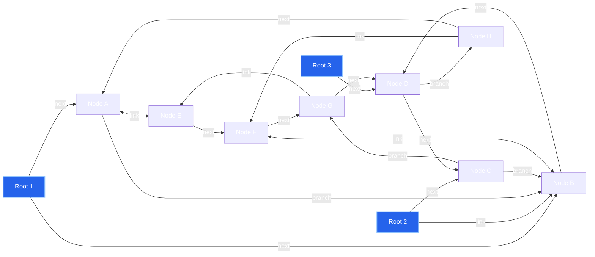
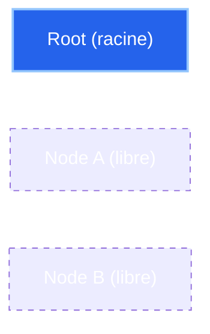
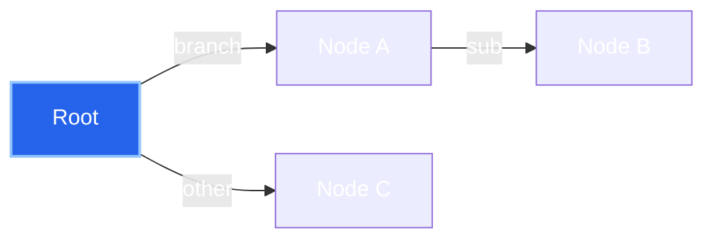
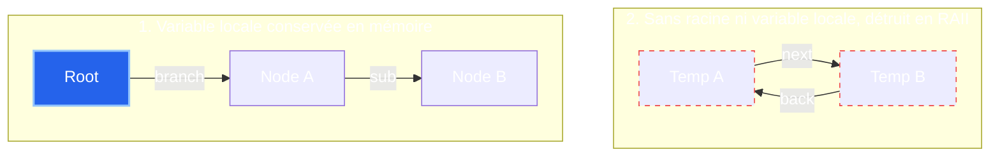
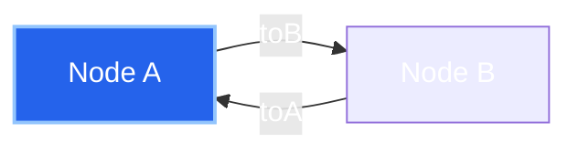
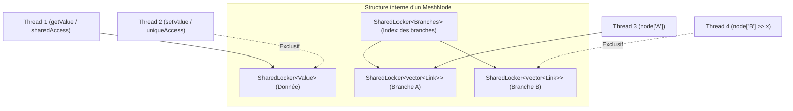

import { Card, CardGrid, Aside } from '@astrojs/starlight/components';

[`CppUtils::Container::MeshNetwork`](/fr/reference/container/meshnodeptr/) est conçu pour la création de **graphes non hiérarchiques** (qu'ils possèdent ou non une racine unique), où les noeuds se connectent via des branches nommées, tolèrent des cycles sans fuite mémoire, se manipulent en toute sécurité entre threads et supportent la pagination sur disque ([`MeshPager`](/fr/reference/filesystem/meshpager/)).

Ce modèle offre une grande flexibilité mais induit un surcoût structurel (allocations de liens, tables de branches, support du multithreading).

<Aside type="caution" title="N'utilisez pas MeshNetwork si...">
- **Votre structure est hiérarchique (arborescence, parent-enfant)** : préférez [`Tree`](/fr/reference/container/tree/node/), [`BTree`](/fr/reference/container/btree/node/) ou de simples `std::vector` imbriqués, bien plus légers.
- **Vous avez besoin d'une association clé-valeur** : préférez `std::unordered_map`, `std::map` ou [`FlatHashMap`](/fr/reference/container/flathashmap/).
- **Votre graphe est statique ou à durée de vie uniforme** (sans concurrence ni pagination) : un simple `std::vector` avec liaisons par indices sera plus compact et plus rapide.

Ne choisissez `MeshNetwork` que si votre domaine impose un graphe non hiérarchique (avec ou sans cycles) nécessitant un accès concurrent ou un chargement paresseux depuis le disque.
</Aside>

**Exemple de graphe représentable avec `MeshNetwork` :**



Ce guide est un **tutoriel pas à pas** conçu pour vous apprendre à déclarer un maillage, connecter ses branches, manipuler ses noeuds en toute sécurité entre threads et activer la persistance paginée sur disque.

<CardGrid>
	<Card title="Graphe non hiérarchique" icon="seti:graphql">
		Reliez librement vos noeuds via des branches nommées (`Token`, `string`, etc.), avec support des cycles.
	</Card>
	<Card title="Destruction RAII" icon="seti:lock">
		Libération immédiate des sous-graphes détachés, même en présence de cycles.
	</Card>
	<Card title="Concurrence sans deadlock" icon="code-branch">
		Verrouillage de chaque noeud via les [verrous RAII](/fr/guides/lockers/) pour des accès concurrents sûrs.
	</Card>
	<Card title="Pagination sur disque" icon="seti:db">
		Sérialisation, enregistrement et chargement progressifs sur disque via [`MeshPager`](/fr/reference/filesystem/meshpager/) pour préserver la RAM.
	</Card>
</CardGrid>

<Aside type="note" title="Pourquoi pas std::shared_ptr et std::weak_ptr ?">
	Il est tout à fait possible de construire un graphe non hiérarchique avec `std::shared_ptr` et `std::weak_ptr`, mais la gestion devient vite fastidieuse et se prête mal aux graphes génériques dont la topologie évolue fortement : il faut arbitrer manuellement quelles références restent fortes pour éviter les fuites sur les cycles détachés, sans détruire prématurément des noeuds lorsqu'un chemin d'accès change. `MeshNetwork` automatise ce suivi en ne conservant en vie que les noeuds encore joignables depuis au moins une racine.
</Aside>

## Déclarer des noeuds

Un pointeur de noeud s'instancie en spécifiant le type de clé des branches (ici `CppUtils::Type::Token`) et le type de valeur portée par chaque noeud (ici `std::string`) :

Les exemples de ce guide utilisent le littéral `""_token` (issu de `using namespace CppUtils::String::Literals;`).

```cpp showLineNumbers
// Définition du type de noeud manipulé (clés Token, valeurs std::string)
using NodePtr = CppUtils::Container::MeshNodePtr<CppUtils::Type::Token, std::string>;

// Création d'un noeud racine du graphe
auto root = NodePtr::makeRoot("Root");

// Création de noeuds libres (non encore rattachés à une racine)
auto nodeA = NodePtr::make("Node A");
auto nodeB = NodePtr::make("Node B");
```



<Aside type="tip" title="Sémantique de smart pointer (RAII)">
	Chaque variable `MeshNodePtr` se comporte en RAII comme un pointeur partagé (`std::shared_ptr`) : tant qu'une variable conserve un `MeshNodePtr`, le noeud ciblé et les descendants qu'il possède restent en vie en mémoire.
</Aside>

<Aside type="caution" title="Règle d'assemblage descendant (makeRoot vs make)">
	`MeshNetwork` s'appuie sur des **noeuds racines** (`makeRoot`) comme points d'ancrage : une racine maintient en vie tout ce qui reste joignable depuis elle, tandis qu'un noeud ordinaire (`make`) n'est maintenu en vie que s'il est rattaché à au moins une racine (ce qui permet de libérer automatiquement les cycles détachés).

	Pour attacher un noeud enfant à un parent (`parent["branche"_token] >> child`), **le parent doit donc déjà être relié à une racine**. Assemblez toujours votre graphe **de haut en bas** :
	```cpp showLineNumbers
	auto root = NodePtr::makeRoot("Root");
	// 'child' est rattaché à 'root' avant d'attacher 'grandChild'
	auto child = root["next"_token] >> NodePtr::make("Child");
	auto grandChild = child["next"_token] >> NodePtr::make("GrandChild");
	```

	```mermaid
	graph LR
	    Root["Root"] -->|"next"| Child["Child"] -->|"next"| GrandChild["GrandChild"]

	    classDef root fill:#2563eb,stroke:#93c5fd,stroke-width:2px,color:#ffffff
	    class Root root
	```

	Si vous souhaitez assembler le graphe dans un autre ordre, vous pouvez créer des racines temporaires avec `makeRoot(...)`, puis les déclasser en noeuds classiques après rattachement via `node->uniqueAccess()->setRoot(false)` :
	```cpp showLineNumbers
	// Construction de bas en haut (sous-arbre d'abord, puis rattachement à la racine)
	auto tempChild = NodePtr::makeRoot("Child");
	tempChild["next"_token] >> NodePtr::make("GrandChild");

	auto root = NodePtr::makeRoot("Root");
	root["next"_token] >> tempChild;
	tempChild->uniqueAccess()->setRoot(false); // Déclassement en noeud classique
	```
</Aside>

## Relier des noeuds

Utilisez les opérateurs dédiés pour relier ou détacher des noeuds :

### Créer un lien unidirectionnel (`>>`)

L'opérateur `>>` relie un noeud enfant à une branche du parent. Il supporte deux formes :
- `branch >> node` attache `node` à `branch` et retourne `node` ;
- `parent["a"_token] >> child["b"_token]` attache `child` à `parent["a"_token]` et retourne la branche `child["b"_token]`, ce qui permet d'enchaîner plusieurs niveaux en une seule expression :

```cpp showLineNumbers
// Attachement des noeuds sous des branches nommées
root["branch"_token] >> nodeA;
nodeA["sub"_token] >> nodeB;

// Équivalent en une seule expression chaînée
root["branch"_token] >> nodeA["sub"_token] >> nodeB;

// Chaînage direct à l'instanciation
auto nodeC = root["other"_token] >> NodePtr::make("Node C");
```



<Aside type="note" title="Opérations idempotentes">
	Attacher plusieurs fois le même noeud sur une même branche (via `>>` ou [`&`](#créer-un-lien-bidirectionnel-)) ne crée pas de doublon : `MeshNetwork` vérifie que le lien n'existe pas déjà avant de l'ajouter.
</Aside>

### Détacher un lien unidirectionnel (`-`)

L'opérateur `-` supprime un lien vers un noeud sans altérer les autres noeuds présents sur la même branche :

```cpp
// Retrait de nodeA de la branche "branch"
root["branch"_token] - nodeA;
```

Tant que vous conservez un `MeshNodePtr` local sur le noeud détaché (`nodeA`), il reste valide en mémoire avec ses enfants (`nodeB`) et peut être rattaché. En revanche, un noeud ou un groupe de noeuds (y compris cyclique) qui n'est plus rattaché à aucune racine et n'a plus de variable locale est libéré immédiatement en RAII :

```cpp showLineNumbers
// 1. nodeA reste valide via la variable locale et garde son enfant nodeB
root["branch"_token] >> nodeA;

// 2. Sous-graphe cyclique sans variable locale conservée : libéré dès le détachement
{
	auto tempA = root["temp"_token] >> NodePtr::make("Temp A");
	auto tempB = tempA["next"_token] >> NodePtr::make("Temp B");
	tempB["back"_token] >> tempA; // Cycle interne
} // tempA et tempB sortent du scope, mais restent en vie tant que root les référence

root["temp"_token].clear(); // Plus aucune racine ni variable locale : tempA et tempB sont détruits immédiatement (malgré le cycle)
```



Pour détacher l'ensemble des noeuds d'une branche en un seul appel, utilisez `clear()` :

```cpp
root["branch"_token].clear();
```

Pour détacher toutes les branches sortantes du noeud d'un coup :

```cpp
root.clearBranches();
```

### Créer un lien bidirectionnel (`&`)

L'opérateur `&` crée deux liaisons réciproques en une seule instruction. Chaque crochet désigne la branche **sortante** du noeud qui le précède, et l'attachement démarre automatiquement depuis le noeud déjà relié à une racine :

```cpp showLineNumbers
// Au moins l'un des noeuds doit être une racine ou déjà rattaché à une racine
auto nodeA = NodePtr::makeRoot("Node A");
auto nodeB = NodePtr::make("Node B");

// nodeA["toB"] -> nodeB et nodeB["toA"] -> nodeA
// (les deux clés peuvent aussi être identiques)
nodeA["toB"_token] & nodeB["toA"_token];
```



Fonctionnellement, `&` équivaut à enchaîner deux `>>` en une seule instruction :

```cpp showLineNumbers
// Équivalent fonctionnel en unidirectionnel
nodeA["toB"_token] >> nodeB;
nodeB["toA"_token] >> nodeA;
```

### Détacher un lien bidirectionnel (`/`)

L'opérateur `/` rompt simultanément les deux directions d'une connexion croisée. Comme pour `&`, chaque crochet indique la branche **sortante** à nettoyer sur chacun des deux noeuds :

```cpp
// Retire nodeB de nodeA["toB"] et nodeA de nodeB["toA"]
nodeA["toB"_token] / nodeB["toA"_token];
```

Fonctionnellement, `/` équivaut à enchaîner deux `-` en une seule instruction :

```cpp showLineNumbers
nodeA["toB"_token] - nodeB;
nodeB["toA"_token] - nodeA;
```

## Lire et modifier un noeud

Chaque noeud encapsule sa valeur dans un conteneur thread-safe :

```cpp showLineNumbers
// Acquisition d'un accesseur en lecture partagée sur la valeur
if (auto valueAccessor = nodeA.getValue())
{
	// La valeur est verrouillée en lecture partagée pendant tout ce bloc
	std::println("Valeur courante : {}", valueAccessor.value());
} // valueAccessor est détruit ici et relâche le verrou

// Modification thread-safe de la valeur (uniquement possible une fois le verrou libéré)
nodeA.setValue("Node A v2");
```

<Aside type="caution" title="Prérequis : maîtrise des verrous RAII">
	`MeshNetwork` repose intégralement sur les [verrous RAII](/fr/guides/lockers/) (`SharedLocker`, `Accessor`, `uniqueAccess()`, `sharedAccess()`) pour protéger l'accès aux valeurs, aux branches et aux liaisons entre threads. Assurez-vous de bien maîtriser leur fonctionnement et leur durée de vie afin d'éviter toute contention inutile ou deadlock dans votre code.
</Aside>

## Comparer des noeuds

Il est essentiel de distinguer deux types de comparaison :
1. **Identité d'instance (`nodeA == nodeB`)** : Retourne un `bool` indiquant si les deux pointeurs font référence au **même noeud physique en mémoire**, peu importe sa valeur.
2. **Équivalence de données (`nodeA.getValue().value() == nodeB.getValue().value()`)** : Compare la charge utile des noeuds.

```cpp showLineNumbers
auto node1 = NodePtr::makeRoot("Value");
auto node2 = NodePtr::makeRoot("Value");
auto alias1 = node1;

assert(node1 == alias1); // Vrai : même adresse mémoire
assert(node1 != node2);  // Vrai : deux instances distinctes
assert(node1.getValue().value() == node2.getValue().value()); // Vrai : même contenu "Value"
```

## Parcourir le graphe

`MeshNodePtr` s'intègre nativement avec les concepts et algorithmes de la bibliothèque standard C++ (ranges, vues, itérateurs).

### Accéder à une branche (`[]` et `at()`)

Il existe deux manières d'accéder à une branche d'un noeud, selon que vous souhaitiez créer ou modifier la branche (`node[key]`) ou l'interroger sans exception (`node.at(key)`) :

| Appel | Sur `node` non-`const` | Sur `node` `const` | Si la clé est absente |
| :--- | :--- | :--- | :--- |
| **`node[key]`** | Retourne une branche modifiable (verrou exclusif) | Retourne une branche en lecture seule (verrou partagé) | **Crée** la branche en non-`const` ; **lance `std::out_of_range`** en `const` |
| **`node.at(key)`** | Retourne un `std::expected` (branche en lecture seule, verrou partagé, ou erreur `std::string_view`) | Identique | **Ne crée pas** et **ne lance jamais d'exception** (`std::unexpected<std::string_view>`) |

<Aside type="caution" title="Cas d'un MeshNodePtr nul (construit par défaut)">
	Un `MeshNodePtr` instancié sans `make` ni `makeRoot` est **nul** (`not emptyNode`) :

	```cpp showLineNumbers
	auto emptyNode = NodePtr{}; // Handle nul (invalide)
	assert(not emptyNode);

	auto result = emptyNode.at("branch"_token); // Pas d'exception : !result.has_value()
	// emptyNode["branch"_token]; // Lance un std::runtime_error
	```
</Aside>

Sur une branche, l'accès indexé `branch[i]` (ainsi que `front()` et `back()`) retourne également un `std::expected<MeshNodePtr, std::string_view>`.

Vérification d'existence préalable (clé de branche et présence d'un noeud) :

```cpp showLineNumbers
if (root.contains("branch"_token))
{
	auto branch = root["branch"_token];
	std::println("Nombre de noeuds : {}", std::ranges::size(branch));
	std::println("Contient nodeA : {}", branch.contains(nodeA));
}
```

Accès sécurisé sans risque d'exception (recommandé en lecture) :

```cpp showLineNumbers
if (auto branch = root.at("branch"_token))
{
	if (auto firstNode = branch->front())
	{
		std::println("Premier noeud trouvé : {}", firstNode->getValue().value());
	}
}
```

Compter les liens d'une branche sans la créer si elle est absente :

```cpp showLineNumbers
const auto linkCount = root.at("branch"_token).transform([](const auto& branch) {
	return std::ranges::size(branch);
}).value_or(0uz);
```

### Parcourir une branche (Ranges, vues et itérateurs)

Une branche se parcourt comme n'importe quelle collection C++ standard :

- Elle supporte l'itération à accès aléatoire (`std::random_access_iterator`).
- L'objet `Branch` maintient un verrou RAII sur le vecteur de liens (`std::vector<Link>`) pendant toute la durée de la boucle ou de l'expression : aucun lien ne peut donc être ajouté ou retiré de cette branche pendant le parcours.
- En revanche, chaque lien référence sa cible via un `WeakPtr` plutôt qu'un pointeur fort. Ce choix évite les fuites mémoire sur les cycles du graphe et permet à un autre thread ou à `MeshPager` de supprimer ou décharger un noeud cible sans verrouiller tout le graphe. Si la cible a disparu ou été déchargée entre-temps, l'itérateur renvoie un `MeshNodePtr` vide (d'où la vérification `if (child)`).

Vous pouvez parcourir directement les enfants avec une simple boucle `for` :

```cpp showLineNumbers
for (const auto& child : root["branch"_token])
{
	if (child)
	{
		std::println("Noeud : {}", child.getValue().value());
	}
}
```

Les branches étant compatibles avec les algorithmes de `std::ranges`, vous pouvez vérifier une condition sur leurs éléments en une seule expression :

```cpp showLineNumbers
const auto hasNodeA = std::ranges::any_of(root["branch"_token], [](const auto& node) {
	return node and node.getValue().value() == "Node A";
});
```

Elles se composent également avec les vues de `std::views`, par exemple pour filtrer les noeuds valides puis inverser l'ordre de parcours :

```cpp showLineNumbers
for (const auto& validChild : root["branch"_token]
	| std::views::filter([](const auto& node) { return static_cast<bool>(node); })
	| std::views::reverse)
{
	std::println("Noeud valide : {}", validChild.getValue().value());
}
```

Enfin, grâce au support de `std::random_access_iterator`, vous pouvez manipuler les itérateurs directement (comme calculer un index par soustraction) :

```cpp showLineNumbers
auto branch = root["branch"_token];
if (auto it = std::ranges::find_if(branch, [](const auto& node) {
		return node and node.getValue().value() == "Node A";
	}); it != std::ranges::end(branch))
{
	std::println("Trouvé à l'index {}", it - std::ranges::begin(branch));
}
```

### Lister toutes les branches (`getBranches()`)

Lorsque les clés de branches ne sont pas connues à l'avance, utilisez `getBranches()` pour parcourir l'ensemble des branches sortantes d'un noeud.

Dans la boucle ci-dessous, `links` est de type [`SafeShared<std::vector<Link>>`](/fr/reference/container/functions/#safeshared) (un pointeur partagé thread-safe vers le vecteur de liens de la branche), dont la méthode `.sharedAccess()` fournit un accès en lecture seule :

```cpp showLineNumbers
for (const auto& [branchKey, links] : node.getBranches().value())
{
	std::println("Branche '{}' : {} lien(s)", branchKey, links->sharedAccess()->size());
}
```

## Concurrence et accès multithread

L'architecture interne de `MeshNode` repose sur une synchronisation sans verrou global, articulée autour de trois niveaux indépendants de [`CppUtils::Thread::SharedLocker`](/fr/reference/thread/sharedlocker/) :

1. **Verrou de donnée (`SharedLocker<Value>`)** : `getValue()` et `setValue()` ne verrouillent que la charge utile, sans bloquer les branches.
2. **Verrou de l'index des branches (`SharedLocker<Branches>`)** : `getBranches()` ne verrouille que l'index des clés de branches.
3. **Verrou par branche (`SharedLocker<std::vector<Link>>`)** : chaque clé possède son propre verrou de vecteur. Un proxy `Branch` sur `"branchA"` n'empêche ni d'accéder à la valeur du noeud, ni de modifier `"branchB"` depuis un autre thread.

Un accesseur ne verrouille donc jamais tout le noeud, mais uniquement la ressource ciblée.



En pratique, un thread peut ainsi modifier la valeur d'un noeud (ou une de ses branches) pendant qu'un autre thread manipule une autre branche ou lit la valeur du même noeud, sans blocage mutuel.

<Aside type="caution" title="Piège courant : conserver un proxy Branch ou getValue()">
	`node["branche"]` retourne un proxy `Branch` qui conserve un verrou RAII exclusif (`Accessor`) sur la branche jusqu'à sa destruction, et `node.getValue()` retourne un `ReadOnlyAccessor<Value>` qui maintient un verrou partagé. Garder ces objets en vie tout en rappelant une opération sur le même noeud dans le même bloc provoque un auto-deadlock :

	```cpp showLineNumbers
	// ❌ Risque d'auto-deadlock avec un proxy Branch
	auto branch = root["branch"_token]; // Prend un verrou exclusif sur "branch"
	root["branch"_token] >> nodeA; // Tente de reprendre le verrou déjà détenu par 'branch'
	```

	```cpp showLineNumbers
	// ❌ Risque d'auto-deadlock avec un accesseur de valeur
	auto valueAccessor = nodeA.getValue(); // Prend un verrou partagé sur la valeur
	nodeA.setValue("Nouvelle valeur"); // Bloque tant que 'valueAccessor' est en vie
	```

	Pour éviter tout blocage, limitez la portée des proxys et accesseurs avec des expressions inline ou des blocs dédiés :

	```cpp showLineNumbers
	// ✅ Bonne pratique : portée courte
	root["branch"_token] >> nodeA; // Expression inline : le proxy temporaire est détruit et le verrou libéré immédiatement
	{
		auto valueAccessor = nodeA.getValue();
		std::println("{}", valueAccessor.value());
	} // 'valueAccessor' est détruit ici : le verrou partagé est libéré
	nodeA.setValue("Nouvelle valeur");
	```
</Aside>

## Pagination sur disque (`MeshPager`)

Lorsque votre graphe doit persister entre deux exécutions d'un programme, ou lorsqu'il devient trop volumineux pour tenir entièrement en mémoire vive (plusieurs millions de noeuds), CppUtils fournit [`CppUtils::FileSystem::MeshPager`](/fr/reference/filesystem/meshpager/).

<Aside type="note" title="Fonctionnement sous-jacent et performances">
	En interne, `MeshPager` s'appuie sur [`CppUtils::FileSystem::IndexedStorage`](/fr/reference/filesystem/indexedstorage/), qui maintient un index en mémoire pour lire chaque noeud en **accès direct O(1)** sans parcourir les fichiers. En écriture, il réutilise les blocs libres dans des chunks binaires préalloués (64 MiB par défaut, configurables via `MeshPager{saveDirectory, maxChunkSize}`) et sérialise les données avec `CppUtils::Type::Binary::Serializer`.
</Aside>

### Enregistrer des noeuds dans le pager (`track`)

`MeshPager` ne suit pas vos noeuds automatiquement : après avoir importé [`CppUtils.FileSystem.MeshPager`](/fr/reference/filesystem/meshpager/) et ouvert un répertoire de stockage, vous devez enregistrer chaque noeud avec `pager.track(noeud)`. Cela lui attribue un identifiant persistant (`std::size_t`).

Enregistrer un noeud avec `track()` ne l'écrit toutefois pas immédiatement sur disque : tant qu'il reste dans le cache du pager, il demeure en RAM. La sauvegarde sur disque ne se déclenche que lorsqu'un noeud sort d'une fenêtre de focus et est déchargé de la RAM, ou lorsque le `MeshPager` est détruit :

```cpp showLineNumbers
using namespace CppUtils::Type::Literals;
using MeshPager = CppUtils::FileSystem::MeshPager<CppUtils::Type::Token, std::string>;
using PagedNode = MeshPager::MeshNodePtr; // Équivalent à CppUtils::Container::MeshNodePtr<CppUtils::Type::Token, std::string, MeshPager::Policy>

const auto saveDirectory = std::filesystem::path{"./save"};
auto pager = MeshPager{saveDirectory};

auto root = PagedNode::makeRoot("Root");
auto nodeA = root["next"_token] >> PagedNode::make("Node A");
auto nodeB = nodeA["next"_token] >> PagedNode::make("Node B");
auto nodeC = nodeB["next"_token] >> PagedNode::make("Node C");
auto nodeD = nodeC["next"_token] >> PagedNode::make("Node D");
auto nodeE = nodeD["next"_token] >> PagedNode::make("Node E");

// Enregistrement des noeuds dans le pager
pager.track(root);
pager.track(nodeA);
pager.track(nodeB);
pager.track(nodeC);
pager.track(nodeD);
pager.track(nodeE);
```

### Maintenir des noeuds en mémoire vive avec `acquireFocus`

Plutôt que de garder tout le graphe en RAM, `pager.acquireFocus(noeud, rayon)` crée une fenêtre RAII (`ScopedFocus`) qui maintient en mémoire les noeuds à distance `<= rayon` et décharge automatiquement les autres sur disque :

```cpp showLineNumbers
{
	auto focus = pager.acquireFocus(root, 1uz);
	// 'root' et son voisin direct 'nodeA' restent en RAM.
	// 'nodeB', 'nodeC', 'nodeD' et 'nodeE' (à distance >= 2) sont déchargés sur disque tout en conservant leurs liens persistants.
} // À la destruction de 'focus' (puis de 'pager'), les noeuds restants sont déchargés sur disque.
```

<svg viewBox="0 0 600 250" width="100%" style="max-width: 600px; height: auto; display: block; margin: 1.5rem auto;" role="img" aria-label="Zone de focus circulaire de rayon 1 centrée sur root, avec noeuds et liens persistants sur disque">
	<defs>
		<marker id="arrow-solid-fr" viewBox="0 0 10 10" refX="8" refY="5" markerWidth="6" markerHeight="6" orient="auto-start-reverse">
			<path d="M 0 1 L 10 5 L 0 9 z" fill="currentColor" />
		</marker>
		<marker id="arrow-dashed-fr" viewBox="0 0 10 10" refX="8" refY="5" markerWidth="6" markerHeight="6" orient="auto-start-reverse">
			<path d="M 0 1 L 10 5 L 0 9 z" fill="#94a3b8" />
		</marker>
	</defs>
	<circle cx="130" cy="130" r="95" fill="rgba(56, 189, 248, 0.08)" stroke="#38bdf8" stroke-width="2" stroke-dasharray="6 4" />
	<text x="130" y="20" text-anchor="middle" fill="#38bdf8" font-size="13" font-weight="600">Zone de focus : Rayon = 1 (RAM)</text>
	<rect x="280" y="38" width="305" height="194" rx="12" fill="rgba(148, 163, 184, 0.08)" stroke="#94a3b8" stroke-width="1.5" stroke-dasharray="4 4" />
	<text x="432" y="58" text-anchor="middle" fill="#94a3b8" font-size="12" font-weight="600">Hors rayon (Disque)</text>
	<line x1="154" y1="130" x2="173" y2="130" stroke="currentColor" stroke-width="2" marker-end="url(#arrow-solid-fr)" />
	<text x="163" y="121" text-anchor="middle" fill="currentColor" font-size="10">next</text>
	<line x1="215" y1="130" x2="293" y2="97" stroke="#94a3b8" stroke-width="1.8" stroke-dasharray="5 4" marker-end="url(#arrow-dashed-fr)" />
	<text x="248" y="103" text-anchor="middle" fill="#94a3b8" font-size="10">targetId = 3</text>
	<line x1="400" y1="97" x2="463" y2="97" stroke="#94a3b8" stroke-width="1.8" stroke-dasharray="5 4" marker-end="url(#arrow-dashed-fr)" />
	<text x="432" y="89" text-anchor="middle" fill="#94a3b8" font-size="10">targetId = 4</text>
	<line x1="517" y1="118" x2="517" y2="166" stroke="#94a3b8" stroke-width="1.8" stroke-dasharray="5 4" marker-end="url(#arrow-dashed-fr)" />
	<text x="524" y="146" text-anchor="start" fill="#94a3b8" font-size="10">targetId = 5</text>
	<line x1="465" y1="189" x2="402" y2="189" stroke="#94a3b8" stroke-width="1.8" stroke-dasharray="5 4" marker-end="url(#arrow-dashed-fr)" />
	<text x="432" y="181" text-anchor="middle" fill="#94a3b8" font-size="10">targetId = 6</text>
	<circle cx="130" cy="130" r="24" fill="rgba(56, 189, 248, 0.2)" stroke="#38bdf8" stroke-width="2" />
	<text x="130" y="127" text-anchor="middle" fill="currentColor" font-size="12" font-weight="600">root</text>
	<text x="130" y="141" text-anchor="middle" fill="currentColor" font-size="10">ID = 1</text>
	<circle cx="195" cy="130" r="20" fill="rgba(56, 189, 248, 0.12)" stroke="#38bdf8" stroke-width="1.5" />
	<text x="195" y="127" text-anchor="middle" fill="currentColor" font-size="11" font-weight="600">nodeA</text>
	<text x="195" y="140" text-anchor="middle" fill="currentColor" font-size="9.5">ID = 2</text>
	<rect x="295" y="76" width="105" height="42" rx="8" fill="rgba(148, 163, 184, 0.15)" stroke="#94a3b8" stroke-width="1.5" />
	<text x="347" y="94" text-anchor="middle" fill="currentColor" font-size="11" font-weight="600">nodeB</text>
	<text x="347" y="109" text-anchor="middle" fill="currentColor" font-size="9.5">ID = 3 (distance 2)</text>
	<rect x="465" y="76" width="105" height="42" rx="8" fill="rgba(148, 163, 184, 0.15)" stroke="#94a3b8" stroke-width="1.5" />
	<text x="517" y="94" text-anchor="middle" fill="currentColor" font-size="11" font-weight="600">nodeC</text>
	<text x="517" y="109" text-anchor="middle" fill="currentColor" font-size="9.5">ID = 4 (distance 3)</text>
	<rect x="465" y="168" width="105" height="42" rx="8" fill="rgba(148, 163, 184, 0.15)" stroke="#94a3b8" stroke-width="1.5" />
	<text x="517" y="186" text-anchor="middle" fill="currentColor" font-size="11" font-weight="600">nodeD</text>
	<text x="517" y="201" text-anchor="middle" fill="currentColor" font-size="9.5">ID = 5 (distance 4)</text>
	<rect x="295" y="168" width="105" height="42" rx="8" fill="rgba(148, 163, 184, 0.15)" stroke="#94a3b8" stroke-width="1.5" />
	<text x="347" y="186" text-anchor="middle" fill="currentColor" font-size="11" font-weight="600">nodeE</text>
	<text x="347" y="201" text-anchor="middle" fill="currentColor" font-size="9.5">ID = 6 (distance 5)</text>
</svg>

Si `noeud` n'est pas encore suivi par le pager, `acquireFocus()` appelle automatiquement `track(noeud)` avant d'activer la fenêtre.

### Cumuler plusieurs focus

Plusieurs `ScopedFocus` peuvent coexister en même temps, qu'ils se chevauchent (fenêtre glissante lors d'un parcours) ou qu'ils soient **totalement disjoints** pour garder plusieurs zones distinctes en RAM. L'union de leurs rayons détermine l'ensemble des noeuds maintenus en RAM, tandis que les autres restent sur disque.

#### Zones de focus qui se chevauchent (fenêtre glissante)

```cpp showLineNumbers
{
	auto focusA = pager.acquireFocus(nodeA, 1uz);
	auto focusB = pager.acquireFocus(nodeB, 1uz);
}
```

<svg viewBox="0 0 640 270" width="100%" style="max-width: 640px; height: auto; display: block; margin: 1.5rem auto;" role="img" aria-label="Deux zones de focus circulaires qui se chevauchent, de rayon 1, centrées sur nodeA et nodeB, avec nodeD et nodeE persistants sur disque">
	<defs>
		<marker id="arrow-overlap-fr" viewBox="0 0 10 10" refX="8" refY="5" markerWidth="6" markerHeight="6" orient="auto-start-reverse">
			<path d="M 0 1 L 10 5 L 0 9 z" fill="currentColor" />
		</marker>
		<marker id="arrow-overlap-dashed-fr" viewBox="0 0 10 10" refX="8" refY="5" markerWidth="6" markerHeight="6" orient="auto-start-reverse">
			<path d="M 0 1 L 10 5 L 0 9 z" fill="#94a3b8" />
		</marker>
	</defs>
	<circle cx="145" cy="140" r="115" fill="rgba(56, 189, 248, 0.08)" stroke="#38bdf8" stroke-width="2" stroke-dasharray="6 4" />
	<circle cx="235" cy="140" r="115" fill="rgba(52, 211, 153, 0.08)" stroke="#34d399" stroke-width="2" stroke-dasharray="6 4" />
	<text x="115" y="16" text-anchor="middle" fill="#38bdf8" font-size="12" font-weight="600">Focus A : Rayon = 1 (RAM)</text>
	<text x="295" y="16" text-anchor="middle" fill="#34d399" font-size="12" font-weight="600">Focus B : Rayon = 1 (RAM)</text>
	<rect x="405" y="45" width="220" height="190" rx="12" fill="rgba(148, 163, 184, 0.08)" stroke="#94a3b8" stroke-width="1.5" stroke-dasharray="4 4" />
	<text x="515" y="66" text-anchor="middle" fill="#94a3b8" font-size="12" font-weight="600">Hors rayon (Disque)</text>
	<line x1="167" y1="140" x2="211" y2="140" stroke="currentColor" stroke-width="2" marker-end="url(#arrow-overlap-fr)" />
	<text x="189" y="131" text-anchor="middle" fill="currentColor" font-size="10">next</text>
	<line x1="257" y1="140" x2="296" y2="140" stroke="currentColor" stroke-width="2" marker-end="url(#arrow-overlap-fr)" />
	<text x="276" y="131" text-anchor="middle" fill="currentColor" font-size="10">next</text>
	<line x1="342" y1="140" x2="453" y2="106" stroke="#94a3b8" stroke-width="1.8" stroke-dasharray="5 4" marker-end="url(#arrow-overlap-dashed-fr)" />
	<text x="385" y="112" text-anchor="middle" fill="#94a3b8" font-size="10">targetId = 5</text>
	<line x1="515" y1="128" x2="515" y2="170" stroke="#94a3b8" stroke-width="1.8" stroke-dasharray="5 4" marker-end="url(#arrow-overlap-dashed-fr)" />
	<text x="523" y="153" text-anchor="start" fill="#94a3b8" font-size="10">targetId = 6</text>
	<circle cx="145" cy="140" r="22" fill="rgba(56, 189, 248, 0.2)" stroke="#38bdf8" stroke-width="2" />
	<text x="145" y="137" text-anchor="middle" fill="currentColor" font-size="11" font-weight="600">nodeA</text>
	<text x="145" y="151" text-anchor="middle" fill="currentColor" font-size="9.5">ID = 2</text>
	<circle cx="235" cy="140" r="22" fill="rgba(52, 211, 153, 0.2)" stroke="#34d399" stroke-width="2" />
	<text x="235" y="137" text-anchor="middle" fill="currentColor" font-size="11" font-weight="600">nodeB</text>
	<text x="235" y="151" text-anchor="middle" fill="currentColor" font-size="9.5">ID = 3</text>
	<circle cx="320" cy="140" r="22" fill="rgba(52, 211, 153, 0.12)" stroke="#34d399" stroke-width="1.5" />
	<text x="320" y="137" text-anchor="middle" fill="currentColor" font-size="11" font-weight="600">nodeC</text>
	<text x="320" y="151" text-anchor="middle" fill="currentColor" font-size="9.5">ID = 4</text>
	<rect x="455" y="84" width="120" height="44" rx="8" fill="rgba(148, 163, 184, 0.15)" stroke="#94a3b8" stroke-width="1.5" />
	<text x="515" y="102" text-anchor="middle" fill="currentColor" font-size="11" font-weight="600">nodeD</text>
	<text x="515" y="117" text-anchor="middle" fill="currentColor" font-size="9.5">ID = 5 (distance 2)</text>
	<rect x="455" y="172" width="120" height="44" rx="8" fill="rgba(148, 163, 184, 0.15)" stroke="#94a3b8" stroke-width="1.5" />
	<text x="515" y="190" text-anchor="middle" fill="currentColor" font-size="11" font-weight="600">nodeE</text>
	<text x="515" y="205" text-anchor="middle" fill="currentColor" font-size="9.5">ID = 6 (distance 3)</text>
</svg>

#### Zones de focus disjointes (sans se toucher)

```cpp showLineNumbers
{
	auto focusA = pager.acquireFocus(nodeA, 1uz);
	auto focusD = pager.acquireFocus(nodeD, 1uz);
}
```

<svg viewBox="0 0 680 265" width="100%" style="max-width: 680px; height: auto; display: block; margin: 1.5rem auto;" role="img" aria-label="Deux zones de focus circulaires disjointes de rayon 1 centrées sur nodeA et nodeD, avec nodeC persistant sur disque entre les deux">
	<defs>
		<marker id="arrow-multi-fr" viewBox="0 0 10 10" refX="8" refY="5" markerWidth="6" markerHeight="6" orient="auto-start-reverse">
			<path d="M 0 1 L 10 5 L 0 9 z" fill="currentColor" />
		</marker>
		<marker id="arrow-multi-dashed-fr" viewBox="0 0 10 10" refX="8" refY="5" markerWidth="6" markerHeight="6" orient="auto-start-reverse">
			<path d="M 0 1 L 10 5 L 0 9 z" fill="#94a3b8" />
		</marker>
	</defs>
	<circle cx="120" cy="140" r="105" fill="rgba(56, 189, 248, 0.08)" stroke="#38bdf8" stroke-width="2" stroke-dasharray="6 4" />
	<circle cx="560" cy="140" r="105" fill="rgba(52, 211, 153, 0.08)" stroke="#34d399" stroke-width="2" stroke-dasharray="6 4" />
	<text x="120" y="20" text-anchor="middle" fill="#38bdf8" font-size="12" font-weight="600">Focus A : Rayon = 1 (RAM)</text>
	<text x="560" y="20" text-anchor="middle" fill="#34d399" font-size="12" font-weight="600">Focus B : Rayon = 1 (RAM)</text>
	<rect x="275" y="76" width="130" height="118" rx="12" fill="rgba(148, 163, 184, 0.08)" stroke="#94a3b8" stroke-width="1.5" stroke-dasharray="4 4" />
	<text x="340" y="96" text-anchor="middle" fill="#94a3b8" font-size="11.5" font-weight="600">Hors rayon (Disque)</text>
	<line x1="142" y1="140" x2="173" y2="140" stroke="currentColor" stroke-width="2" marker-end="url(#arrow-multi-fr)" />
	<text x="157" y="131" text-anchor="middle" fill="currentColor" font-size="10">next</text>
	<line x1="215" y1="140" x2="288" y2="140" stroke="#94a3b8" stroke-width="1.8" stroke-dasharray="5 4" marker-end="url(#arrow-multi-dashed-fr)" />
	<text x="251" y="131" text-anchor="middle" fill="#94a3b8" font-size="10">targetId = 4</text>
	<line x1="390" y1="140" x2="536" y2="140" stroke="#94a3b8" stroke-width="1.8" stroke-dasharray="5 4" marker-end="url(#arrow-multi-dashed-fr)" />
	<text x="463" y="131" text-anchor="middle" fill="#94a3b8" font-size="10">targetId = 5</text>
	<line x1="582" y1="140" x2="611" y2="140" stroke="currentColor" stroke-width="2" marker-end="url(#arrow-multi-fr)" />
	<text x="596" y="131" text-anchor="middle" fill="currentColor" font-size="10">next</text>
	<circle cx="120" cy="140" r="22" fill="rgba(56, 189, 248, 0.2)" stroke="#38bdf8" stroke-width="2" />
	<text x="120" y="137" text-anchor="middle" fill="currentColor" font-size="11" font-weight="600">nodeA</text>
	<text x="120" y="151" text-anchor="middle" fill="currentColor" font-size="9.5">ID = 2</text>
	<circle cx="195" cy="140" r="20" fill="rgba(56, 189, 248, 0.12)" stroke="#38bdf8" stroke-width="1.5" />
	<text x="195" y="137" text-anchor="middle" fill="currentColor" font-size="11" font-weight="600">nodeB</text>
	<text x="195" y="150" text-anchor="middle" fill="currentColor" font-size="9.5">ID = 3</text>
	<rect x="290" y="118" width="100" height="44" rx="8" fill="rgba(148, 163, 184, 0.15)" stroke="#94a3b8" stroke-width="1.5" />
	<text x="340" y="136" text-anchor="middle" fill="currentColor" font-size="11" font-weight="600">nodeC</text>
	<text x="340" y="151" text-anchor="middle" fill="currentColor" font-size="9.5">ID = 4 (disque)</text>
	<circle cx="560" cy="140" r="22" fill="rgba(52, 211, 153, 0.2)" stroke="#34d399" stroke-width="2" />
	<text x="560" y="137" text-anchor="middle" fill="currentColor" font-size="11" font-weight="600">nodeD</text>
	<text x="560" y="151" text-anchor="middle" fill="currentColor" font-size="9.5">ID = 5</text>
	<circle cx="633" cy="140" r="20" fill="rgba(52, 211, 153, 0.12)" stroke="#34d399" stroke-width="1.5" />
	<text x="633" y="137" text-anchor="middle" fill="currentColor" font-size="11" font-weight="600">nodeE</text>
	<text x="633" y="150" text-anchor="middle" fill="currentColor" font-size="9.5">ID = 6</text>
</svg>

### Contrôle manuel des focus (`addFocus`, `removeFocus`)

Si vous avez besoin d'un contrôle manuel sans garde RAII (par exemple pour attacher un focus à un événement plutôt qu'à un bloc), utilisez `addFocus(nodeId, distance)` et `removeFocus(nodeId, distance)` :

```cpp showLineNumbers
// Gérer la durée de vie d'un focus manuellement (sans scope RAII)
const auto idA = nodeA.getId();
pager.addFocus(idA, 1uz);
// ...
pager.removeFocus(idA, 1uz);
```

### Charger et décharger des noeuds manuellement (`loadNode`, `unloadNode`)

Si vous souhaitez contrôler manuellement la présence des noeuds en RAM **sans utiliser de [focus](#maintenir-des-noeuds-en-mémoire-vive-avec-acquirefocus)**, `MeshPager` fournit deux fonctions complémentaires : `loadNode(nodeId)` pour charger un noeud depuis le disque vers la RAM, et `unloadNode(nodeId)` pour le sérialiser sur disque et libérer immédiatement la RAM :

```cpp showLineNumbers
auto root = pager.loadNode(rootId); // Charge root depuis le disque
pager.unloadNode(rootId); // Sauvegarde root sur disque et le libère de la RAM
```

`loadNode()` et `unloadNode()` fonctionnent sur **n'importe quel noeud** à partir de son identifiant, pas uniquement sur une racine : chaque noeud est stocké et indexé indépendamment par son `nodeId`.

<Aside type="caution" title="Attention aux noeuds non racines hors focus">
	Un noeud non racine chargé directement via `loadNode()` n'est rattaché à aucune racine en RAM. Si un focus est acquis ou relâché ailleurs (par exemple via `acquireFocus()`) alors que ce noeud est toujours en RAM hors focus, il sera considéré comme orphelin et **supprimé du disque** (`removeNode()`) au lieu d'être simplement déchargé. Pensez donc à le décharger avec `unloadNode()` ou à le couvrir par un focus.
</Aside>

```cpp showLineNumbers
auto root = pager.loadNode(rootId);
auto nodeA = root["next"_token].front().value(); // Charge nodeA à la volée
```

Une fois un noeud chargé avec `loadNode()`, chaque accès à l'une de ses branches recharge automatiquement depuis le disque les noeuds cibles qui ne sont pas encore en RAM, et il en va de même pour les sauts suivants vers d'autres noeuds du graphe.

<Aside type="tip" title="Chargement paresseux et gestion de la mémoire">
	Grâce à `MeshPager`, vous n'avez jamais à charger tout le graphe en mémoire d'un bloc : chargez uniquement le noeud de départ, puis naviguez dans les branches [comme d'habitude](#parcourir-le-graphe). Vous pouvez également appeler `acquireFocus()` sur un noeud chargé de cette manière pour le protéger en RAM et décharger automatiquement ses voisins hors portée, ou appeler `unloadNode()` lors de longs parcours pour éviter que les noeuds rechargés à la volée ne restent en cache.
</Aside>

### Retrouver ses points d'entrée au redémarrage

`MeshPager` attribue des identifiants séquentiels à partir de `1uz` (`0uz` étant réservé aux noeuds non suivis ou invalides) et ne maintient pas de catalogue des racines. Deux bonnes pratiques permettent de retrouver facilement vos points d'entrée au lancement suivant :

- **Noeud d'entrée unique à l'ID `1uz`** : dans un répertoire neuf, enregistrez en premier un noeud racine dédié qui reçoit automatiquement l'ID `1uz` et relie vos différentes racines ou branches du graphe. Au redémarrage, il suffit d'appeler `pager.loadNode(1uz)` pour tout retrouver.
- **Sauvegarde côté application** : si vos points d'entrée sont dynamiques ou indépendants, persistez les identifiants retournés par `pager.track(root)` (ou `root.getId()`) dans un fichier de configuration applicatif (ou dans un [`IndexedStorage`](/fr/reference/filesystem/indexedstorage/) distinct, placé dans un autre répertoire que celui du pager) pour les relire au démarrage.

### Suppression manuelle ou automatique sur disque (`removeNode`)

Deux mécanismes permettent de supprimer des noeuds du disque, selon votre besoin :

- **Nettoyage automatique (noeuds non racines)** : lorsque vous détachez un noeud ou un sous-graphe de toute racine, il est automatiquement supprimé du disque dès qu'un focus est mis à jour (par exemple à la sortie d'un `ScopedFocus`). Un simple appel à `unloadNode()` ne déclenche **pas** cette suppression : il se contente d'écrire le noeud sur disque et de le retirer de la RAM.
- **Suppression explicite (`removeNode(nodeId)`)** : indispensable pour supprimer un **noeud racine** (jamais supprimé automatiquement, même sans parent) ou pour supprimer **immédiatement** un noeud précis de la RAM, de l'index des liens et du disque (notamment sans utiliser de focus, ou sans attendre la fin d'un `ScopedFocus`).

```cpp showLineNumbers
{
	auto focus = pager.acquireFocus(root, 1uz);
	root["next"_token] - nodeA;
} // À la sortie du focus, nodeA (et nodeB s'il n'est plus rattaché) sont supprimés du disque

// Ou suppression explicite d'un noeud par son ID
pager.removeNode(rootId);
```

### Sérialisation native des clés et des valeurs

Pour sauvegarder un noeud sur disque lorsqu'il est déchargé de la RAM (et le reconstruire lors d'un rechargement), `MeshPager<Key, Value>` doit convertir ses clés de branches (`Key`) et ses valeurs (`Value`) en flux binaire via `CppUtils::Type::Binary::Serializer`.

Les types suivants sont pris en charge nativement, sans code supplémentaire :

- **Types trivialement copiables (hors pointeurs)** : types arithmétiques (`int`, `double`, `bool`, etc.), `enum` et structures POD simples (`std::is_trivially_copyable_v<T>`).
- **`std::string`**
- **`std::vector<T>`**, dès lors que `T` est lui-même sérialisable.
- **`std::unordered_map<Key, Value>`**, dès lors que `Key` et `Value` sont eux-mêmes sérialisables.

### Sérialisation de types personnalisés

Pour étendre la sérialisation binaire à vos propres types utilisateur (par exemple une structure contenant des `std::string` ou d'autres membres non triviaux), spécialisez [`CppUtils::Type::Binary::Serializer`](/fr/reference/type/binary/serializer/) :

```cpp showLineNumbers
struct UserAccount
{
	std::string name;
	std::uint64_t score = 0;
};

template<>
struct CppUtils::Type::Binary::Serializer<UserAccount> final
{
	static auto serialize(const UserAccount& user, auto& target) -> void
	{
		CppUtils::Type::serialize(user.name, target);
		CppUtils::Type::serialize(user.score, target);
	}

	[[nodiscard]] static auto deserialize(auto& source, UserAccount& user) -> std::expected<void, std::string_view>
	{
		if (auto result = CppUtils::Type::deserialize(source, user.name); not result)
			return result;
		if (auto result = CppUtils::Type::deserialize(source, user.score); not result)
			return result;
		return {};
	}

	[[nodiscard]] static auto deserialize(auto& source) -> std::expected<UserAccount, std::string_view>
	{
		auto user = UserAccount{};
		if (auto result = deserialize(source, user); not result)
			return std::unexpected{result.error()};
		return user;
	}
};
```

Une fois cette spécialisation définie, vous pouvez directement instancier `MeshPager<std::string, UserAccount>` : le pager sérialise et recharge automatiquement vos objets `UserAccount` sur disque sans configuration supplémentaire.
