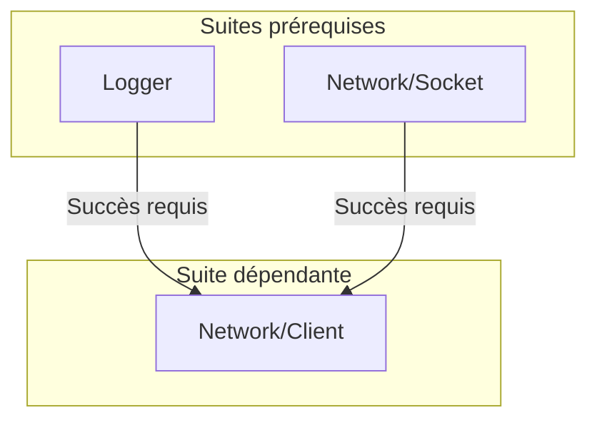

import { Card, CardGrid, Aside, Tabs, TabItem } from '@astrojs/starlight/components';

Les tests unitaires constituent le socle de toute base de code pérenne et évolutive. Pourtant, dans l'écosystème C++, leur mise en place impose historiquement de recourir à des bibliothèques tierces conçues il y a plus de quinze ans (GoogleTest, Catch2, doctest, Boost.Test, CppUnit). Bien qu'éprouvées, ces solutions historiques souffrent de compromis techniques majeurs :

- **Prolifération des macros préprocesseur** : Les frameworks traditionnels imposent des macros aussi bien pour déclarer les suites et les cas de tests (`TEST`, `TEST_F`, `TEST_CASE`) que pour formuler chaque vérification (`ASSERT_EQ`, `CHECK`, etc.). Ces macros [ignorent le typage statique et les namespaces](https://morgancaron.github.io/articles/cpp/preprocessor#typage-et-namespaces), [polluent le namespace global](https://morgancaron.github.io/articles/cpp/preprocessor#pollution-namespace-global) et [entravent le débogage pas-à-pas](https://morgancaron.github.io/articles/cpp/preprocessor#debogage-pas-a-pas). Pourtant, le C++ permet d'assurer [l'enregistrement des suites de tests](#déclarer-une-suite-de-tests) et [le diagnostic des valeurs d'assertion](#diagnostic-des-valeurs) sans aucun artifice du préprocesseur.
- **Absence de modularité native** : Conçus pour le modèle historique d'inclusion d'en-têtes (`#include`), ces outils n'offrent pas d'intégration native avec les modules C++20, ce qui alourdit les temps de compilation.
- **Absence d'ordonnancement par dépendances et avalanche d'échecs** : Les frameworks traditionnels exécutent les tests sans aucune notion de dépendance réelle entre les composants. Si une brique fondamentale dysfonctionne (allocateur mémoire, socket réseau, file d'attente), tous les tests dépendants s'effondrent simultanément, noyant le terminal sous des dizaines d'échecs secondaires qui masquent la cause première.
- **L'illusion du mock comme palliatif** : Pour tenter d'isoler chaque composant, les développeurs multiplient les interfaces virtuelles et les objets factices (mocks). Ces simulations artificielles altèrent le comportement réel du système, alourdissent le code de production par des indirections inutiles (vtable, smart-pointers, allocations) et masquent les régressions d'intégration, les race conditions et les cas limites réels.

Le module [`CppUtils::UnitTest`](/fr/reference/unittest/functions/) repense intégralement les tests unitaires pour l'ère moderne de C++26 :

<CardGrid>
	<Card title="Zéro macro préprocesseur" icon="seti:cpp">
		Syntaxe déclarative pure sans macro préprocesseur. Aucune injection de "magie" via la génération de code obscur par des macros.
	</Card>
	<Card title="Graphe de dépendances" icon="seti:pipeline">
		Ordonnancement déterministe par un [graphe orienté acyclique (DAG)](https://fr.wikipedia.org/wiki/Graphe_orient%C3%A9_acyclique). L'exécution des tests se fait dans l'ordre de leurs dépendances, garantissant l'isolation de la cause racine sans recourir aux mocks.
	</Card>
	<Card title="Diagnostic des valeurs" icon="magnifier">
		Testez vos conditions avec les opérateurs naturels du langage (`==`, `!=`, `<`, etc.). En cas d'échec, les valeurs exactes comparées s'affichent automatiquement dans le rapport sans passer par des macros dédiées.
	</Card>
	<Card title="Isolation par processus" icon="seti:lock">
		Chaque test s'exécute dans son propre sous-processus isolé ([`fork()`](#isolation-par-processus-et-gestion-du-temps-maximal)). Résilience absolue face aux crashs et aux boucles infinies (via watchdog temporel strict avec `SIGKILL`).
	</Card>
	<Card title="Surveillance d'exceptions" icon="warning">
		Vérifier qu'une exception précise survient bien dans certaines situations (via [`throws`](#matcher-throws--vérification-des-exceptions)). Ou par défaut, s'assurer qu'aucune n'est produite ([`noThrow`](#matcher-nothrow--absence-dexception)). Et ce, directement dans le test, mais également dans d'autres threads créés depuis ce test.
	</Card>
	<Card title="Paramétrage de types et valeurs" icon="puzzle">
		Exécuter un même scénario sur un éventail de types ([`forTypes`](#itération-sur-une-liste-de-types-fortypes)) ou une séquence de valeurs ([`forValues`](#itération-sur-une-liste-de-valeurs-forvalues)), que ce soit au niveau d'un test individuel ou à l'échelle d'une suite complète.
	</Card>
	<Card title="Désactivation conditionnelle de tests" icon="seti:ignored">
		Ignorer proprement des tests lorsque l'environnement cible (système d'exploitation, ressources réseau, matériel spécifique) ne remplit pas les prérequis requis (via [`skip`](#ignorer-délibérément-un-test--skip-et-skipif) et [`skipIf`](#ignorer-délibérément-un-test--skip-et-skipif)), sans faire échouer la suite.
	</Card>
	<Card title="Fuzzing déterministe" icon="random">
		Génération pseudo-aléatoire déterministe pour tester des fonctions avec des entrées inattendues, pour pousser les cas testés dans leurs retranchements. Supporte également les chaînes de caractères aléatoires suivant des alphabets précis.
	</Card>
	<Card title="Benchmarks intégrés" icon="seti:clock">
		Mesures de performances intégrées au framework, avec warnings et suivi comparatif si la fonctionnalité testée n'atteint pas les standards de performance.
	</Card>
	<Card title="Assertions asynchrones" icon="code-branch">
		Vérification périodique d'une condition ([`eventually`](#matcher-eventually--attente-dune-condition-asynchrone)) ou attente d'une opération asynchrone ([`completes`](#matcher-completes--synchronisation-réactive-sans-polling)).
	</Card>
	<Card title="Tests constexpr à la compilation" icon="setting">
		Validez vos contrats et calculs `constexpr` dès la compilation ([`suite.test<Predicate>`](#tests-à-la-compilation-suitetestpredicate)). Détection d'erreurs instantanée au build sans aucun surcoût d'exécution au runtime.
	</Card>
	<Card title="Rapports universels CI/CD" icon="document">
		Génération de rapports standardisés JUnit XML ([`--report`](#export-de-rapports-junit-xml-et-intégration-cicd)). Intégration dans GitLab CI et GitHub Actions pour publier automatiquement les résultats et annotations dans vos pull requests.
	</Card>
</CardGrid>

---

## Comparatif avec les frameworks de test en C++

`CppUtils::UnitTest` rompt avec les compromis des frameworks historiques : aucune macro préprocesseur, capture directe des expressions et ordonnancement automatique des suites par un graphe de dépendances.

### Comparaison syntaxique

Le comparatif interactif ci-dessous illustre un scénario de test identique exprimé dans chaque framework :

<Tabs>
	<TabItem label="CppUtils::UnitTest" icon="star">
		<Tabs>
			<TabItem label="Alias de namespace">
```cpp
// Support natif des modules C++20 (zéro macro, zéro fichier d'en-tête)
import std;
import CppUtils;

namespace MyApp::Tests
{
	namespace ut = CppUtils::UnitTest;

	// Déclaration de la suite avec dépendances
	auto _ = ut::testSuite("Math/Calculator").dependsOn("Logger") = [](ut::TestSuite& suite) {
		suite.test("Operations") = [] {
			// Assertions avec capture des valeurs réelles sans macro
			ut::expect(add(20, 22)) == 42;
			not ut::expect(isNegative(42));
			ut::expect([&] { divide(10, 0); }) == ut::throws<std::invalid_argument>;
		};

		// Test paramétré sur une collection de valeurs
		suite.test("Scale factor").forValues(10, 50, 100) = [](int scale) {
			ut::expect(scale) > 0;
		};
	};
}
```
			</TabItem>
			<TabItem label="Avec using namespace">
```cpp
// Support natif des modules C++20 (zéro macro, zéro fichier d'en-tête)
import std;
import CppUtils;

namespace MyApp::Tests
{
	using namespace CppUtils::UnitTest;

	// Déclaration de la suite avec dépendances
	auto _ = testSuite("Math/Calculator").dependsOn("Logger") = [](TestSuite& suite) {
		suite.test("Operations") = [] {
			// Assertions avec capture des valeurs réelles sans macro
			expect(add(20, 22)) == 42;
			not expect(isNegative(42));
			expect([&] { divide(10, 0); }) == throws<std::invalid_argument>;
		};

		// Test paramétré sur une collection de valeurs
		suite.test("Scale factor").forValues(10, 50, 100) = [](int scale) {
			expect(scale) > 0;
		};
	};
}
```
			</TabItem>
		</Tabs>
	</TabItem>
	<TabItem label="Boost.UT">
```cpp
import boost.ut;

int main() {
    // Pratique recommandée par la documentation de Boost.UT (un alias reste possible pour éviter les conflits de noms)
    using namespace boost::ut;

    // Déclaration du test par un suffixe littéral
    // Aucune gestion de dépendances entre suites (exécution linéaire)
    "operations"_test = [] {
        // Impose des suffixes littéraux (_i) pour capturer les valeurs en cas d'échec (restreint aux types arithmétiques basiques)
        expect(add(20, 22) == 42_i);
        expect(not isNegative(42));
        expect(throws<std::invalid_argument>([] { divide(10, 0); }));
    };

    // Test paramétré via surcharge de l'opérateur pipe |
    "scale_factor"_test = [](int scale) {
        expect(scale > 0_i);
    } | std::vector{10, 50, 100};
}
```
	</TabItem>
	<TabItem label="Catch2 (v3)">
```cpp
// Modules C++20 non supportés nativement (en-têtes #include obligatoires)
#include <catch2/catch_test_macros.hpp>
#include <catch2/generators/catch_generators.hpp>
#include <stdexcept>

// Macros intrusives polluant le namespace global
// Aucune gestion de dépendances entre suites (exécution linéaire)
TEST_CASE("Math/Calculator Operations", "[math]") {
    // Macros de préprocesseur obligatoires pour décomposer les opérandes
    REQUIRE(add(20, 22) == 42);
    REQUIRE_FALSE(isNegative(42));
    REQUIRE_THROWS_AS(divide(10, 0), std::invalid_argument);
}

// Test paramétré : la macro GENERATE réexécute l'intégralité du corps du TEST_CASE
TEST_CASE("Math/Calculator Scale factor", "[math]") {
    auto scale = GENERATE(10, 50, 100);
    REQUIRE(scale > 0);
}
```
	</TabItem>
	<TabItem label="Google Test">
```cpp
// Modules C++20 non supportés nativement (en-têtes #include obligatoires)
#include <gtest/gtest.h>
#include <stdexcept>

// Macros intrusives polluant le namespace global
// Aucune gestion de dépendances entre suites (exécution linéaire)
TEST(CalculatorTest, Operations) {
    EXPECT_EQ(add(20, 22), 42); // Macro distincte requise pour chaque opérateur
    EXPECT_FALSE(isNegative(42));
    EXPECT_THROW(divide(10, 0), std::invalid_argument);
}

// Test paramétré : impose une classe fixture dédiée dérivant de TestWithParam + 2 macros verbeuses
class ScaleTest : public testing::TestWithParam<int> {};

TEST_P(ScaleTest, PositiveScale) {
    EXPECT_GT(GetParam(), 0);
}

INSTANTIATE_TEST_SUITE_P(Values, ScaleTest, testing::Values(10, 50, 100));
```
	</TabItem>
	<TabItem label="doctest">
```cpp
// Modules C++20 non supportés nativement (en-têtes #include obligatoires)
#include <doctest/doctest.h>
#include <stdexcept>

// Macros intrusives polluant le namespace global
// Aucune gestion de dépendances entre suites (exécution linéaire)
TEST_CASE("Math/Calculator") {
    SUBCASE("Operations") {
        CHECK(add(20, 22) == 42); // Décomposition via macros préprocesseur
        CHECK_FALSE(isNegative(42));
        CHECK_THROWS_AS(divide(10, 0), std::invalid_argument);
    }

    // Test paramétré : la macro GENERATE réexécute l'intégralité du corps du TEST_CASE (comme Catch2)
    SUBCASE("Scale factor") {
        auto scale = GENERATE(10, 50, 100);
        CHECK(scale > 0);
    }
}
```
	</TabItem>
	<TabItem label="Boost.Test">
```cpp
// Modules C++20 non supportés nativement (en-têtes #include obligatoires)
#define BOOST_TEST_MODULE CalculatorTest
#include <boost/test/included/unit_test.hpp>
#include <boost/test/data/test_case.hpp>
#include <stdexcept>

// Macros intrusives polluant le namespace global
// Aucune gestion de dépendances entre suites (exécution linéaire)
// Scope caché (namespace) injecté sans accolades visibles, enfermant tout code intermédiaire
BOOST_AUTO_TEST_SUITE(Calculator)

BOOST_AUTO_TEST_CASE(Operations) {
    BOOST_TEST(add(20, 22) == 42);
    BOOST_TEST(!isNegative(42));
    BOOST_CHECK_THROW(divide(10, 0), std::invalid_argument);
}

// Test paramétré : nécessite une macro de dataset lourde et complexe
BOOST_DATA_TEST_CASE(ScaleFactor, boost::unit_test::data::make({10, 50, 100}), scale) {
    BOOST_TEST(scale > 0);
}

BOOST_AUTO_TEST_SUITE_END() // Fermeture obligatoire du scope caché ouvert par la macro de suite
```
	</TabItem>
	<TabItem label="Qt Test">
```cpp
// Modules C++20 non supportés nativement (en-têtes #include obligatoires)
#include <QTest>
#include <stdexcept>

// Déclaration verbeuse par classe dérivée de QObject
// Aucune gestion de dépendances entre suites (exécution linéaire)
class CalculatorTest : public QObject {
    Q_OBJECT
private slots:
    void testOperations() {
        QCOMPARE(add(20, 22), 42); // Force les types à s'adapter aux tests en imposant de surcharger l'API propriétaire non standard QTest::toString pour le diagnostic
        QVERIFY(!isNegative(42));
        QVERIFY_THROWS_EXCEPTION(std::invalid_argument, divide(10, 0));
    }

    // Test paramétré : impose 2 méthodes distinctes et un tableau dynamique de données
    void testScale_data() {
        QTest::addColumn<int>("scale");
        QTest::newRow("10") << 10;
        QTest::newRow("50") << 50;
        QTest::newRow("100") << 100;
    }

    void testScale() {
        QFETCH(int, scale);
        QVERIFY(scale > 0);
    }
};

QTEST_MAIN(CalculatorTest)

// Inclusion obligatoire du code généré par le MOC : dépendance à un préprocesseur propriétaire injectant du code invisible et appliquant une "magie" non standard ('Q_OBJECT', slots) pour introspecter les tests
#include "CalculatorTest.moc"
```
	</TabItem>
	<TabItem label="MS Test">
```cpp
// Modules C++20 non supportés nativement (en-têtes #include obligatoires)
#include "CppUnitTest.h"
#include <stdexcept>

// Pratique officielle de Microsoft pour accéder à la classe Assert::, polluant volontairement le namespace global avec tout leur framework propriétaire
using namespace Microsoft::VisualStudio::CppUnitTestFramework;

// Macros intrusives polluant le namespace global
// Aucune gestion de dépendances entre suites (exécution linéaire)
TEST_CLASS(CalculatorTest) {
public:
    TEST_METHOD(TestOperations) {
        Assert::AreEqual(42, add(20, 22));
        Assert::IsFalse(isNegative(42));
        Assert::ExpectException<std::invalid_argument>([] { divide(10, 0); });
    }

    // Test paramétré : aucun mécanisme natif, boucle impérative sans isolation
    TEST_METHOD(TestScale) {
        for (int scale : {10, 50, 100})
            Assert::IsTrue(scale > 0);
    }
};
```
	</TabItem>
	<TabItem label="CppUnit">
```cpp
// Modules C++20 non supportés nativement (en-têtes #include obligatoires)
#include <cppunit/extensions/HelperMacros.h>
#include <stdexcept>

// Macros intrusives et classe fixture verbeuse
// Aucune gestion de dépendances entre suites (exécution linéaire)
class CalculatorTest : public CppUnit::TestFixture {
    CPPUNIT_TEST_SUITE(CalculatorTest);
    CPPUNIT_TEST(testOperations);
    CPPUNIT_TEST(testScale);
    CPPUNIT_TEST_SUITE_END();

public:
    void testOperations() {
        CPPUNIT_ASSERT_EQUAL(42, add(20, 22)); // Macros d'assertions sans décomposition moderne
        CPPUNIT_ASSERT(!isNegative(42));
        CPPUNIT_ASSERT_THROW(divide(10, 0), std::invalid_argument);
    }

    // Test paramétré : aucun support natif, boucle impérative sans isolation
    void testScale() {
        for (int scale : {10, 50, 100})
            CPPUNIT_ASSERT(scale > 0);
    }
};

CPPUNIT_TEST_SUITE_REGISTRATION(CalculatorTest);
```
	</TabItem>
</Tabs>

<Aside type="note" title="Impact des directives using namespace">
Certes, l'utilisation d'un `using namespace` dans un fichier de tests ne pollue que le namespace du binaire de tests, sans contaminer directement les en-têtes du projet testé. Cependant, cette pratique engendre directement des conflits d'identifiants et des ambiguïtés de surcharge dès que le projet testé définit des fonctions, types ou constantes portant des noms usuels (`test`, `suite`, `expect`, `throws`, etc.). Pour approfondir les risques architecturaux de cette pratique, consultez la section dédiée à la directive [**`using namespace`**](https://morgancaron.github.io/articles/cpp/scopes#using-namespace).
</Aside>

### Tableau récapitulatif des fonctionnalités

| Fonctionnalité | `CppUtils::UnitTest` | Boost.UT | Catch2 (v3) | Google Test | doctest | Boost.Test | Qt Test | MS Test (C++) | CppUnit |
| :--- | :---: | :---: | :---: | :---: | :---: | :---: | :---: | :---: | :---: |
| **Zéro macro de préprocesseur** | ✅ | ✅ | ❌ ([`REQUIRE`](https://github.com/catchorg/Catch2/blob/devel/docs/assertions.md)) | ❌ ([`EXPECT_EQ`](https://google.github.io/googletest/reference/assertions.html)) | ❌ ([`CHECK`](https://github.com/doctest/doctest/blob/master/doc/markdown/assertions.md)) | ❌ ([`BOOST_CHECK`](https://www.boost.org/doc/libs/release/libs/test/doc/html/boost_test/testing_tools/summary.html)) | ❌ ([`QCOMPARE`](https://doc.qt.io/qt-6/qtest.html#QCOMPARE)) | ❌ ([`TEST_METHOD`](https://learn.microsoft.com/visualstudio/test/microsoft-visualstudio-testtools-cppunittestframework-api-reference#test_macros)) | ❌ ([`CPPUNIT_`](https://freedesktop.org/wiki/Software/cppunit/)) |
| **Support natif des modules C++20** | ✅ (`import`) | ✅ ([`ut.cppm`](https://github.com/boost-ext/ut/blob/master/include/boost/ut.cppm)) | ❌ (en-têtes `#include`) | ❌ (en-têtes `#include`) | ❌ (en-têtes `#include`) | ❌ (en-têtes `#include`) | ❌ (en-têtes `#include`) | ❌ (en-têtes `#include`) | ❌ (en-têtes `#include`) |
| **Décomposition d'expressions (`lhs == rhs`)** | ✅ (syntaxe `expect(a) == b`) | ✅ (`1_i == 2` ou `that %` / `eq`) | ⚠️ Partiel (décomposition dans macros) | ❌ (macros dédiées [`ASSERT_EQ`](https://google.github.io/googletest/reference/assertions.html)) | ⚠️ Partiel (décomposition dans macros) | ⚠️ Partiel (via macro [`BOOST_TEST`](https://www.boost.org/doc/libs/release/libs/test/doc/html/boost_test/testing_tools/extended_comparison/test.html)) | ❌ ([`QCOMPARE`](https://doc.qt.io/qt-6/qtest.html#QCOMPARE)) | ❌ ([`Assert::AreEqual`](https://learn.microsoft.com/visualstudio/test/microsoft-visualstudio-testtools-cppunittestframework-api-reference#assert_classes)) | ❌ ([`CPPUNIT_ASSERT_EQUAL`](https://cppunit.sourceforge.net/doc/lastest/group___assertions.html#ga71162f02be052994ea26d15cb9115ab5)) |
| **Mock** | ❌ ([découvrir pourquoi](#pourquoi-aucun-utilitaire-de-mock-nest-fourni)) | ❌ | ❌ (via tiers) | ✅ ([GoogleMock](https://google.github.io/googletest/gmock_for_dummies.html)) | ❌ (via tiers) | ❌ (via tiers) | ⚠️ Partiel ([`QSignalSpy`](https://doc.qt.io/qt-6/qsignalspy.html)) | ❌ | ❌ |
| **Ordonnancement par dépendances** | ✅ (ordonnancement topologique et arrêt des branches défaillantes) | ❌ | ❌ | ❌ | ❌ | ❌ | ❌ | ❌ | ❌ |
| **Benchmarks intégrés et comparatifs** | ✅ (`benchmark`, `warnIfSlower`) | ❌ | ⚠️ Partiel ([`BENCHMARK`](https://github.com/catchorg/Catch2/blob/devel/docs/benchmarks.md)) | ❌ | ❌ | ❌ | ❌ | ❌ | ❌ |
| **Tests paramétrés (`forValues`)** | ✅ | ✅ | ✅ ([`GENERATE`](https://github.com/catchorg/Catch2/blob/devel/docs/generators.md)) | ✅ ([`INSTANTIATE_TEST_SUITE_P`](https://google.github.io/googletest/advanced.html#value-parameterized-tests)) | ✅ ([`GENERATE`](https://github.com/doctest/doctest/blob/master/doc/markdown/parameterized-tests.md)) | ✅ ([datasets](https://www.boost.org/doc/libs/release/libs/test/doc/html/boost_test/tests_organization/test_cases/test_case_generation.html)) | ⚠️ Partiel ([`QTest::newRow`](https://doc.qt.io/qt-6/qtest-overview.html#data-driven-testing)) | ❌ | ❌ |
| **Tests typés (`forTypes`)** | ✅ (direct via variadique) | ✅ | ✅ ([`TEMPLATE_TEST_CASE`](https://github.com/catchorg/Catch2/blob/devel/docs/test-cases-and-sections.md#type-parametrised-test-cases)) | ✅ ([`TYPED_TEST`](https://google.github.io/googletest/advanced.html#typed-tests)) | ⚠️ Partiel ([`TYPE_TO_STRING`](https://github.com/doctest/doctest/blob/master/doc/markdown/parameterized-tests.md)) | ✅ ([template test cases](https://www.boost.org/doc/libs/release/libs/test/doc/html/boost_test/tests_organization/test_cases/test_case_generation/datasets_auto_creation/types.html)) | ❌ | ❌ | ❌ |
| **Moteur de fuzzing déterministe** | ✅ (avec seed reproductible) | ❌ | ❌ | ❌ | ❌ | ❌ | ❌ | ❌ | ❌ |
| **Isolation par processus (`fork`)** | ✅ (résilience `SIGSEGV`) | ❌ | ❌ | ⚠️ Partiel ([`death_test`](https://google.github.io/googletest/advanced.html#death-tests)) | ❌ | ❌ | ❌ | ❌ | ❌ |
| **Vérification asynchrone (`eventually`, `completes`)** | ✅ (polling périodique et réveil réactif) | ❌ | ❌ | ❌ | ❌ | ❌ | ❌ | ❌ | ❌ |
| **Rapports JUnit XML (CI/CD)** | ✅ (natif avec `--report=junit:...`) | ❌ | ✅ ([`-r junit`](https://github.com/catchorg/Catch2/blob/devel/docs/reporters.md#junit-reporter)) | ✅ ([`--gtest_output=xml`](https://google.github.io/googletest/advanced.html#generating-an-xml-report)) | ✅ ([`-r=junit`](https://github.com/doctest/doctest/blob/master/doc/markdown/reporters.md#reporters-and-listeners)) | ✅ ([`--log_format=JUNIT`](https://www.boost.org/doc/libs/release/libs/test/doc/html/boost_test/utf_reference/rt_param_reference/log_format.html)) | ✅ ([`-junitxml`](https://doc.qt.io/qt-6/qtest-overview.html#qtest-command-line-arguments)) | ⚠️ Partiel ([`.trx` propriétaire](https://learn.microsoft.com/visualstudio/test/vstest-console-options), JUnit via plugin tiers) | ✅ ([`XmlOutputter`](https://cppunit.sourceforge.net/doc/lastest/class_xml_outputter.html)) |
| **Zéro dépendance externe** | ✅ | ✅ | ✅ | ✅ | ✅ | ❌ ([Boost](https://www.boost.org/)) | ❌ ([Qt Core & MOC](https://doc.qt.io/qt-6/qtest.html)) | ❌ ([Visual Studio](https://learn.microsoft.com/visualstudio/test/writing-unit-tests-for-c-cpp)) | ✅ |

### Pourquoi cette architecture fait la différence

- **Clarté du code et outillage moderne** : L'absence totale de macros permet une autocomplétion parfaite, un refactoring fiable dans votre éditeur de code, et un débogage pas-à-pas transparent sans code généré invisible.
- **Positionnement vis-à-vis des alternatives modernes** : Parmi l'ensemble des frameworks existants, **Boost.UT** constitue l'alternative la plus avancée et respectable pour s'affranchir des macros. `CppUtils::UnitTest` en conserve l'esprit moderne tout en éliminant les contraintes restantes : aucune exigence de littéraux dédiés (`_i`) pour capturer n'importe quel type standard, ordonnancement par graphe de dépendances et résilience par isolation étanche des processus.
- **Résolution immédiate de la cause racine** : Grâce au graphe de dépendances (`CppUtils::Container::DependencyGraph`), si un module fondamental de votre application échoue, les centaines de tests dépendants sont automatiquement ignorés au lieu d'inonder la console d'erreurs parasites.
- **Tout-en-un de la qualité logicielle** : Au lieu de jongler entre Google Test pour les tests unitaires, Google Benchmark pour les performances, libFuzzer pour la robustesse et des scripts maison pour l'isolation des processus, `CppUtils::UnitTest` rassemble ces piliers dans une interface cohérente et expressive.

---

## Déclarer une suite de tests

Une suite de tests se déclare simplement :

```cpp
import std;
import CppUtils;

namespace MyApp::Tests
{
	namespace ut = CppUtils::UnitTest;

	auto _ = ut::testSuite("Math/Calculator") = [](ut::TestSuite& suite) {
		using namespace std::literals;

		suite.test("Addition") = [] {
			const auto result = 20 + 22;
			ut::expect(result) == 42;
		};

		suite.test("Calcul intensif").timeout(30s) = [] {
			ut::expect(performHeavyComputation()) > 0;
		};
	};
}
```

### Dépendances entre suites de tests

Lorsqu'une suite nécessite que d'autres suites de tests soient préalablement validées avant de s'exécuter, déclarez-les avec `.dependsOn(...)` :

```cpp
auto _ = ut::testSuite("Network/Client").dependsOn("Logger", "Network/Socket") = [](ut::TestSuite& suite) {
	suite.test("Connection") = [] {
		// Ce test ne s'exécutera que si "Logger" et "Network/Socket" ont réussi
	};
};
```



En déclarant ces dépendances, l'exécuteur structure l'ordonnancement sous la forme d'un [graphe orienté acyclique (DAG)](https://fr.wikipedia.org/wiki/Graphe_orient%C3%A9_acyclique). Cette organisation apporte trois bénéfices majeurs :
- **Localisation immédiate de la cause racine d'un échec** : Si la suite `Network/Socket` échoue, la suite `Network/Client` n'est même pas lancée et est marquée comme ignorée en raison d'un prérequis non satisfait. Vous évitez ainsi de voir la cause réelle noyée sous une avalanche d'échecs en cascade provoqués par une dépendance défaillante.
- **Sortie console épurée avec le mode `failFast`** : Lorsque l'option [`failFast`](#options-de-configuration-cpputilsunittesttestsettings) est activée, l'exécuteur s'interrompt dès le premier échec sans exécuter les suites dépendantes.
- **Suppression du besoin de mocking** : Puisque les tests s'exécutent dans l'ordre strict de leurs dépendances réelles et que les pannes sont isolées à la source, il devient inutile d'introduire des doublures de test artificielles pour masquer les instabilités en amont. Vous pouvez tester directement vos composants réels de bout en bout en toute confiance.

---

## Pourquoi aucun utilitaire de mock n'est fourni

L'absence d'utilitaire de mock au sein de CppUtils est un choix délibéré. Dans l'écosystème C++, le recours aux mocks pose deux problèmes majeurs :

### 1. L'illusion du test et le piège des fausses garanties

Un mock remplace un composant authentique par des réponses pré-programmées. Ce procédé donne l'illusion de valider le composant, alors que l'interaction réelle n'a **jamais été exécutée** :
- **Exemple réseau** : Si l'on mocke une socket pour lui faire renvoyer un JSON figé, on valide le parsing dans des conditions idéales, mais on ignore comment notre composant réagit aux dynamiques réelles du flux : paquets fragmentés, désynchronisation d'état ou *race conditions* si des données arrivent pendant un changement d'état interne. Ces deux traitements peuvent alors entrer en conflit et corrompre le fonctionnement du composant, un défaut indétectable avec un mock.
- **Exemple filesystem** : Si l'on mocke le filesystem, on ignore les verrous concurrents, les droits d'accès réels du système d'exploitation et la synchronisation sur disque.

En conditions réelles, le système se retrouve donc dans une situation qui n'a **véritablement jamais été testée**. CppUtils préconise de tester les interfaces en conditions authentiques : démarrer un vrai serveur local sur un port éphémère ou manipuler de vrais fichiers temporaires.

### 2. Dénaturation du code de production (*Zero-cost abstraction*)

Pour rendre une classe « mockable », le développeur est souvent contraint de dénaturer son architecture : imposer des hiérarchies orientées objet (POO) pour l'injection de dépendances, multiplier les interfaces virtuelles (`virtual` / vtable) et recourir aux allocations dynamiques (`std::unique_ptr<Interface>`). Ces indirections empêchent l'inlining par le compilateur et alourdissent le code de production uniquement pour satisfaire le banc de tests.

### L'alternative : ordonnancement par dépendances

Le besoin de mocks naît souvent de la peur qu'une panne en amont ne fasse échouer tous les tests en cascade et qu'on ne sache plus isoler facilement la cause racine du problème. Grâce à [`CppUtils::Container::DependencyGraph`](/fr/reference/container/dependencygraph/), CppUtils résout ce problème : les briques de base [sont exécutées en premier](#dépendances-entre-suites-de-tests). Si une fondation échoue, les suites dépendantes sont automatiquement ignorées, isolant immédiatement la cause première sans introduire de simulation artificielle.

---

## Écrire des assertions

Contrairement aux frameworks traditionnels qui imposent de mémoriser des dizaines de macros spécialisées selon le type de vérification ([`ASSERT_EQ`](https://google.github.io/googletest/reference/assertions.html#EXPECT_EQ), [`ASSERT_NE`](https://google.github.io/googletest/reference/assertions.html#EXPECT_NE), [`ASSERT_THROW`](https://google.github.io/googletest/reference/assertions.html#EXPECT_THROW), [`CHECK_FALSE`](https://github.com/catchorg/Catch2/blob/devel/docs/assertions.md), etc. (voir [Comparatif](#comparatif-avec-les-frameworks-de-test-en-c))), `CppUtils::UnitTest` privilégie la simplicité en ne proposant **qu'une seule fonction d'assertion : `expect(...)`**.

### Assertion booléenne : `expect`

La fonction `expect` valide qu'une condition ou une expression est vraie :

```cpp
ut::expect(database.isConnected());
ut::expect(not std::ranges::empty(buffer));
```

Écrire `== true` est inutile : `expect(condition);` évalue directement la condition.

En cas d'échec, le rapport affiche précisément le fichier, la ligne, la colonne ainsi que la valeur textuelle défaillante :

```terminal
[blue]──────────────────────────────────────────────────────────────[/blue]
[blue]Database/Connection/Ping:[/blue]
                         [red]🛇 ERROR 🛇[/red]
The following test didn't pass:
Database/Connection/Ping
  In tests/Database/Connection.mpp
At line 42, column 5
In expect(condition)
with value:
[red]false[/red]

[red]Failed ✕[/red]
```

#### Objets convertibles en booléen

Tout type convertible en booléen (`std::optional`, pointeurs bruts, `std::unique_ptr`, `std::shared_ptr`, types avec `explicit operator bool()`) est automatiquement converti et évalué sous forme de booléen par `expect` :

```cpp
auto user = std::optional<User>{fetchUser(42)};
ut::expect(user);

auto connection = std::unique_ptr<Socket>{connect()};
ut::expect(connection);
```

En cas d'échec sur un pointeur nul ou un `std::optional` vide, le rapport affiche directement `with value: nullptr` ou `with value: nullopt` en rouge :

```terminal
[blue]──────────────────────────────────────────────────────────────[/blue]
[blue]Database/Connection/Open:[/blue]
                         [red]🛇 ERROR 🛇[/red]
The following test didn't pass:
Database/Connection/Open
  In tests/Database/Connection.mpp
At line 42, column 2
In expect(condition)
with value:
[red]nullopt[/red]

[red]Failed ✕[/red]
```

#### Négation : `not expect(...)` plutôt que `expect(not ...)`

Pour affirmer qu'une condition doit être fausse, préférez placer la négation à l'extérieur :

```cpp
// Recommandé :
not expect(session.isExpired());

// Équivalent :
expect(session.isExpired()) == false;
```

Bien qu'écrire `expect(not condition);` fonctionne en C++, la négation externe offre un diagnostic bien plus riche en cas d'échec :

- Avec `expect(not error);` : la négation logique est résolue *avant* l'appel à `expect`. L'expression est immédiatement réduite à un simple `bool`. En cas d'échec, le rapport affiche uniquement `with value: false` sans révéler le contenu de l'objet :

```cpp
auto error = std::optional<std::string>{"Connexion refusée"};
expect(not error);
```

```terminal
[blue]──────────────────────────────────────────────────────────────[/blue]
[blue]Network/Connection:[/blue]
                         [red]🛇 ERROR 🛇[/red]
The following test didn't pass:
Network/Connection
  In tests/Network/Connection.mpp
At line 42, column 5
In expect(condition)
with value:
[red]false[/red]

[red]Failed ✕[/red]
```

- Avec `not expect(error);` : le framework capture l'objet d'origine intact. Pour tout objet déréférençable (`operator*`) dont la valeur sous-jacente est affichable, le diagnostic extrait et affiche directement l'élément inattendu qui a provoqué l'erreur :

```cpp
auto error = std::optional<std::string>{"Connexion refusée"};
not expect(error);
```

```terminal
[blue]──────────────────────────────────────────────────────────────[/blue]
[blue]Network/Connection:[/blue]
                         [red]🛇 ERROR 🛇[/red]
The following test didn't pass:
Network/Connection
  In tests/Network/Connection.mpp
At line 42, column 5
In not expect(condition)
with value:
[red]Connexion refusée[/red]

[red]Failed ✕[/red]
```

### Diagnostic des valeurs

Dans les bibliothèques traditionnelles, inspecter la valeur des opérandes impose de renoncer aux opérateurs C++ au profit d'une longue liste de macros spécialisées à mémoriser ([`ASSERT_EQ`](https://google.github.io/googletest/reference/assertions.html#EXPECT_EQ), [`ASSERT_NE`](https://google.github.io/googletest/reference/assertions.html#EXPECT_NE), [`ASSERT_LT`](https://google.github.io/googletest/reference/assertions.html#EXPECT_LT), [`ASSERT_LE`](https://google.github.io/googletest/reference/assertions.html#EXPECT_LE), [`ASSERT_GT`](https://google.github.io/googletest/reference/assertions.html#EXPECT_GT), [`ASSERT_GE`](https://google.github.io/googletest/reference/assertions.html#EXPECT_GE), [`EXPECT_FLOAT_EQ`](https://google.github.io/googletest/reference/assertions.html#EXPECT_FLOAT_EQ), etc.).

Avec `CppUtils::UnitTest`, les opérateurs standards du C++ remplacent l'intégralité de ces macros, sans wrapper verbeux ni [littéral propriétaire](https://boost-ext.github.io/ut/) :

```cpp
ut::expect(left) == right;
ut::expect(left) != right;
ut::expect(left) < right;
ut::expect(left) <= right;
ut::expect(left) > right;
ut::expect(left) >= right;
```

```cpp
namespace ut = CppUtils::UnitTest;

auto _ = ut::testSuite("Auth/Session") = [](ut::TestSuite& suite) {
	using namespace std::chrono_literals;

	suite.test("Validate session") = [] {
		ut::expect(session.getRemainingTime()) > 0s;
		ut::expect(session.getUserRole()) == "admin";
		ut::expect(session.getFailedAttempts()) <= 3u;
		ut::expect(std::ranges::size(session.getActiveTokens())) == 2uz;
	};
};
```

#### Pourquoi cette syntaxe a été choisie

1. **Pur C++23 sans macro préprocesseur** : Dans des frameworks comme Catch2 ou GoogleTest, la décomposition d'expression nécessite impérativement une macro (`REQUIRE(a == b)`, `EXPECT_EQ(a, b)`). En C++ pur, écrire `expect(a == b);` transmettrait un simple `bool` déjà évalué à `expect`, rendant impossible l'inspection séparée de `a` et `b`. En écrivant `expect(a) == b;`, `expect(a)` renvoie un objet proxy temporaire (`ExpectationProxy`) qui intercepte l'opérateur de comparaison suivant et capture à la fois la valeur de gauche (`lhs`) et celle de droite (`rhs`) avec leur opérateur sans la moindre macro.
2. **Zéro conflit d'identifiants et zéro masquage de variable** : Les approches basées sur des fonctions libres comme `value(...)` ou `that(...)` entraînent des conflits majeurs dès qu'un test déclare une variable locale portant ce même nom usuel. Écrire `auto value = calculate(); expect(value(value) == 42);` produit une erreur fatale à la compilation (`error: type does not provide a call operator`). Avec `expect(value) == 42;`, la variable `value` est passée directement sans aucun risque d'écrasement ou d'ambiguïté.
3. **Zéro pollution par des littéraux de test personnalisés** : Pour intercepter les comparaisons sans macro, [Boost.UT](https://boost-ext.github.io/ut/) doit forcer au moins l'un des opérandes dans un type intermédiaire : soit via des suffixes littéraux propriétaires (`42_i == sum()`), restreints aux types arithmétiques primitifs, soit via un wrapper de matcher (`expect(that % 0 == sum());`), soit via des fonctions préfixées (`expect(eq(a, b));`). `CppUtils::UnitTest` résout cette problématique de manière unifiée et générique sans aucun compromis : aucun littéral utilisateur imposé, aucun wrapper verbeux et aucune fonction préfixée. N'importe quel type C++ moderne est immédiatement capturé avec les opérateurs naturels du langage.
4. **Lisibilité directe** : L'assertion se lit de gauche à droite sans rupture ("expect left equals right") et sans préfixes redondants.
5. **Assertions sans opérateur relationnel** : Les conditions booléennes s'évaluent directement (par exemple `ut::expect(user.isConnected());`) sans exiger d'opérateur de comparaison ni de suffixe `== true`.

En cas d'échec (par exemple si `user.getRole()` renvoie `"guest"` au lieu de `"admin"`), le diagnostic décompose l'expression et affiche les valeurs exactes des deux opérandes :

```terminal
[blue]──────────────────────────────────────────────────────────────[/blue]
[blue]UnitTest/Auth:[/blue]
                         [red]🛇 ERROR 🛇[/red]
The following test didn't pass:
Auth/Session/Admin verification
  In tests/Auth/Session.mpp
At line 42, column 2
In expect(lhs) == rhs
with lhs:
guest
and rhs:
admin

Diff:
  lhs (-): "[red]guest[/red]"
  rhs (+): "[green]admin[/green]"

[red]Failed ✕[/red]
```

<Aside type="tip" title="Diagnostic de Diff visuel coloré dans le terminal">
Pour les comparaisons textuelles (`std::string`, `std::string_view`, `const char*`), `CppUtils::UnitTest` calcule automatiquement les différences caractère par caractère via l'algorithme [`CppUtils::Container::Sequence::getDifferences`](/fr/reference/container/sequence/functions/#getDifferences) :
- Les caractères supprimés de gauche (`lhs`) sont mis en évidence en **rouge** (`-`).
- Les caractères ajoutés de droite (`rhs`) sont mis en évidence en **vert** (`+`).
- Les caractères inchangés restent en couleur neutre standard.
</Aside>

Lors de divergences ponctuelles au sein de longues chaînes, ce calcul de diff isole instantanément les caractères fautifs au milieu du texte identique :

```cpp
const auto expectedUrl = "https://api.example.com/v1/users/42/profile";
const auto actualUrl   = "https://api.example.com/v2/users/42/profile";
ut::expect(expectedUrl) == actualUrl;
```

```terminal
[blue]──────────────────────────────────────────────────────────────[/blue]
[blue]Network/Api/EndpointCheck:[/blue]
                         [red]🛇 ERROR 🛇[/red]
The following test didn't pass:
Network/Api/EndpointCheck
  In tests/Network/Api.mpp
At line 18, column 2
In expect(lhs) == rhs
with lhs:
https://api.example.com/v1/users/42/profile
and rhs:
https://api.example.com/v2/users/42/profile

Diff:
  lhs (-): "https://api.example.com/v[red]1[/red]/users/42/profile"
  rhs (+): "https://api.example.com/v[green]2[/green]/users/42/profile"

[red]Failed ✕[/red]
```

*(Comme affiché ci-dessus, seul le chiffre `1` apparaît en rouge et le `2` en vert, tout le reste de l'URL restant en couleur neutre).*

De même, lorsque plusieurs segments diffèrent au sein d'une même phrase, chaque divergence est mise en évidence individuellement sans amalgamer le texte intermédiaire inchangé :

```cpp
const auto expectedSentence = "The quick brown fox jumps over the lazy dog";
const auto actualSentence   = "The fast brown fox leaps over a lazy dog";
ut::expect(expectedSentence) == actualSentence;
```

```terminal
[blue]──────────────────────────────────────────────────────────────[/blue]
[blue]UnitTest/VisualColorInspection/Diff visuel complexe (segments multiples):[/blue]
                         [red]🛇 ERROR 🛇[/red]
The following test didn't pass:
UnitTest/VisualColorInspection/Diff visuel complexe (segments multiples)
  In tests/UnitTest/UnitTest.mpp
At line 711, column 5
In expect(lhs) == rhs
with lhs:
The quick brown fox jumps over the lazy dog
and rhs:
The fast brown fox leaps over a lazy dog

Diff:
  lhs (-): "The [red]quick[/red] brown fox [red]jum[/red]ps over [red]the[/red] lazy dog"
  rhs (+): "The [green]fast[/green] brown fox [green]lea[/green]ps over [green]a[/green] lazy dog"

[red]Failed ✕[/red]
```

### Prise en charge native des types complexes

Le moteur d'inspection s'appuie sur des concepts C++20 génériques, sans exiger de macro de sérialisation ni de surcharge d'affichage (contrairement par exemple à [`QTest::toString`](https://doc.qt.io/qt-6/qtest.html#toString) dans Qt Test). Tout type qui satisfait ces concepts (plages itérables, types déréférençables, structures décomposables façon tuple, etc.), qu'il provienne de la bibliothèque standard, d'une bibliothèque tierce ou de votre propre code, est automatiquement analysé et mis en forme.

#### Conteneurs et plages (*ranges*)

Les conteneurs (`std::vector`, `std::span`, listes, vues) sont comparés élément par élément avec `std::ranges::equal` et formatés sous forme de liste lisible :

```cpp
const auto headers = std::vector<std::string>{"content-type", "authorization"};
ut::expect(headers) == std::vector<std::string>{"content-type", "accept"};
```

```terminal
[blue]──────────────────────────────────────────────────────────────[/blue]
[blue]Network/Headers/Validate:[/blue]
                         [red]🛇 ERROR 🛇[/red]
The following test didn't pass:
Network/Headers/Validate
  In tests/Network/Headers.mpp
At line 32, column 2
In expect(lhs) == rhs
with lhs:
["content-type", "authorization"]
and rhs:
["content-type", "accept"]

Diff:
  lhs (-): ["content-type", "[red]authorization[/red]"]
  rhs (+): ["content-type", "[green]accept[/green]"]

[red]Failed ✕[/red]
```

#### Tuples et paires

Les structures composites `std::tuple` et `std::pair` sont décomposées et formatées récursivement champ par champ :

```cpp
const auto response = std::make_pair(404, "Not Found");
ut::expect(response) == std::make_pair(200, "OK");
```

```terminal
[blue]──────────────────────────────────────────────────────────────[/blue]
[blue]Network/Response/Validate:[/blue]
                         [red]🛇 ERROR 🛇[/red]
The following test didn't pass:
Network/Response/Validate
  In tests/Network/Response.mpp
At line 15, column 2
In expect(lhs) == rhs
with lhs:
(404, "Not Found")
and rhs:
(200, "OK")

Diff:
  lhs (-): ([red]404[/red], "[red]Not Found[/red]")
  rhs (+): ([green]200[/green], "[green]OK[/green]")

[red]Failed ✕[/red]
```

#### Types déréférençables et optionnels

`std::optional`, `std::unique_ptr` et `std::shared_ptr` sont inspectés automatiquement : ils affichent explicitement `nullopt` ou `nullptr` lorsqu'ils sont vides, ou la valeur pointée déréférencée :

```cpp
const auto cachedUser = std::optional<std::string>{std::nullopt};
ut::expect(cachedUser) == std::optional<std::string>{"alice"};
```

```terminal
[blue]──────────────────────────────────────────────────────────────[/blue]
[blue]Auth/Cache/Lookup:[/blue]
                         [red]🛇 ERROR 🛇[/red]
The following test didn't pass:
Auth/Cache/Lookup
  In tests/Auth/Cache.mpp
At line 24, column 2
In expect(lhs) == rhs
with lhs:
[red]nullopt[/red]
and rhs:
"alice"

[red]Failed ✕[/red]
```

#### Octets mémoire (`std::byte`) et buffers binaires

Les octets mémoire sont mis en forme sous notation hexadécimale explicite (`0x2A`), y compris lorsqu'ils sont combinés dans des collections (`std::vector<std::byte>`, `std::span<const std::byte>`), idéal pour tester des protocoles binaires et des en-têtes réseau :

```cpp
const auto header = std::vector<std::byte>{std::byte{0x7F}, std::byte{0x45}, std::byte{0x4C}, std::byte{0x46}}; // ELF magic
ut::expect(header) == std::vector<std::byte>{std::byte{0x7F}, std::byte{0x45}, std::byte{0x00}, std::byte{0x00}};
```

```terminal
[blue]──────────────────────────────────────────────────────────────[/blue]
[blue]Binary/Header/Magic:[/blue]
                         [red]🛇 ERROR 🛇[/red]
The following test didn't pass:
Binary/Header/Magic
  In tests/Binary/Header.mpp
At line 12, column 2
In expect(lhs) == rhs
with lhs:
[0x7F, 0x45, 0x4C, 0x46]
and rhs:
[0x7F, 0x45, 0x00, 0x00]

Diff:
  lhs (-): [0x7F, 0x45, [red]0x4C[/red], [red]0x46[/red]]
  rhs (+): [0x7F, 0x45, [green]0x00[/green], [green]0x00[/green]]

[red]Failed ✕[/red]
```

#### Chemins de fichiers (`std::filesystem::path`)

Les chemins de fichiers sont normalisés et affichés sous leur forme canonique :

```terminal
[blue]──────────────────────────────────────────────────────────────[/blue]
[blue]FileSystem/Config/PathCheck:[/blue]
                         [red]🛇 ERROR 🛇[/red]
The following test didn't pass:
FileSystem/Config/PathCheck
  In tests/FileSystem/Config.mpp
At line 28, column 2
In expect(lhs) == rhs
with lhs:
"/var/log/syslog"
and rhs:
"/var/log/app.log"

Diff:
  lhs (-): "/var/log/[red]sys[/red]log"
  rhs (+): "/var/log/[green]app.[/green]log"

[red]Failed ✕[/red]
```

#### Nombres flottants avec tolérance epsilon automatique

Les comparaisons de nombres à virgule flottante (`float`, `double`) s'appuient automatiquement sur une tolérance relative epsilon ([`Math::isEqual`](/fr/reference/math/functions/#isEqual)), éliminant les échecs liés aux arrondis binaires IEEE 754 sans imposer de macro dédiée ([`EXPECT_NEAR`](https://google.github.io/googletest/reference/assertions.html#EXPECT_NEAR)) :

```cpp
ut::expect(0.1 + 0.2) == 0.3; // Valide automatiquement malgré l'imprécision IEEE 754
```

#### Entiers hétérogènes (signés / non signés)

Les comparaisons mixtes s'appuient sur les fonctions sécurisées de la bibliothèque standard (`std::cmp_equal`, `std::cmp_greater`, etc.), éliminant les faux positifs dus aux conversions implicites risquées du C++ :

```cpp
ut::expect(-1) > 1u; // Faux en C++ standard à cause de la conversion non signée ; évalué correctement ici
```

#### Chaînes de caractères et littéraux

La comparaison avec un littéral textuel compare le contenu des chaînes via `std::string_view`, éliminant le risque classique de comparer par inadvertance les adresses mémoire des pointeurs `const char*`.

### Matchers : `throws`, `noThrow`, `crashes`, `eventually`, `completes`

Plutôt que d'invoquer des fonctions d'assertion verbeuses et dispersées ([`ASSERT_THROW`](https://google.github.io/googletest/reference/assertions.html#EXPECT_THROW), [`ASSERT_NO_THROW`](https://google.github.io/googletest/reference/assertions.html#EXPECT_NO_THROW), [`ASSERT_DEATH`](https://google.github.io/googletest/reference/assertions.html#death-assertions), etc.), `CppUtils::UnitTest` unifie les vérifications via l'opérateur `==` appliqué à `expect(action)` :

#### Matcher `throws` : Vérification des exceptions

Validation du type d'exception :

```cpp
ut::expect([&] {
	computeSquareRoot(-1.0);
}) == ut::throws<std::invalid_argument>;
```

Validation que le message d'erreur contient une sous-chaîne :

```cpp
ut::expect([&] {
	divide(10, 0);
}) == ut::throws<std::invalid_argument>("Division par zéro");
// Valide si exception.what() contient "Division par zéro" (ex. "Erreur mathématique: Division par zéro détectée")
```

Validation par prédicat booléen :

```cpp
ut::expect([&] {
	database.connect("invalid_host");
}) == ut::throws<DatabaseException>([](const DatabaseException& error) {
	return error.code == 404 and error.message.contains("unreachable");
});
```

Validation par comparaison directe de valeur :

```cpp
ut::expect([&] {
	parser.parse("!");
}) == ut::throws<ParseError>(ParseError{.line = 1, .code = ErrorCode::UnexpectedToken});
```

Validation par inspecteur avec assertions internes :

```cpp
ut::expect([&] {
	database.connect("invalid_host");
}) == ut::throws<DatabaseException>([&](const DatabaseException& error) {
	ut::expect(error.code) == 404;
	ut::expect(error.message.contains("unreachable"));
});
```

#### Matcher `noThrow` : Absence d'exception

Vérifie qu'aucune exception n'est lancée lors de l'exécution :

```cpp
ut::expect([&] {
	socket.receive();
}) == ut::noThrow;
```

#### Matcher `crashes` : Interception de crashs et signaux critiques

Validation d'une interruption fatale (tout signal d'arrêt critique) :

```cpp
ut::expect([&] {
	int* nullPointer = nullptr;
	*nullPointer = 42;
}) == ut::crashes;
```

Validation d'un signal fatal spécifique :

```cpp
ut::expect([&] {
	std::abort();
}) == ut::crashes(CppUtils::System::Signal::Abort);
```

#### Matcher `eventually` : Attente d'une condition asynchrone

Vérifie périodiquement qu'une condition asynchrone devient vraie avant un délai maximal.

Par défaut, `eventually` attend jusqu'à **1 seconde** en réévaluant la condition toutes les **20 ms** :

```cpp
// Utilisation avec les valeurs par défaut (timeout: 1s, step: 20ms)
ut::expect([&] {
	return counter.load() == 5uz;
}) == ut::eventually;
```

Il est également possible de personnaliser le délai maximal seul, ou conjointement avec l'intervalle périodique :

```cpp
// Délai maximal personnalisé de 500ms (intervalle conservé à 20ms)
ut::expect([&] {
	return isReady.load();
}) == ut::eventually(500ms);

// Délai maximal (500ms) et intervalle d'évaluation (10ms) personnalisés
ut::expect([&] {
	return counter.load() == 5uz;
}) == ut::eventually(500ms, 10ms);
```

#### Matcher `completes` : Synchronisation réactive sans polling

Attend la fin d'une opération asynchrone ou le déblocage d'une primitive de synchronisation avant un délai maximal (1 seconde par défaut).

Attente d'un `std::future` :

```cpp
auto promise = std::promise<int>{};
auto future = promise.get_future();
worker.execute([&] { promise.set_value(42); });

// Validation de la complétion seule
ut::expect(future) == ut::completes;

// Validation combinée de la complétion et de la valeur
ut::expect(future) == ut::completes.with(42);

// Personnalisation du délai maximal
ut::expect(future) == ut::completes(500ms).with(42);
```

Avec une lambda retournant un résultat asynchrone :

```cpp
ut::expect([&] { return worker.computeAsync(); }) == ut::completes.with(42);
```

Avec un `std::shared_future` :

```cpp
auto sharedFuture = promise.get_future().share();
ut::expect(sharedFuture) == ut::completes.with(42);
```

Avec un sémaphore C++20 (`std::binary_semaphore`, `std::counting_semaphore`) :

```cpp
auto signal = std::binary_semaphore{0};
scheduler.schedule([&] { signal.release(); }, 50ms);

ut::expect(signal) == ut::completes;
```

---

<Aside type="tip">
**Organisation des namespaces et alternatives** :

Pour adapter l'organisation de vos tests selon vos préférences de lisibilité :

**Alias de namespace** (recommandé pour éviter toute ambiguïté) :

```cpp
namespace MyApp::Tests
{
	namespace ut = CppUtils::UnitTest;

	auto _ = ut::testSuite("Math/Calculator") = [](ut::TestSuite& suite) {
		suite.test("Operations") = [] {
			ut::expect(add(20, 22)) == 42;
			ut::expect([&] { divide(10, 0); }) == ut::throws<std::invalid_argument>;
			ut::expect([&] { divide(10, 2); }) == ut::noThrow;
		};
	};
}
```

**Imports scopés** :

```cpp
namespace MyApp::Tests
{
	using CppUtils::UnitTest::testSuite;
	using CppUtils::UnitTest::TestSuite;
	using CppUtils::UnitTest::expect;
	using CppUtils::UnitTest::throws;
	using CppUtils::UnitTest::noThrow;

	auto _ = testSuite("Math/Calculator") = [](TestSuite& suite) {
		suite.test("Operations") = [] {
			expect(add(20, 22)) == 42;
			expect([&] { divide(10, 0); }) == throws<std::invalid_argument>;
			expect([&] { divide(10, 2); }) == noThrow;
		};
	};
}
```

**Avec `using namespace`** (syntaxe directe sans préfixe) :

```cpp
namespace MyApp::Tests
{
	using namespace CppUtils::UnitTest;

	auto _ = testSuite("Math/Calculator") = [](TestSuite& suite) {
		suite.test("Operations") = [] {
			expect(add(20, 22)) == 42;
			expect([&] { divide(10, 0); }) == throws<std::invalid_argument>;
			expect([&] { divide(10, 2); }) == noThrow;
		};
	};
}
```
</Aside>

### Ignorer délibérément un test : `skip` et `skipIf`

Lorsqu'un test est temporairement désactivé ou requiert un environnement spécifique (système d'exploitation particulier, ressource matérielle requise, connectivité réseau distante, etc.), vous pouvez l'ignorer proprement sans faire échouer la suite :

```cpp
// Ignorer inconditionnellement un test (ex. fonctionnalité en cours de développement ou bogue en attente de correctif)
skip("Fonctionnalité en cours de refactorisation (ticket #142)");

// Ignorer un test selon une condition
skipIf(not isNetworkAvailable(), "Connexion réseau distante requise");
```

---

## Tests à la compilation (`suite.test<Predicate>`)

Pour valider vos algorithmes `constexpr`, métaprogrammation par templates, concepts ou constantes statiques, le framework de test fournit une surcharge directe de `suite.test` évaluée à la compilation :

```cpp
suite.test<[] {
	constexpr auto value = factorial(5);
	return value == 120;
}>("Factorial computation");
```

Ce mécanisme combine la rigueur d'un `static_assert` avec l'intégration complète au banc de tests :
- **Feedback statique immédiat sans réexécution** : Si le prédicat échoue, la compilation échoue immédiatement avec une erreur `static_assert`, bloquant le binaire avant toute exécution. Vous savez que le test passe dès que le projet compile, même sans avoir à relancer la suite de tests.
- **Intégration au rapport et statistiques** : Le test compile-time est comptabilisé dans le bilan de la suite et affiche son statut (`Passed ✓`).

<Aside type="tip">
Privilégiez systématiquement `suite.test<Predicate>` dès qu'un test est intégralement `constexpr` (validation de concepts, `type_traits`, calculs statiques) pour bénéficier d'une détection d'erreur instantanée à la compilation tout en allégeant le temps d'exécution global de la suite de tests.
</Aside>

---

## Tests de robustesse et fuzzing (`fuzzTest` et `fuzz`)

Le framework intègre un moteur de fuzzing pseudo-aléatoire déterministe. Ce déterminisme garantit que chaque exécution de test rejoue rigoureusement la même séquence de données pour une reproductibilité absolue en intégration continue :

```cpp
// Exécute 5 000 itérations avec des valeurs régénérées pseudo-aléatoirement à chaque passage
suite.fuzzTest("Parser fuzzing", 5'000uz) = [](auto& fuzzer) {
	// Génère une chaîne pseudo-aléatoire de longueur 1 à 64 caractères
	const auto input = fuzzer.randomString(1uz, 64uz);

	// Valide que le parser ne subit aucun comportement indéfini ni plantage
	parseData(input);
};
```

Vous pouvez également injecter des séquences pseudo-aléatoires au sein d'un test unitaire classique à l'aide de `fuzz` :

```cpp
suite.test("Integer arithmetic fuzzing") = [] {
	fuzz("Random arithmetic checks", 1'000uz, [](auto& fuzzer) {
		const auto a = fuzzer.random(-1000, 1000);
		// Borne inférieure à 1 pour exclure toute division par zéro
		const auto b = fuzzer.random(1, 1000);
		expect((a / b) * b + (a % b)) == a;
	});
};
```

### Générateurs pseudo-aléatoires disponibles

L'objet `fuzzer` (instance de [`CppUtils::Math::DeterministicRandomEngine`](/fr/reference/math/deterministicrandomengine/)) met à disposition un ensemble complet de méthodes de génération déterministes entièrement compatibles `constexpr` :

| Méthode & signature | Description |
| :--- | :--- |
| [`random<Type>()`](/fr/reference/math/deterministicrandomengine/#random_2) | Génère une valeur pseudo-aléatoire du type demandé (`int`, `size_t`, `double`, `bool`, etc.) couvrant par défaut les bornes minimales et maximales du type. |
| [`random(min, max)`](/fr/reference/math/deterministicrandomengine/#random) | Génère une valeur pseudo-aléatoire bornée dans l'intervalle `[min, max]` avec déduction automatique du type (entier ou flottant). |
| [`randomSize(max)`](/fr/reference/math/deterministicrandomengine/#randomSize_2) | Raccourci pratique pour générer une taille `std::size_t` comprise entre `0` et `max` inclus (ou dans `[min, max]` avec 2 arguments). Sans argument, génère une taille bornée par défaut par `PTRDIFF_MAX` [conformément à la limite légale des objets contigus en C++](https://morgancaron.github.io/articles/cpp/size#limitation-de-la-plage-de-valeurs). |
| [`randomFloat(min, max)`](/fr/reference/math/deterministicrandomengine/#randomFloat) | Génère un flottant dans l'intervalle `[min, max]` (par défaut `0.0` à `1.0`). |
| [`randomString(minLen, maxLen, alphabet)`](/fr/reference/math/deterministicrandomengine/#randomString) | Génère une chaîne de longueur variable (par défaut 0 à 32 caractères) issue de l'alphabet fourni. |
| [`randomBytes(count)`](/fr/reference/math/deterministicrandomengine/#randomBytes) | Alloue et remplit un vecteur de `count` octets (`std::vector<std::byte>`). |
| [`pickOne(collection)`](/fr/reference/math/deterministicrandomengine/#pickOne) | Sélectionne un élément aléatoire au sein d'une collection. |

Pour le détail exhaustif de leurs paramètres et surcharges, consultez la [référence d'API de `DeterministicRandomEngine`](/fr/reference/math/deterministicrandomengine/).

### Personnalisation des chaînes aléatoires

Le paramètre `alphabet` de `randomString` permet de cibler des motifs et formats spécifiques :

```cpp
// Longueur fixe de 32 caractères (min=32, max=32) tirés de l'alphabet hexadécimal (hash, token UUID)
auto hexToken = fuzzer.randomString(32uz, 32uz, "0123456789abcdef");

// Longueur variable de 1 à 10 caractères restreinte aux seuls chiffres 0 à 9
auto numericId = fuzzer.randomString(1uz, 10uz, "0123456789");

// Longueur variable de 5 à 20 caractères spéciaux pour éprouver la robustesse d'un parseur
auto syntaxPayload = fuzzer.randomString(5uz, 20uz, "{}[]():;\"'\\/<>&=");
```

---

## Mesures de performances et benchmarks

Le framework met à disposition des utilitaires légers pour chronométrer votre code et comparer directement les performances de deux implémentations :

```cpp
suite.test("FlatHashMap vs std::unordered_map performance") = [] {
	constexpr auto elementCount = 50'000uz;
	auto flatMap = CppUtils::Container::FlatHashMap<std::size_t, std::size_t>{};
	auto stdMap = std::unordered_map<std::size_t, std::size_t>{};

	const auto flatBenchmark = benchmark("FlatHashMap insert", [&] {
		for (auto index = 0uz; index < elementCount; ++index)
			flatMap[index] = index * 2uz;
	});

	const auto stdMapBenchmark = benchmark("std::unordered_map insert", [&] {
		for (auto index = 0uz; index < elementCount; ++index)
			stdMap[index] = index * 2uz;
	});

	// Compare les deux benchmarks et rapporte le facteur d'accélération
	const auto comparison = compareBenchmarks(flatBenchmark, stdMapBenchmark);

	// Avertissement non bloquant : affiche une alerte dans la console si le candidat est plus lent
	warnIfSlower(flatBenchmark, stdMapBenchmark);

	// Si vous souhaitez au contraire imposer une contrainte stricte qui fait échouer le test :
	// expect(comparison.isFirstFaster());
};
```

---

## Tests paramétrés par types et par valeurs (`forTypes` et `forValues`)

Le framework de test prend en charge l'exécution itérative d'un même scénario de test pour une liste de types ou un jeu de valeurs distinctes. Ces modificateurs s'appliquent aussi bien **au niveau d'un test unitaire isolé** qu'**au niveau d'une suite entière**.

<Aside type="note">
Chaque type ou valeur paramétré enregistre un test distinct et indépendant auprès du runner. Chaque itération dispose ainsi de sa propre ligne dans le rapport d'exécution console (avec son propre statut `Passed ✓` ou `Failed ✗` et son temps d'exécution) et est comptabilisée individuellement dans le bilan global. Si une variation échoue, les autres continuent de s'exécuter et le rapport isole précisément la valeur ou le type en défaut.
</Aside>

### Paramétrage au niveau d'un test individuel

#### Itération sur une liste de types (`forTypes`)

Le corps du test est instancié et enregistré comme autant de tests distincts (nommés automatiquement avec le suffixe `[type 0]`, `[type 1]`, etc.) pour chacun des types spécifiés en argument template :

```cpp
suite.test("Vector operations").forTypes<int, double, std::string>() = []<class Type> {
	auto vector = std::vector<Type>{};
	vector.push_back(Type{});
};
```

Rapport généré dans la console lors de l'exécution :

```terminal
[blue]──────────────────────────────────────────────────────────────[/blue]
[blue]Container/Vector/Vector operations [type 0]:[/blue]
[green]Passed ✓[/green]
[blue]──────────────────────────────────────────────────────────────[/blue]
[blue]Container/Vector/Vector operations [type 1]:[/blue]
[green]Passed ✓[/green]
[blue]──────────────────────────────────────────────────────────────[/blue]
[blue]Container/Vector/Vector operations [type 2]:[/blue]
[green]Passed ✓[/green]
```

#### Itération sur une liste de valeurs (`forValues`)

Le test génère une entrée distincte pour chaque valeur transmise. Si le type est formatable avec `std::format`, la valeur elle-même apparaît entre crochets dans l'intitulé du test (`[10]`, `[50]`, etc.) :

```cpp
suite.test("Positive scale factor").forValues(10, 50, 100, 500) = [](int scale) {
	expect(scale) > 0;
};
```

Rapport généré dans la console lors de l'exécution :

```terminal
[blue]──────────────────────────────────────────────────────────────[/blue]
[blue]Math/Scale/Positive scale factor [10]:[/blue]
[green]Passed ✓[/green]
[blue]──────────────────────────────────────────────────────────────[/blue]
[blue]Math/Scale/Positive scale factor [50]:[/blue]
[green]Passed ✓[/green]
[blue]──────────────────────────────────────────────────────────────[/blue]
[blue]Math/Scale/Positive scale factor [100]:[/blue]
[green]Passed ✓[/green]
[blue]──────────────────────────────────────────────────────────────[/blue]
[blue]Math/Scale/Positive scale factor [500]:[/blue]
[green]Passed ✓[/green]
```

#### Itération sur un conteneur ou une plage (`std::ranges`)

Vous pouvez également transmettre un conteneur standard ou n'importe quelle vue `std::ranges` (comme `std::views::iota` pour tester une séquence numérique paresseuse sans aucune allocation dynamique) ; chaque élément génère alors un cas de test individuel :

```cpp
// Séquence paresseuse avec std::views::iota (sans allocation mémoire) :
suite.test("Index validation").forValues(std::views::iota(1, 10)) = [](int index) {
	expect(index) >= 1;
	expect(index) < 10;
};

// Conteneur séquentiel standard :
suite.test("Buffer allocation").forValues(std::vector{64uz, 256uz, 1024uz}) = [](std::size_t size) {
	auto buffer = std::vector<std::uint8_t>(size, 0);
	expect(std::ranges::size(buffer)) == size;
};

// Conteneur associatif (itère sur chaque paire std::pair clé-valeur) :
const auto rolePermissions = std::map<std::string, int>{
	{"guest", 1},
	{"user", 2},
	{"admin", 4}
};
suite.test("Role permissions").forValues(rolePermissions) = [](const auto& entry) {
	const auto& [role, permissionLevel] = entry;
	expect(permissionLevel) > 0;
};
```

### Paramétrage au niveau d'une suite complète

Le modificateur s'applique aussi à l'enregistrement d'une suite entière (`testSuite(...).forTypes<...>()` ou `testSuite(...).forValues(...)`). Le moteur génère automatiquement une suite de tests distincte pour chaque type (nommée par exemple `"Container/Vector [type 0]"`, `"Container/Vector [type 1]"`) ou pour chaque valeur (nommée `"Math/Prime [2]"`, `"Math/Prime [3]"`) :

```cpp
auto _ = testSuite("Container/Vector").forTypes<int, float>() = []<class Type>(TestSuite& suite) {
	suite.test("Default initialization") = [] {
		auto container = std::vector<Type>{};
		expect(std::ranges::empty(container));
	};
};

auto _ = testSuite("Math/Prime").forValues(2, 3, 5, 7) = [](TestSuite& suite, int prime) {
	suite.test("Is prime") = [prime] {
		expect(isPrime(prime));
	};
};
```

---

## Surveillance d'événements (`CppUtils::UnitTest::EventWatcher`)

Pour tester des architectures événementielles ([`CppUtils::Execution::EventQueue`](/fr/reference/execution/eventqueue/), [`CppUtils::Execution::EventDispatcher`](/fr/reference/execution/eventdispatcher/)), `CppUtils::UnitTest::EventWatcher` s'abonne à un événement à sa construction et propose des outils pour enregistrer l'historique des émissions et bloquer jusqu'à réception du nombre attendu d'occurrences sans boucle manuelle :

```cpp
suite.test("Event dispatching") = [] {
	using namespace std::chrono_literals;

	auto queue = CppUtils::Execution::EventQueue{};

	// Création d'un observateur d'événements typé sur "Notification"
	auto watcher = watch<"Notification", int>(queue);

	expect(not watcher.hasOccurred());
	expect(watcher.count()) == 0uz;

	queue.emit<"Notification">(42);
	queue.emit<"Notification">(84);

	// Attente active jusqu'à réception de 2 occurrences dans la limite de 500ms
	expect(watcher.waitForOccurrences(2uz, 500ms));
	expect(watcher.count()) == 2uz;
	auto occurrences = watcher.occurrences();
	expect(occurrences->count) == 2uz;
	expect(std::ranges::size(occurrences->payloads)) == 2uz;
	expect(occurrences->payloads[0]) == 42;
	expect(occurrences->payloads.back()) == 84;
};
```

---

## Suivi du cycle de vie des objets : `CppUtils::UnitTest::LifetimeChecker`

Pour tester la conformité sémantique de vos objets (conteneurs, wrappers RAII, types à sémantique de déplacement, optimisations sans copie), CppUtils fournit [`CppUtils::UnitTest::LifetimeChecker`](/fr/reference/unittest/lifetimechecker/), un objet inerte conçu pour suivre avec précision le cycle de vie de vos types (constructions, destructions, copies et déplacements) et notifier l'appelant.

### Vérification des compteurs de copie et de déplacement

L'objet conserve un compteur interne du nombre de copies et de déplacements subis :

```cpp
import CppUtils;

suite.test("Move semantics in vector") = [&] {
	// Objet inerte avec callback vide
	auto checker = CppUtils::UnitTest::LifetimeChecker{[](std::string_view) {}, "Widget"};

	auto container = std::vector<CppUtils::UnitTest::LifetimeChecker>{};
	container.reserve(1);

	// Déplacement dans le conteneur
	container.push_back(std::move(checker));

	expect(container.front().getCopyCount()) == 0uz;
	expect(container.front().getMoveCount()) == 1uz;
};
```

<Aside type="note">
Bien que les compteurs internes `getCopyCount()` et `getMoveCount()` soient atomiques (`std::atomic_size_t`), les mutations d'une même instance (modification du nom, exécution du callback utilisateur) ne sont pas protégées par mutex. En environnement multithreadé, chaque thread doit manipuler ses propres instances ou synchroniser ses accès.
</Aside>

### Traçabilité des événements de cycle de vie

Le constructeur accepte une fonction de rappel (*callback*) et un identifiant textuel. À chaque opération sur l'objet (construction, copie, déplacement, destruction), ce rappel est automatiquement invoqué avec le libellé de l'événement correspondant :

```cpp
suite.test("Lifecycle notifications") = [&] {
	auto checker = CppUtils::UnitTest::LifetimeChecker{[](std::string_view event) {
		std::println("{}", event);
	}, "Resource"};

	auto copy = checker;
	auto moved = std::move(copy);
};
```

La sortie console retrace fidèlement la succession d'appels et l'invalidation de l'objet déplacé :

```text
Resource()
Resource(const Resource&)
Resource(Resource&&)
~[invalid object]()
~Resource()
~Resource()
```

---

## Configuration et exécution des suites de tests

Le lancement de l'ensemble des suites s'effectue dans le point d'entrée principal (`main.cpp`) de votre binaire de tests via `executeTests()` :

```cpp
import std;
import CppUtils;

auto main(int argc, char** argv) -> int
{
	// Analyse les arguments en ligne de commande (mode, filter, verbose, failFast, chrono)
	auto settings = CppUtils::UnitTest::executeCommands(argc, argv);
	if (settings.abort)
		return CppUtils::exitSuccess;

	return CppUtils::UnitTest::executeTests(settings);
}
```

### Options de configuration (`CppUtils::UnitTest::TestSettings`)

| Option | Type | Valeur par défaut | Description |
| :--- | :--- | :--- | :--- |
| `verbose` | `bool` | `true` | Affiche l'intitulé et le statut de chaque test unitaire en temps réel. Si `false`, n'affiche que le bilan final. |
| `detail` | `bool` | `true` | Affiche les détails d'exécution (séparateurs, noms complets de suites) lors du déroulement. |
| `chrono` | `bool` | `false` | Mesure et affiche la durée précise de chaque test via `CppUtils::Log::ChronoLogger`. |
| `failFast` | `bool` | `false` | Interrompt immédiatement l'exécution des tests dès le premier échec rencontré. |
| `filter` | `std::string` | `""` | Filtre les suites de tests à exécuter par sous-chaîne tout en résolvant automatiquement leurs prérequis. |
| `report` | `std::string` | `""` | Exporte les résultats d'exécution dans un fichier de rapport (format `junit:chemin.xml` ou `chemin.xml`). |

#### Syntaxe en ligne de commande

La fonction [`executeCommands()`](/fr/reference/unittest/functions/#executeCommands) parse les arguments transmis au binaire (`argc`, `argv`) selon les conventions standards POSIX et GNU :

```bash
# Options standards longues
./UnitTests --filter=Network --chrono --report=junit:report.xml

# Formes courtes équivalentes
./UnitTests -f=Network -c -r=report.xml

# Arrêt immédiat dès la première défaillance (fail-fast)
./UnitTests --fail-fast
```

| Option longue | Forme courte | Valeur par défaut | Description |
| :--- | :--- | :--- | :--- |
| `--help` | `-h` | - | Affiche l'aide des paramètres disponibles et interrompt le programme. |
| `--mode=<mode>` | `-m=<mode>` | `debug` | Profil d'exécution prédéfini : `debug` (défaut), `test` (avec chronométrage), `prod` (silencieux et arrêt au premier échec). |
| `--verbose[=<bool>]` | `-v[=<bool>]` | `true` | Active ou désactive les journaux standards d'exécution. |
| `--detail[=<bool>]` | `-d[=<bool>]` | `true` | Active ou désactive l'affichage détaillé de l'avancement (noms des tests, durées, métriques de benchmarks, séparateurs). |
| `--fail-fast` | | `false` | Interrompt l'exécution dès la première erreur. |
| `--chrono[=<bool>]` | `-c[=<bool>]` | `false` | Affiche le temps d'exécution de chaque test. |
| `--filter=<chaine>` | `-f=<chaine>` | `""` | Ne lance que les suites de tests dont le nom contient cette sous-chaîne (et résout automatiquement leurs dépendances). |
| `--report=<chemin>` | `-r=<chemin>` | `""` | Exporte le rapport d'exécution au format JUnit XML (ex. `-r=report.xml` ou explicitement `--report=junit:report.xml`). |

### Export de rapports JUnit XML et intégration CI/CD

L'option `--report=junit:<chemin>` (ou simplement `-r=<chemin>`) génère un rapport au standard universel **JUnit XML**. Ce format permet aux plates-formes d'intégration continue d'analyser automatiquement les résultats, d'afficher les métriques temporelles et d'insérer des annotations directement sur les lignes de code défaillantes :

- **GitLab CI** : Prend en charge le format JUnit XML **de manière native** (aucun plugin ni composant tiers requis) via [`artifacts:reports:junit:`](https://docs.gitlab.com/ci/yaml/artifacts_reports/#artifactsreportsjunit) dans `.gitlab-ci.yml`.
- **GitHub Actions** : Ne parse pas nativement les fichiers XML de tests par défaut. L'affichage d'un résumé graphique et des annotations inline dans les Pull Requests s'effectue via une action GitHub dédiée du marketplace (telle que [`EnricoMi/publish-unit-test-result-action`](https://github.com/EnricoMi/publish-unit-test-result-action) ou [`dorny/test-reporter`](https://github.com/dorny/test-reporter)).
- **Jenkins** : Exploite directement le rapport via son plugin officiel standard [JUnit Plugin](https://plugins.jenkins.io/junit/).

<Tabs>
	<TabItem label="GitLab CI (support natif)" icon="seti:pipeline">
```yaml
# .gitlab-ci.yml : Aucun plugin requis, support natif de GitLab CI
test:
  stage: test
  script:
    - xmake run CppUtils-UnitTests --report=junit:build/test-results.xml
  artifacts:
    when: always
    reports:
      junit: build/test-results.xml
```
	</TabItem>
	<TabItem label="GitHub Actions" icon="github">
```yaml
# .github/workflows/test.yml : Publication via l'action du marketplace
    - name: Run unit tests
      run: |
        xmake run CppUtils-UnitTests --report=junit:build/test-results.xml

    - name: Publish Test Results
      uses: EnricoMi/publish-unit-test-result-action@v2
      if: always()
      with:
        files: "build/test-results.xml"
```
	</TabItem>
</Tabs>

### Isolation par processus et gestion du temps maximal

Chaque test unitaire est exécuté dans un processus enfant dédié. Les violations d'accès mémoire, les arrêts brutaux et les blocages infinis sont ainsi interceptés de manière étanche sans jamais interrompre l'exécuteur de tests ni affecter les suites suivantes.

Cette architecture offre deux garanties majeures :
- **Résilience face aux plantages critiques** : Si un test déclenche un signal fatal (`SIGSEGV`, `SIGABRT`, etc.), le signal est capturé par l'exécuteur parent. Le test est consigné en échec avec le détail du signal reçu, tandis que le reste des tests continue son exécution normale.
- **Interruption stricte en cas de timeout** : Si un test dépasse son temps limite alloué (10 secondes par défaut, ou personnalisé via `.timeout(2s)`), il est interrompu immédiatement, évitant les blocages indéfinis de la suite de tests.

---

## Rapport et diagnostics d'exécution

### Exécution réussie

Lors d'une exécution sans erreur, le rapport affiche le déroulement structuré des tests :

```terminal
2 tests found. Execution:
[blue]──────────────────────────────────────────────────────────────[/blue]
[blue]Math/Calculator/Addition:[/blue]
[green]Passed ✓[/green]
[blue]──────────────────────────────────────────────────────────────[/blue]
[blue]Network/Socket/TCP/Accept connection:[/blue]
[green]Passed ✓[/green]
[blue]──────────────────────────────────────────────────────────────[/blue]
Test results
All tests passed successfully
- 2 successful tests
```

### Défaillance ciblée et propagation aux dépendances

En cas d'échec d'un composant de base, le rapport isole distinctement la ligne fautive avec les valeurs évaluées, et marque automatiquement les suites dépendantes comme sautées :

```terminal
[blue]──────────────────────────────────────────────────────────────[/blue]
[blue]Network/Socket/Init:[/blue]
[green]Passed ✓[/green]
[blue]──────────────────────────────────────────────────────────────[/blue]
[blue]Network/Socket/TCP:[/blue]
                         [red]🛇 ERROR 🛇[/red]
The following test didn't pass:
Network/Socket/TCP
  In tests/Network/Socket.mpp
At line 48, column 3
In expect(lhs) == rhs
with lhs:
500
and rhs:
200

[red]Failed ✕[/red]
[blue]──────────────────────────────────────────────────────────────[/blue]
[yellow]Skipping test suite Network/Client due to failed prerequisites in test suite Network/Socket ⚠[/yellow]
[blue]──────────────────────────────────────────────────────────────[/blue]
Test results
The tests failed:
- 1 successful tests
- 1 failed tests
  - Network/Socket
- 1 skipped tests
  - Network/Client (due to failed prerequisites)
```
